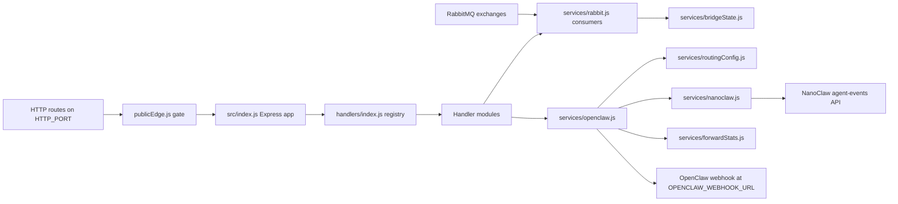

# Architecture

The bridge is a single Node.js process. `src/index.js` builds the Express app and admin routes, then starts the RabbitMQ connection and initializes handlers ([src/index.js:L22-L36](https://github.com/Jeffrey-Keyser/openclaw-bridge/blob/d6c5d8e55b0d6ccdae14101efc8b33b9db0e8e11/src/index.js#L22-L36)). `initializeHandlers()` loads persisted state, then runs each enabled handler's `init()` in order ([src/handlers/index.js:L68-L91](https://github.com/Jeffrey-Keyser/openclaw-bridge/blob/d6c5d8e55b0d6ccdae14101efc8b33b9db0e8e11/src/handlers/index.js#L68-L91)). In the current source, `publicEdgeGate` is the first middleware on the app, before body parsing and routes ([src/index.js @ 9e9b630e](https://github.com/Jeffrey-Keyser/openclaw-bridge/blob/9e9b630e3a0a58bb36de7556f272c792165adb94/src/index.js)).

## Component diagram

## Role contracts

**HTTP shell (`src/index.js`).** Provides `/health`, the `/admin` control routes, Twilio routes, the CCW contact form, and the email proxy. The `/email` routes are restricted to loopback and a local host header ([src/index.js:L29-L31](https://github.com/Jeffrey-Keyser/openclaw-bridge/blob/d6c5d8e55b0d6ccdae14101efc8b33b9db0e8e11/src/index.js#L29-L31), [L265-L287](https://github.com/Jeffrey-Keyser/openclaw-bridge/blob/d6c5d8e55b0d6ccdae14101efc8b33b9db0e8e11/src/index.js#L265-L287)). The visible admin routes set a wildcard CORS header and show no auth check ([src/index.js:L36-L42](https://github.com/Jeffrey-Keyser/openclaw-bridge/blob/d6c5d8e55b0d6ccdae14101efc8b33b9db0e8e11/src/index.js#L36-L42)). Whether auth exists in the truncated part of the file is unknown.

**Public edge gate (`src/publicEdge.js`).** Port 3099 is exposed through the Cloudflare tunnel for `twilio.jeffreykeyser.net`, `ccw.jeffreykeyser.net`, and `webhook.creamcityweb.com`. The gate treats a request as tunnel traffic when it carries `CF-Ray` or `CF-Connecting-IP`, or when its `Host` is one of those public hosts. Tunnel traffic may reach only an exact allow-list of method and path pairs: `GET /health`, the three `/twilio/*` webhooks, `POST /email/inbound`, and `/ccw/contact` (`OPTIONS` and `POST`). Any other route returns 404 for tunnel traffic. Local, Docker, and Tailscale callers are not affected ([src/publicEdge.js @ 9e9b630e](https://github.com/Jeffrey-Keyser/openclaw-bridge/blob/9e9b630e3a0a58bb36de7556f272c792165adb94/src/publicEdge.js)).

**Inbound webhook trust.** Each `/twilio/*` route runs `validateTwilioSignature` before its handler. The middleware checks `X-Twilio-Signature` against `TWILIO_AUTH_TOKEN`. It returns 503 when the token is unset and 403 when the signature is missing or invalid ([src/handlers/twilio.js @ 9e9b630e](https://github.com/Jeffrey-Keyser/openclaw-bridge/blob/9e9b630e3a0a58bb36de7556f272c792165adb94/src/handlers/twilio.js), [src/index.js @ 9e9b630e](https://github.com/Jeffrey-Keyser/openclaw-bridge/blob/9e9b630e3a0a58bb36de7556f272c792165adb94/src/index.js)).

**Handler registry (`src/handlers/index.js`).** A flat array of `{ name, module, enabled }` entries. Each handler's `init()` runs with the handler name set, so consumers can check pause state ([src/handlers/index.js:L37](https://github.com/Jeffrey-Keyser/openclaw-bridge/blob/d6c5d8e55b0d6ccdae14101efc8b33b9db0e8e11/src/handlers/index.js#L37), [L82-L84](https://github.com/Jeffrey-Keyser/openclaw-bridge/blob/d6c5d8e55b0d6ccdae14101efc8b33b9db0e8e11/src/handlers/index.js#L82-L84)).

**Untrusted input helpers (`src/services/untrusted.js`).** Handlers that forward text from outside senders (CCW contact form, CCW email, SMS) use these helpers to build agent instructions. `safeEmail` and `safeE164` return a value only when it matches a strict format. `inlineUntrusted` renders a short value as a JSON string literal on one line. `fenceUntrusted` wraps multi-line text in a code fence longer than any backtick run inside it, and labels it as untrusted data ([src/services/untrusted.js @ 9e9b630e](https://github.com/Jeffrey-Keyser/openclaw-bridge/blob/9e9b630e3a0a58bb36de7556f272c792165adb94/src/services/untrusted.js)).

**RabbitMQ service (`src/services/rabbit.js`).** Uses one connection and channel with prefetch 1 ([src/services/rabbit.js:L25-L43](https://github.com/Jeffrey-Keyser/openclaw-bridge/blob/d6c5d8e55b0d6ccdae14101efc8b33b9db0e8e11/src/services/rabbit.js#L25-L43)). Fanout subscriptions bind with an empty key, and topic subscriptions bind with a pattern ([L55-L65](https://github.com/Jeffrey-Keyser/openclaw-bridge/blob/d6c5d8e55b0d6ccdae14101efc8b33b9db0e8e11/src/services/rabbit.js#L55-L65), [L106-L114](https://github.com/Jeffrey-Keyser/openclaw-bridge/blob/d6c5d8e55b0d6ccdae14101efc8b33b9db0e8e11/src/services/rabbit.js#L106-L114)). A connection close exits the process ([L30-L33](https://github.com/Jeffrey-Keyser/openclaw-bridge/blob/d6c5d8e55b0d6ccdae14101efc8b33b9db0e8e11/src/services/rabbit.js#L30-L33)). `RABBITMQ_URL` has no default. A missing value throws when the connection is opened ([src/services/rabbit.js @ 9e9b630e](https://github.com/Jeffrey-Keyser/openclaw-bridge/blob/9e9b630e3a0a58bb36de7556f272c792165adb94/src/services/rabbit.js)).

**Bridge state (`src/services/bridgeState.js`).** Holds `globalPause` and per-handler overrides. `isHandlerEnabled` returns false on global pause or an explicit disable ([src/services/bridgeState.js:L72-L77](https://github.com/Jeffrey-Keyser/openclaw-bridge/blob/d6c5d8e55b0d6ccdae14101efc8b33b9db0e8e11/src/services/bridgeState.js#L72-L77)).

**Routing (`src/services/routingConfig.js`).** Valid targets are `openclaw`, `nanoclaw`, and `both`. Lookup is case-insensitive ([src/services/routingConfig.js:L9](https://github.com/Jeffrey-Keyser/openclaw-bridge/blob/d6c5d8e55b0d6ccdae14101efc8b33b9db0e8e11/src/services/routingConfig.js#L9), [L19-L22](https://github.com/Jeffrey-Keyser/openclaw-bridge/blob/d6c5d8e55b0d6ccdae14101efc8b33b9db0e8e11/src/services/routingConfig.js#L19-L22)).

**OpenClaw client (`src/services/openclaw.js`).** Posts `message`, `name`, `deliver`, `channel`, and `wakeMode: 'now'` to the webhook ([src/services/openclaw.js:L61-L67](https://github.com/Jeffrey-Keyser/openclaw-bridge/blob/d6c5d8e55b0d6ccdae14101efc8b33b9db0e8e11/src/services/openclaw.js#L61-L67)). When the target includes NanoClaw, it also calls the NanoClaw client ([L38-L44](https://github.com/Jeffrey-Keyser/openclaw-bridge/blob/d6c5d8e55b0d6ccdae14101efc8b33b9db0e8e11/src/services/openclaw.js#L38-L44)). The bearer token comes only from `OPENCLAW_HOOK_TOKEN`. If it is unset, the client logs an error and returns false without sending ([src/services/openclaw.js @ 9e9b630e](https://github.com/Jeffrey-Keyser/openclaw-bridge/blob/9e9b630e3a0a58bb36de7556f272c792165adb94/src/services/openclaw.js)).

**NanoClaw client (`src/services/nanoclaw.js`).** Posts `recipient`, `instruction`, and `source` to `NANOCLAW_AGENT_API_URL`, which defaults to a loopback `agent-events` path ([src/services/nanoclaw.js:L8](https://github.com/Jeffrey-Keyser/openclaw-bridge/blob/d6c5d8e55b0d6ccdae14101efc8b33b9db0e8e11/src/services/nanoclaw.js#L8), [L43-L47](https://github.com/Jeffrey-Keyser/openclaw-bridge/blob/d6c5d8e55b0d6ccdae14101efc8b33b9db0e8e11/src/services/nanoclaw.js#L43-L47)). Error logs are throttled to one line per minute per key ([L14](https://github.com/Jeffrey-Keyser/openclaw-bridge/blob/d6c5d8e55b0d6ccdae14101efc8b33b9db0e8e11/src/services/nanoclaw.js#L14)).

**Forward stats (`src/services/forwardStats.js`).** In-memory map of the last attempt per handler name, cleared on restart ([src/services/forwardStats.js:L4-L9](https://github.com/Jeffrey-Keyser/openclaw-bridge/blob/d6c5d8e55b0d6ccdae14101efc8b33b9db0e8e11/src/services/forwardStats.js#L4-L9)).

**Contracts package.** `@jeffrey-keyser/message-contracts` is pinned to `1.16.1` and supplies exchange names and event types used by several handlers ([package.json:L15](https://github.com/Jeffrey-Keyser/openclaw-bridge/blob/d6c5d8e55b0d6ccdae14101efc8b33b9db0e8e11/package.json#L15), [src/handlers/ping.js:L11](https://github.com/Jeffrey-Keyser/openclaw-bridge/blob/d6c5d8e55b0d6ccdae14101efc8b33b9db0e8e11/src/handlers/ping.js#L11)).

**Plan-manager.** Its header says routes are mounted in `src/index.js`, and it is not in the handler registry ([src/handlers/plan-manager.js:L8-L11](https://github.com/Jeffrey-Keyser/openclaw-bridge/blob/d6c5d8e55b0d6ccdae14101efc8b33b9db0e8e11/src/handlers/plan-manager.js#L8-L11)). The mount itself is in truncated code, so it is unverified here.
