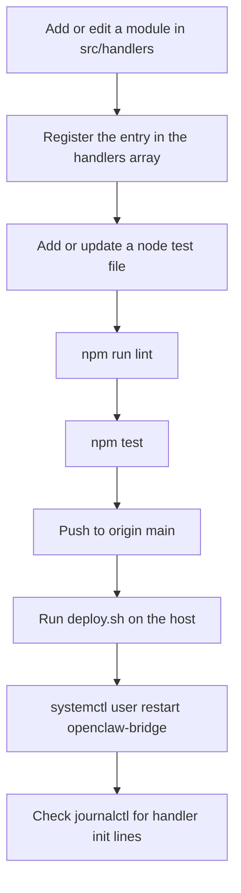

# Iteration Loop

Most changes add a handler or adjust an existing one. The steps below use the scripts and deploy path in the snapshot. No CI configuration appears in the provided excerpts, so whether CI runs is unknown.

## Change cycle

## Steps

1. **Write the handler.** The README shows a minimal pattern: an `init()` that calls `subscribeToExchange`, plus a handler that calls `sendToOpenClaw` ([README.md:L46-L66](https://github.com/Jeffrey-Keyser/openclaw-bridge/blob/d6c5d8e55b0d6ccdae14101efc8b33b9db0e8e11/README.md#L46-L66)). Current handlers also use `subscribeToQueue` for topic patterns, for example the cron alert handler ([src/handlers/cron.js:L14-L16](https://github.com/Jeffrey-Keyser/openclaw-bridge/blob/d6c5d8e55b0d6ccdae14101efc8b33b9db0e8e11/src/handlers/cron.js#L14-L16)).

2. **Register it.** Add an entry to the `handlers` array. Entries are `{ name, module, enabled }` ([src/handlers/index.js:L37-L38](https://github.com/Jeffrey-Keyser/openclaw-bridge/blob/d6c5d8e55b0d6ccdae14101efc8b33b9db0e8e11/src/handlers/index.js#L37-L38)). A handler that is not in this array is not initialized ([L68-L91](https://github.com/Jeffrey-Keyser/openclaw-bridge/blob/d6c5d8e55b0d6ccdae14101efc8b33b9db0e8e11/src/handlers/index.js#L68-L91)).

3. **Lint.** `npm run lint` runs `node --check` on five named files only: the entry point, bridge state, the handler registry, plan-manager, and one test file ([package.json:L8](https://github.com/Jeffrey-Keyser/openclaw-bridge/blob/d6c5d8e55b0d6ccdae14101efc8b33b9db0e8e11/package.json#L8)). Other handler files are not syntax-checked by this script. `typecheck` is an alias for lint ([package.json:L11](https://github.com/Jeffrey-Keyser/openclaw-bridge/blob/d6c5d8e55b0d6ccdae14101efc8b33b9db0e8e11/package.json#L11)).

4. **Test.** `npm test` runs `node --test` ([package.json:L9](https://github.com/Jeffrey-Keyser/openclaw-bridge/blob/d6c5d8e55b0d6ccdae14101efc8b33b9db0e8e11/package.json#L9)). The test files themselves are not in the excerpts, so their coverage is unknown.

5. **Build check.** `npm run build` only runs syntax checks on the entry point and plan-manager ([package.json:L10](https://github.com/Jeffrey-Keyser/openclaw-bridge/blob/d6c5d8e55b0d6ccdae14101efc8b33b9db0e8e11/package.json#L10)).

6. **Deploy.** `deploy.sh` runs `git pull origin main`, `npm ci --production`, and `systemctl --user restart openclaw-bridge` ([deploy.sh:L12](https://github.com/Jeffrey-Keyser/openclaw-bridge/blob/d6c5d8e55b0d6ccdae14101efc8b33b9db0e8e11/deploy.sh#L12), [L15](https://github.com/Jeffrey-Keyser/openclaw-bridge/blob/d6c5d8e55b0d6ccdae14101efc8b33b9db0e8e11/deploy.sh#L15), [L18](https://github.com/Jeffrey-Keyser/openclaw-bridge/blob/d6c5d8e55b0d6ccdae14101efc8b33b9db0e8e11/deploy.sh#L18)).

7. **Verify.** The README tails logs with `journalctl -u openclaw-bridge -f` ([README.md:L92-L93](https://github.com/Jeffrey-Keyser/openclaw-bridge/blob/d6c5d8e55b0d6ccdae14101efc8b33b9db0e8e11/README.md#L92-L93)). Handler init logs `Handler initialized` or a skip message ([src/handlers/cron.js:L44-L47](https://github.com/Jeffrey-Keyser/openclaw-bridge/blob/d6c5d8e55b0d6ccdae14101efc8b33b9db0e8e11/src/handlers/cron.js#L44-L47)).

## Runtime toggles without redeploy

Pause and routing state can change through the admin API without a restart. These routes are `PUT /admin/handlers/:name`, `PUT /admin/bridge`, and `PUT /admin/targets/:handler` ([src/index.js:L58-L68](https://github.com/Jeffrey-Keyser/openclaw-bridge/blob/d6c5d8e55b0d6ccdae14101efc8b33b9db0e8e11/src/index.js#L58-L68), [L96-L105](https://github.com/Jeffrey-Keyser/openclaw-bridge/blob/d6c5d8e55b0d6ccdae14101efc8b33b9db0e8e11/src/index.js#L96-L105), [L81-L93](https://github.com/Jeffrey-Keyser/openclaw-bridge/blob/d6c5d8e55b0d6ccdae14101efc8b33b9db0e8e11/src/index.js#L81-L93)). Use these to isolate a noisy handler before changing code.

Route targets are keyed by the name passed to `sendToOpenClaw`, not the registry name. For example, the briefing handler sends `Morning Email Triage` ([src/handlers/briefing.js:L39-L41](https://github.com/Jeffrey-Keyser/openclaw-bridge/blob/d6c5d8e55b0d6ccdae14101efc8b33b9db0e8e11/src/handlers/briefing.js#L39-L41)). Check that key when rerouting.

## Hygiene

Source files contain embedded credentials and fallback secrets. Do not copy them into docs or tickets. Move them into environment configuration before adding new integrations.
