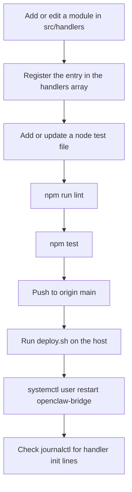

# Iteration Loop

Most changes add a handler or adjust an existing one. The steps below use the scripts and deploy path in the snapshot. The excerpts include no CI configuration, so whether CI runs is unknown.

## Change cycle

## Steps

1. **Write the handler.** The README shows a minimal pattern: an `init()` that calls `subscribeToExchange`, plus a handler that calls `sendToOpenClaw` ([README.md:L46-L66](https://github.com/Jeffrey-Keyser/openclaw-bridge/blob/d6c5d8e55b0d6ccdae14101efc8b33b9db0e8e11/README.md#L46-L66)). Current handlers also use `subscribeToQueue` for topic patterns. The cron alert handler is one example ([src/handlers/cron.js:L14-L16](https://github.com/Jeffrey-Keyser/openclaw-bridge/blob/d6c5d8e55b0d6ccdae14101efc8b33b9db0e8e11/src/handlers/cron.js#L14-L16)). Handlers that forward outside text should build instructions with the helpers in `src/services/untrusted.js` rather than splicing raw fields into SQL or shell commands ([src/services/untrusted.js @ 9e9b630e](https://github.com/Jeffrey-Keyser/openclaw-bridge/blob/9e9b630e3a0a58bb36de7556f272c792165adb94/src/services/untrusted.js)).

2. **Register it.** Add an entry to the `handlers` array. Entries have the shape `{ name, module, enabled }` ([src/handlers/index.js:L37-L38](https://github.com/Jeffrey-Keyser/openclaw-bridge/blob/d6c5d8e55b0d6ccdae14101efc8b33b9db0e8e11/src/handlers/index.js#L37-L38)). A handler that is not in this array is not initialized ([L68-L91](https://github.com/Jeffrey-Keyser/openclaw-bridge/blob/d6c5d8e55b0d6ccdae14101efc8b33b9db0e8e11/src/handlers/index.js#L68-L91)).

3. **Lint.** `npm run lint` runs `node --check` on five named files only: the entry point, bridge state, the handler registry, plan-manager, and one test file ([package.json:L8](https://github.com/Jeffrey-Keyser/openclaw-bridge/blob/d6c5d8e55b0d6ccdae14101efc8b33b9db0e8e11/package.json#L8)). This script does not syntax-check other handler files. `typecheck` is an alias for lint ([package.json:L11](https://github.com/Jeffrey-Keyser/openclaw-bridge/blob/d6c5d8e55b0d6ccdae14101efc8b33b9db0e8e11/package.json#L11)).

4. **Test.** `npm test` runs `node --test` ([package.json:L9](https://github.com/Jeffrey-Keyser/openclaw-bridge/blob/d6c5d8e55b0d6ccdae14101efc8b33b9db0e8e11/package.json#L9)). Most test files are not in the excerpts, so overall coverage is unknown.

   `test-flights-auth.test.js` is one visible example. It stubs `src/services/rabbit` through `require.cache` and replaces `global.fetch` and `console` ([test-flights-auth.test.js:L4-L27](https://github.com/Jeffrey-Keyser/openclaw-bridge/blob/48a98d91a89da554413b552bf3c3dd4b6c622e09/test-flights-auth.test.js#L4-L27)). It then checks three things for both Flights handlers ([L37-L64](https://github.com/Jeffrey-Keyser/openclaw-bridge/blob/48a98d91a89da554413b552bf3c3dd4b6c622e09/test-flights-auth.test.js#L37-L64)):
   - The bearer header is sent and the payload is forwarded unchanged.
   - No request is made when the key is missing.
   - A 401 is logged without exposing the key.

   This pattern is a reasonable template for testing other handlers that make outbound HTTP calls.

   Since the secret-fallback removal, several test files set placeholder values at the top, for example `OPENCLAW_HOOK_TOKEN` in `test-nanoclaw.test.js` and `RABBITMQ_URL` in the RabbitMQ tests ([test-nanoclaw.test.js @ 9e9b630e](https://github.com/Jeffrey-Keyser/openclaw-bridge/blob/9e9b630e3a0a58bb36de7556f272c792165adb94/test-nanoclaw.test.js), [test-rabbit-topology.test.js @ 9e9b630e](https://github.com/Jeffrey-Keyser/openclaw-bridge/blob/9e9b630e3a0a58bb36de7556f272c792165adb94/test-rabbit-topology.test.js)). `test-webhook-trust.test.js` covers Twilio signature checks, the SMS reply command, parameterized lead inserts, email prompt fencing, and the CCW webhook secret check ([test-webhook-trust.test.js @ 9e9b630e](https://github.com/Jeffrey-Keyser/openclaw-bridge/blob/9e9b630e3a0a58bb36de7556f272c792165adb94/test-webhook-trust.test.js)). `test-public-edge.test.js` covers the public edge allow-list ([test-public-edge.test.js @ 9e9b630e](https://github.com/Jeffrey-Keyser/openclaw-bridge/blob/9e9b630e3a0a58bb36de7556f272c792165adb94/test-public-edge.test.js)).

5. **Build check.** `npm run build` only runs syntax checks on the entry point and plan-manager ([package.json:L10](https://github.com/Jeffrey-Keyser/openclaw-bridge/blob/d6c5d8e55b0d6ccdae14101efc8b33b9db0e8e11/package.json#L10)).

6. **Deploy.** `deploy.sh` runs `git pull origin main`, then `npm ci --production`, then `systemctl --user restart openclaw-bridge` ([deploy.sh:L12](https://github.com/Jeffrey-Keyser/openclaw-bridge/blob/d6c5d8e55b0d6ccdae14101efc8b33b9db0e8e11/deploy.sh#L12), [L15](https://github.com/Jeffrey-Keyser/openclaw-bridge/blob/d6c5d8e55b0d6ccdae14101efc8b33b9db0e8e11/deploy.sh#L15), [L18](https://github.com/Jeffrey-Keyser/openclaw-bridge/blob/d6c5d8e55b0d6ccdae14101efc8b33b9db0e8e11/deploy.sh#L18)). Because required secrets now have no defaults, the host environment must define them before the restart. See Operations.

7. **Verify.** The README tails logs with `journalctl -u openclaw-bridge -f` ([README.md:L92-L93](https://github.com/Jeffrey-Keyser/openclaw-bridge/blob/d6c5d8e55b0d6ccdae14101efc8b33b9db0e8e11/README.md#L92-L93)). Handler init logs either `Handler initialized` or a skip message ([src/handlers/cron.js:L44-L47](https://github.com/Jeffrey-Keyser/openclaw-bridge/blob/d6c5d8e55b0d6ccdae14101efc8b33b9db0e8e11/src/handlers/cron.js#L44-L47)). Missing required secrets log errors such as `[Twilio] TWILIO_AUTH_TOKEN not set` or `[OpenClaw] OPENCLAW_HOOK_TOKEN not configured` ([src/handlers/twilio.js @ 9e9b630e](https://github.com/Jeffrey-Keyser/openclaw-bridge/blob/9e9b630e3a0a58bb36de7556f272c792165adb94/src/handlers/twilio.js), [src/services/openclaw.js @ 9e9b630e](https://github.com/Jeffrey-Keyser/openclaw-bridge/blob/9e9b630e3a0a58bb36de7556f272c792165adb94/src/services/openclaw.js)).

## Runtime toggles without redeploy

You can change pause and routing state through the admin API without a restart. The routes are:
- `PUT /admin/handlers/:name` ([src/index.js:L58-L68](https://github.com/Jeffrey-Keyser/openclaw-bridge/blob/d6c5d8e55b0d6ccdae14101efc8b33b9db0e8e11/src/index.js#L58-L68))
- `PUT /admin/bridge` ([src/index.js:L96-L105](https://github.com/Jeffrey-Keyser/openclaw-bridge/blob/d6c5d8e55b0d6ccdae14101efc8b33b9db0e8e11/src/index.js#L96-L105))
- `PUT /admin/targets/:handler` ([src/index.js:L81-L93](https://github.com/Jeffrey-Keyser/openclaw-bridge/blob/d6c5d8e55b0d6ccdae14101efc8b33b9db0e8e11/src/index.js#L81-L93))

Use these to isolate a noisy handler before changing code.

Route targets are keyed by the name passed to `sendToOpenClaw`, not the registry name. For example, the briefing handler sends `Morning Email Triage` ([src/handlers/briefing.js:L39-L41](https://github.com/Jeffrey-Keyser/openclaw-bridge/blob/d6c5d8e55b0d6ccdae14101efc8b33b9db0e8e11/src/handlers/briefing.js#L39-L41)). Check that key before rerouting.

## Hygiene

Source files no longer contain credentials or fallback secrets. The PR that removed them (`9e9b630e`) changed the RabbitMQ, OpenClaw, Spanish, CCW email webhook, and CCW contact paths to read secrets from the environment only ([src/services/rabbit.js @ 9e9b630e](https://github.com/Jeffrey-Keyser/openclaw-bridge/blob/9e9b630e3a0a58bb36de7556f272c792165adb94/src/services/rabbit.js), [src/handlers/spanish.js @ 9e9b630e](https://github.com/Jeffrey-Keyser/openclaw-bridge/blob/9e9b630e3a0a58bb36de7556f272c792165adb94/src/handlers/spanish.js)). Keep it that way. Do not add a default value for any secret, and do not copy secret values into docs or tickets. Add new integrations with environment configuration from the start.
