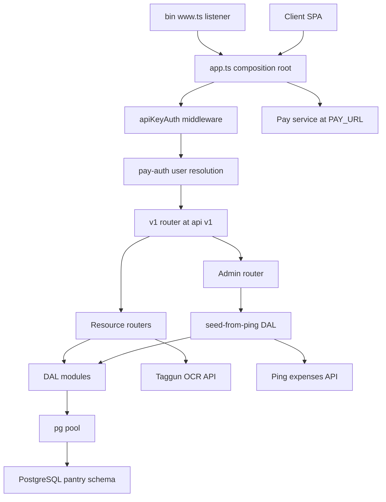

# Architecture

Pantry Manager is an Express 5 service in which HTTP routers delegate to a data access layer, which uses a shared `pg` pool. Middleware, health checks, CORS, and routes are declared as configuration and handed to `createExpressApp` from `express-server-factory` ([src/app.ts:L55-L116](https://github.com/Jeffrey-Keyser/pantry-manager/blob/9293c1392f52c8565c675c9168034b9f77a54d77/src/app.ts#L55-L116), [src/app.ts:L120-L122](https://github.com/Jeffrey-Keyser/pantry-manager/blob/9293c1392f52c8565c675c9168034b9f77a54d77/src/app.ts#L120-L122)).

## Role contracts

**Entrypoint.** `src/bin/www.ts` gets the cached app, calls `listen`, and closes the server on `SIGTERM` before exiting ([src/bin/www.ts:L8-L14](https://github.com/Jeffrey-Keyser/pantry-manager/blob/9293c1392f52c8565c675c9168034b9f77a54d77/src/bin/www.ts#L8-L14), [src/bin/www.ts:L33-L39](https://github.com/Jeffrey-Keyser/pantry-manager/blob/9293c1392f52c8565c675c9168034b9f77a54d77/src/bin/www.ts#L33-L39)).

**Composition root.** `src/app.ts` sets CORS, JSON parsing, auth config, custom middleware, health check, routes, and error logging ([src/app.ts:L59-L116](https://github.com/Jeffrey-Keyser/pantry-manager/blob/9293c1392f52c8565c675c9168034b9f77a54d77/src/app.ts#L59-L116)). `/auth` is proxied to Pay, `/` serves a descriptor, and `/api/v1` mounts the v1 router ([src/app.ts:L100-L104](https://github.com/Jeffrey-Keyser/pantry-manager/blob/9293c1392f52c8565c675c9168034b9f77a54d77/src/app.ts#L100-L104)).

**Config.** `src/config/env.ts` loads `.env` and requires `NODE_ENV`, `PAY_URL`, and `PANTRY_MANAGER_API_KEY`. Database settings come from `validateConfig` in `database-base-config` ([src/config/env.ts:L7](https://github.com/Jeffrey-Keyser/pantry-manager/blob/9293c1392f52c8565c675c9168034b9f77a54d77/src/config/env.ts#L7), [src/config/env.ts:L49-L58](https://github.com/Jeffrey-Keyser/pantry-manager/blob/9293c1392f52c8565c675c9168034b9f77a54d77/src/config/env.ts#L49-L58)).

**Auth.** `apiKeyAuth` accepts `X-API-Key` or a Bearer token, and exempts `/health` and `/` ([src/middleware/api-key-auth.ts:L4](https://github.com/Jeffrey-Keyser/pantry-manager/blob/9293c1392f52c8565c675c9168034b9f77a54d77/src/middleware/api-key-auth.ts#L4), [src/middleware/api-key-auth.ts:L11-L17](https://github.com/Jeffrey-Keyser/pantry-manager/blob/9293c1392f52c8565c675c9168034b9f77a54d77/src/middleware/api-key-auth.ts#L11-L17)). `resolveUser` upserts `pantry.users` by `pay_uuid` ([src/app.ts:L27-L43](https://github.com/Jeffrey-Keyser/pantry-manager/blob/9293c1392f52c8565c675c9168034b9f77a54d77/src/app.ts#L27-L43)).

**Routing.** The v1 router mounts products, pantry-items, receipts, nudges, admin, and authority ([src/routes/versions/v1/index.ts:L12-L17](https://github.com/Jeffrey-Keyser/pantry-manager/blob/9293c1392f52c8565c675c9168034b9f77a54d77/src/routes/versions/v1/index.ts#L12-L17)).

**DAL.** Modules such as products, pantry-items, receipts, nudges, and authority call `pool.query` directly with typed functions ([src/dal/products.ts:L31-L40](https://github.com/Jeffrey-Keyser/pantry-manager/blob/9293c1392f52c8565c675c9168034b9f77a54d77/src/dal/products.ts#L31-L40), [src/dal/authority.ts:L27-L33](https://github.com/Jeffrey-Keyser/pantry-manager/blob/9293c1392f52c8565c675c9168034b9f77a54d77/src/dal/authority.ts#L27-L33)).

**Database.** One pool is created from `databaseConfig` ([src/db/connection.ts:L4](https://github.com/Jeffrey-Keyser/pantry-manager/blob/9293c1392f52c8565c675c9168034b9f77a54d77/src/db/connection.ts#L4)). Migration files are not in the provided excerpts, so the table definitions are unverified here. Code references `pantry.products`, `pantry.pantry_items`, `pantry.purchase_history`, and `pantry.product_categories` ([src/dal/nudges.ts:L149-L151](https://github.com/Jeffrey-Keyser/pantry-manager/blob/9293c1392f52c8565c675c9168034b9f77a54d77/src/dal/nudges.ts#L149-L151)).

**Client.** `client/` is a separate React SPA with routes for `/login` and `/dashboard` ([client/src/App.tsx:L9-L17](https://github.com/Jeffrey-Keyser/pantry-manager/blob/9293c1392f52c8565c675c9168034b9f77a54d77/client/src/App.tsx#L9-L17)). It has its own build script ([client/package.json:L8](https://github.com/Jeffrey-Keyser/pantry-manager/blob/9293c1392f52c8565c675c9168034b9f77a54d77/client/package.json#L8)).

**Open question.** The SPA sends a Pay access token as a Bearer header ([client/src/store/api/pantryItems.ts:L25-L27](https://github.com/Jeffrey-Keyser/pantry-manager/blob/9293c1392f52c8565c675c9168034b9f77a54d77/client/src/store/api/pantryItems.ts#L25-L27)). `apiKeyAuth` compares Bearer values against the service key ([src/middleware/api-key-auth.ts:L22-L25](https://github.com/Jeffrey-Keyser/pantry-manager/blob/9293c1392f52c8565c675c9168034b9f77a54d77/src/middleware/api-key-auth.ts#L22-L25)). How these interact is unknown from the excerpts.
