# Iteration Loop

A typical change starts at the database, moves through the DAL and a versioned router, is tested, then is built and restarted. The steps below follow the scripts in the repo.

```mermaid
flowchart LR
  a["Plan change"] --> b["Scaffold migration with migrate create"]
  b --> c["Write up and down in migrations folder"]
  c --> d["Apply with npm run migrate"]
  d --> e["Add DAL function in src dal"]
  e --> f["Mount route in src routes versions v1"]
  f --> g["Write tests in tests folder then npm test"]
  g --> h["Compile with npm run build"]
  h --> i["Restart with systemctl user restart"]
```

## Steps

1. **Scaffold a migration.** `npm run migrate:create` runs `scripts/create-migration.js` ([package.json:L13](https://github.com/Jeffrey-Keyser/pantry-manager/blob/9293c1392f52c8565c675c9168034b9f77a54d77/package.json#L13)). It reads the `migrations` directory and writes a file named with the next timestamp, stepping by 1000 ([scripts/create-migration.js:L13-L14](https://github.com/Jeffrey-Keyser/pantry-manager/blob/9293c1392f52c8565c675c9168034b9f77a54d77/scripts/create-migration.js#L13-L14), [scripts/create-migration.js:L26-L28](https://github.com/Jeffrey-Keyser/pantry-manager/blob/9293c1392f52c8565c675c9168034b9f77a54d77/scripts/create-migration.js#L26-L28)).
2. **Write up and down.** The generated template exports `up` and `down` functions with a `MigrationBuilder` ([scripts/create-migration.js:L31-L39](https://github.com/Jeffrey-Keyser/pantry-manager/blob/9293c1392f52c8565c675c9168034b9f77a54d77/scripts/create-migration.js#L31-L39)).
3. **Apply.** `npm run migrate` runs `scripts/run-migrate.js`, which builds a `DATABASE_URL` from `DATABASE_*` variables and runs node-pg-migrate with `up` ([scripts/run-migrate.js:L8-L15](https://github.com/Jeffrey-Keyser/pantry-manager/blob/9293c1392f52c8565c675c9168034b9f77a54d77/scripts/run-migrate.js#L8-L15), [scripts/run-migrate.js:L19](https://github.com/Jeffrey-Keyser/pantry-manager/blob/9293c1392f52c8565c675c9168034b9f77a54d77/scripts/run-migrate.js#L19)). Rollback uses `npm run migrate:down` ([scripts/run-migrate-down.js:L19](https://github.com/Jeffrey-Keyser/pantry-manager/blob/9293c1392f52c8565c675c9168034b9f77a54d77/scripts/run-migrate-down.js#L19)).
4. **DAL function.** Add typed functions in `src/dal/`. Writes that touch products or pantry items must carry receipt lineage, which `requireReceiptLineage` enforces ([src/dal/products.ts:L31-L32](https://github.com/Jeffrey-Keyser/pantry-manager/blob/9293c1392f52c8565c675c9168034b9f77a54d77/src/dal/products.ts#L31-L32), [src/dal/pantry-items.ts:L43-L44](https://github.com/Jeffrey-Keyser/pantry-manager/blob/9293c1392f52c8565c675c9168034b9f77a54d77/src/dal/pantry-items.ts#L43-L44)).
5. **Route.** Add handlers in `src/routes/versions/v1/` and keep the v1 mount list current ([src/routes/versions/v1/index.ts:L12-L17](https://github.com/Jeffrey-Keyser/pantry-manager/blob/9293c1392f52c8565c675c9168034b9f77a54d77/src/routes/versions/v1/index.ts#L12-L17)).
6. **Test.** `npm test` runs `vitest run` ([package.json:L10](https://github.com/Jeffrey-Keyser/pantry-manager/blob/9293c1392f52c8565c675c9168034b9f77a54d77/package.json#L10)). Vitest only includes `tests/**/*.test.ts` ([vitest.config.ts:L6](https://github.com/Jeffrey-Keyser/pantry-manager/blob/9293c1392f52c8565c675c9168034b9f77a54d77/vitest.config.ts#L6)). The tests folder is not in the excerpts, so its contents are unverified.
7. **Build and restart.** `npm run build` runs `tsc` ([package.json:L8](https://github.com/Jeffrey-Keyser/pantry-manager/blob/9293c1392f52c8565c675c9168034b9f77a54d77/package.json#L8)). The README documents `systemctl --user restart pantry-manager` after the build ([README.md:L51-L54](https://github.com/Jeffrey-Keyser/pantry-manager/blob/9293c1392f52c8565c675c9168034b9f77a54d77/README.md#L51-L54)).

## Notes

- The excerpts include no CI workflow. Because the snapshot is partial, its absence is not established. The gate that is documented is local `npm test` and `npm run build`.
- The server reads `.env` through dotenv ([src/config/env.ts:L7](https://github.com/Jeffrey-Keyser/pantry-manager/blob/9293c1392f52c8565c675c9168034b9f77a54d77/src/config/env.ts#L7)). Missing `PANTRY_MANAGER_API_KEY` makes config loading throw ([src/config/env.ts:L55-L58](https://github.com/Jeffrey-Keyser/pantry-manager/blob/9293c1392f52c8565c675c9168034b9f77a54d77/src/config/env.ts#L55-L58)).
- For the client, `npm run dev` starts Vite ([client/package.json:L7](https://github.com/Jeffrey-Keyser/pantry-manager/blob/9293c1392f52c8565c675c9168034b9f77a54d77/client/package.json#L7)). Its dev server proxies `/api` and `/auth` to the API ([client/vite.config.ts:L7-L10](https://github.com/Jeffrey-Keyser/pantry-manager/blob/9293c1392f52c8565c675c9168034b9f77a54d77/client/vite.config.ts#L7-L10)).
