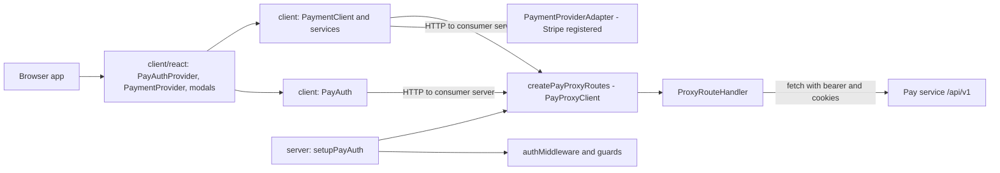

# Architecture

The package is organised as five subpath exports, each with its own ESM, CJS and type-declaration builds ([package.json:L9-L35](https://github.com/Jeffrey-Keyser/pay-auth-integration/blob/d4ecf76d913db4ff0a5178aae561fd0fe16c4e03/package.json#L9-L35)).

The root entry `.` exports only integration-specific types and configuration builders. Since v6.0.0, the Pay API types must be imported directly from `@jeffrey-keyser/pay-api-types` ([src/index.ts:L1-L60](https://github.com/Jeffrey-Keyser/pay-auth-integration/blob/d4ecf76d913db4ff0a5178aae561fd0fe16c4e03/src/index.ts#L1-L60)).

## Server (`./server`)

### setupPayAuth

`setupPayAuth` accepts either a config object or a `PayAuthConfigBuilder` ([src/server/index.ts:L37-L126](https://github.com/Jeffrey-Keyser/pay-auth-integration/blob/d4ecf76d913db4ff0a5178aae561fd0fe16c4e03/src/server/index.ts#L37-L126)). It then:

- merges `DEFAULT_PUBLIC_ROUTES` and `DEFAULT_AUTH_ENDPOINTS` with the caller's values;
- passes only the proxy's anonymous endpoints under `authPath` to the gate as `publicEndpoints` (see below), instead of a `${authPath}/*` wildcard. Other routes under `authPath`, including the consumer's own, still require a token ([src/server/index.ts:L61-L80](https://github.com/Jeffrey-Keyser/pay-auth-integration/blob/e9ed426ccda1880c2d89ed76e40f9015229264c8/src/server/index.ts#L61-L80));
- throws `PayAuthConfigurationError` if `authPath` is `''`, `'/'` or otherwise not a dedicated mount path, or if `publicRoutes` contains `'/*'` or `'*'`, which would make every route public ([src/server/index.ts:L61-L80](https://github.com/Jeffrey-Keyser/pay-auth-integration/blob/e9ed426ccda1880c2d89ed76e40f9015229264c8/src/server/index.ts#L61-L80), [src/server/validation.ts:L70-L100](https://github.com/Jeffrey-Keyser/pay-auth-integration/blob/e9ed426ccda1880c2d89ed76e40f9015229264c8/src/server/validation.ts#L70-L100));
- throws `PayAuthConfigurationError` if validation fails;
- returns `{ middleware, routes, applyTo }`.

### Anonymous proxy endpoints

`ANONYMOUS_PROXY_ENDPOINTS` lists the proxy endpoints that are called without Pay credentials: login, register, guest, refresh, password reset and validation, ping, OAuth sign-in, and the product and price catalog. `proxyPublicEndpoints(authPath)` prefixes that list with the mount path. Manual setups can pass the result as `publicEndpoints` ([src/server/pay-proxy-client.ts:L19-L56](https://github.com/Jeffrey-Keyser/pay-auth-integration/blob/e9ed426ccda1880c2d89ed76e40f9015229264c8/src/server/pay-proxy-client.ts#L19-L56)).

Matching is exact. `:param` segments match one path segment, and sub-paths are not included. `isPublicEndpoint()` implements this check ([src/server/auth-middleware.ts:L192-L208](https://github.com/Jeffrey-Keyser/pay-auth-integration/blob/e9ed426ccda1880c2d89ed76e40f9015229264c8/src/server/auth-middleware.ts#L192-L208)).

### Proxy router

`createPayProxyRoutes` requires a `payUrl` ([src/server/pay-proxy-routes.ts:L28-L140](https://github.com/Jeffrey-Keyser/pay-auth-integration/blob/d4ecf76d913db4ff0a5178aae561fd0fe16c4e03/src/server/pay-proxy-routes.ts#L28-L140)). It:

- attaches a correlation ID to each request and returns it in the `X-Correlation-ID` header;
- mounts the routes produced by `PayProxyClient`;
- adds a `/health` route;
- formats errors in the ActionResponse shape.

### Route table

Route metadata is declarative. Each entry records `path`, `method`, `requiresAuth`, `cacheable` and `cacheTTL`, under the `API_V1 = '/api/v1'` prefix. The table covers auth, user, OAuth, admin and payment routes ([src/server/config/route-config.ts:L6-L194](https://github.com/Jeffrey-Keyser/pay-auth-integration/blob/d4ecf76d913db4ff0a5178aae561fd0fe16c4e03/src/server/config/route-config.ts#L6-L194), [src/server/config/payment-route-config.ts:L12-L175](https://github.com/Jeffrey-Keyser/pay-auth-integration/blob/d4ecf76d913db4ff0a5178aae561fd0fe16c4e03/src/server/config/payment-route-config.ts#L12-L175)).

### ProxyRouteHandler

For each request, `ProxyRouteHandler` ([src/server/helpers/ProxyRouteHandler.ts:L48-L170](https://github.com/Jeffrey-Keyser/pay-auth-integration/blob/d4ecf76d913db4ff0a5178aae561fd0fe16c4e03/src/server/helpers/ProxyRouteHandler.ts#L48-L170)):

- enforces a bearer token when `requiresAuth` is set;
- optionally serves and stores cached responses;
- substitutes `:params` into the path, URL-encoded;
- forwards the `Authorization` header and cookies upstream;
- relays `Set-Cookie` headers back to the client.

The upstream `HttpClient` retries with exponential backoff ([src/server/services/http-client.ts:L37-L72](https://github.com/Jeffrey-Keyser/pay-auth-integration/blob/d4ecf76d913db4ff0a5178aae561fd0fe16c4e03/src/server/services/http-client.ts#L37-L72)).

### Token validation

`TokenValidator` calls `${payUrl}` plus a ping endpoint, which defaults to `/auth/ping`. It then decodes the JWT to build the user object ([src/server/services/token-validator.ts:L15-L163](https://github.com/Jeffrey-Keyser/pay-auth-integration/blob/d4ecf76d913db4ff0a5178aae561fd0fe16c4e03/src/server/services/token-validator.ts#L15-L163)).

The `auth-middleware.ts` source is not in this snapshot. Which validator the middleware actually wires in is therefore unverified.

## Client (`./client`)

### PayAuth

`PayAuth` is a facade over several internal pieces ([src/client/pay-auth.ts:L31-L90](https://github.com/Jeffrey-Keyser/pay-auth-integration/blob/d4ecf76d913db4ff0a5178aae561fd0fe16c4e03/src/client/pay-auth.ts#L31-L90)):

- `ConfigurationManager`
- `TokenStorageService`
- `AuthOperations` and `UserOperations`
- an `AuthStateMachine`

Its HTTP client refreshes the access token automatically when it receives a 401. The refresh token lives in an httpOnly cookie, not in client storage ([src/client/pay-auth.ts:L313-L353](https://github.com/Jeffrey-Keyser/pay-auth-integration/blob/d4ecf76d913db4ff0a5178aae561fd0fe16c4e03/src/client/pay-auth.ts#L313-L353)).

Default endpoint paths are defined in `ConfigurationManager` ([src/client/services/configuration-manager.ts:L38-L63](https://github.com/Jeffrey-Keyser/pay-auth-integration/blob/d4ecf76d913db4ff0a5178aae561fd0fe16c4e03/src/client/services/configuration-manager.ts#L38-L63)).

### PaymentClient

`PaymentClient` provides lazy-loaded `customer`, `subscriptions` and `products` services. It resolves the payment adapter via `PaymentProviderAdapterFactory.create` ([src/client/PaymentClient.ts:L99-L241](https://github.com/Jeffrey-Keyser/pay-auth-integration/blob/d4ecf76d913db4ff0a5178aae561fd0fe16c4e03/src/client/PaymentClient.ts#L99-L241), [src/client/providers/PaymentProviderAdapter.ts:L214-L247](https://github.com/Jeffrey-Keyser/pay-auth-integration/blob/d4ecf76d913db4ff0a5178aae561fd0fe16c4e03/src/client/providers/PaymentProviderAdapter.ts#L214-L247)).

## React (`./client/react`)

`PayAuthProvider` performs four jobs, each through a separate hook. It wraps its children in the personal-ui-kit `ThemeProvider` ([src/client/react/context/PayAuthProvider.tsx:L58-L175](https://github.com/Jeffrey-Keyser/pay-auth-integration/blob/d4ecf76d913db4ff0a5178aae561fd0fe16c4e03/src/client/react/context/PayAuthProvider.tsx#L58-L175)):

- validation
- i18n
- auth state
- auth operations

`PaymentProvider` holds customer, subscription and product state on top of `PaymentClient` ([src/client/react/context/PaymentProvider.tsx:L87-L356](https://github.com/Jeffrey-Keyser/pay-auth-integration/blob/d4ecf76d913db4ff0a5178aae561fd0fe16c4e03/src/client/react/context/PaymentProvider.tsx#L87-L356)).

## Shared core and testing

`src/core` re-exports five modules ([src/core/index.ts:L1-L15](https://github.com/Jeffrey-Keyser/pay-auth-integration/blob/d4ecf76d913db4ff0a5178aae561fd0fe16c4e03/src/core/index.ts#L1-L15)):

- validation
- repositories
- http
- configuration
- environment

`./testing` ships mocks and builders for consumers' test suites ([src/testing/index.ts:L4-L40](https://github.com/Jeffrey-Keyser/pay-auth-integration/blob/d4ecf76d913db4ff0a5178aae561fd0fe16c4e03/src/testing/index.ts#L4-L40)).
