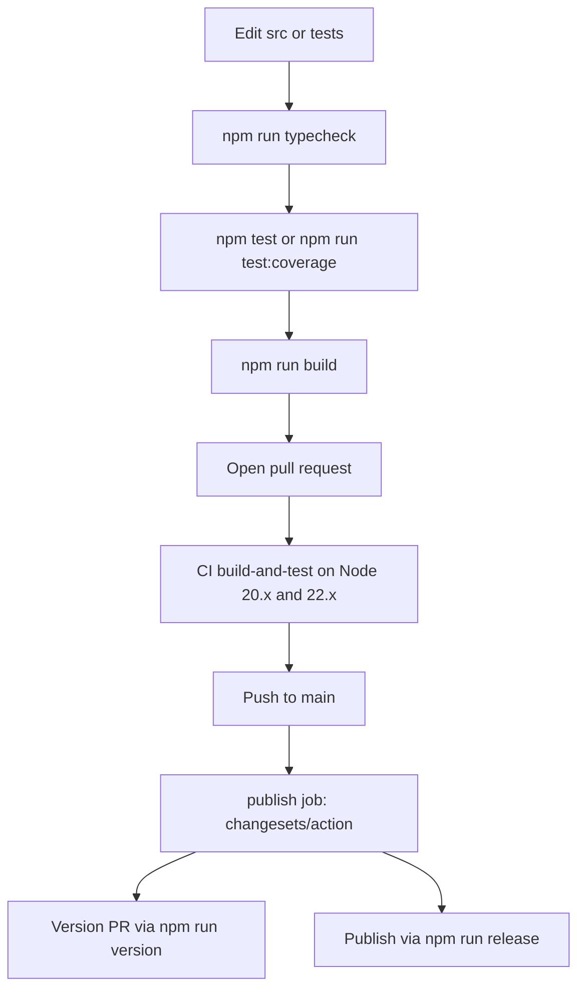

# Iteration Loop

This is a library repo, so a change ends in a package release, not a deployment. The tooling is TypeScript, Jest, Storybook and changesets, all declared in package.json scripts and dev dependencies ([package.json:L98-L173](https://github.com/Jeffrey-Keyser/pay-auth-integration/blob/d4ecf76d913db4ff0a5178aae561fd0fe16c4e03/package.json#L98-L173)).

## Local loop

1. **Install.** Install dependencies with a GitHub Package Registry token configured. Scoped `@jeffrey-keyser` packages are resolved from `npm.pkg.github.com` ([README.md:L47-L51](https://github.com/Jeffrey-Keyser/pay-auth-integration/blob/d4ecf76d913db4ff0a5178aae561fd0fe16c4e03/README.md#L47-L51)).
2. **Typecheck.** The main check is `npm run typecheck` (`tsc --noEmit`). Two variants exist ([package.json:L120-L122](https://github.com/Jeffrey-Keyser/pay-auth-integration/blob/d4ecf76d913db4ff0a5178aae561fd0fe16c4e03/package.json#L120-L122)):
   - `typecheck:react`;
   - `lint:types`, which runs with `--strict`.
3. **Test.** Test scripts are defined at [package.json:L112-L116](https://github.com/Jeffrey-Keyser/pay-auth-integration/blob/d4ecf76d913db4ff0a5178aae561fd0fe16c4e03/package.json#L112-L116):
   - `npm test` runs Jest;
   - `test:watch` and `test:coverage` are variants;
   - `test:react` and `test:types` target specific suites.
4. **Jest configuration** ([jest.config.js:L4-L60](https://github.com/Jeffrey-Keyser/pay-auth-integration/blob/d4ecf76d913db4ff0a5178aae561fd0fe16c4e03/jest.config.js#L4-L60)):
   - uses `ts-jest` with `jsdom`;
   - collects tests from `src` and `tests`;
   - enforces global coverage minimums of branches 24, functions 34, lines 32 and statements 32.
5. **Build.** `npm run build` runs four steps in order ([package.json:L99-L109](https://github.com/Jeffrey-Keyser/pay-auth-integration/blob/d4ecf76d913db4ff0a5178aae561fd0fe16c4e03/package.json#L99-L109)):
   - the ESM build;
   - the CJS build;
   - `scripts/fix-esm-imports.mjs`;
   - copying CSS and locale assets into both `dist` trees.
   The two TypeScript configs differ only in `module` and `outDir` ([tsconfig.esm.json:L1-L10](https://github.com/Jeffrey-Keyser/pay-auth-integration/blob/d4ecf76d913db4ff0a5178aae561fd0fe16c4e03/tsconfig.esm.json#L1-L10), [tsconfig.cjs.json:L1-L10](https://github.com/Jeffrey-Keyser/pay-auth-integration/blob/d4ecf76d913db4ff0a5178aae561fd0fe16c4e03/tsconfig.cjs.json#L1-L10)).
6. **Optional extras** ([package.json:L131-L136](https://github.com/Jeffrey-Keyser/pay-auth-integration/blob/d4ecf76d913db4ff0a5178aae561fd0fe16c4e03/package.json#L131-L136)):
   - `npm run storybook` starts Storybook on port 6006;
   - the `i18n:*` scripts run i18next-parser.

## CI

The workflow runs on every pull request and on pushes to `main` and `develop`. It uses a Node 20.x / 22.x matrix ([.github/workflows/ci.yml:L3-L13](https://github.com/Jeffrey-Keyser/pay-auth-integration/blob/d4ecf76d913db4ff0a5178aae561fd0fe16c4e03/.github/workflows/ci.yml#L3-L13)).

The steps are ([.github/workflows/ci.yml:L30-L49](https://github.com/Jeffrey-Keyser/pay-auth-integration/blob/d4ecf76d913db4ff0a5178aae561fd0fe16c4e03/.github/workflows/ci.yml#L30-L49)):

1. `npm ci`
2. `typecheck`
3. `test:coverage`
4. `build:esm`
5. `build:cjs`
6. `copy:assets`
7. `npm pack --dry-run`

On the Node 20 leg only, CI also uploads coverage to Codecov (non-fatal) and saves `dist/` as a build artifact ([.github/workflows/ci.yml:L51-L66](https://github.com/Jeffrey-Keyser/pay-auth-integration/blob/d4ecf76d913db4ff0a5178aae561fd0fe16c4e03/.github/workflows/ci.yml#L51-L66)).

CI differs from a local `npm run build` in two ways:

- It never runs `fix:esm-imports`. That only happens in the full `build` script, or through `prepublishOnly`.
- It does not run `i18n:check` or `lint:types`.

## Release

The `publish` job runs only on pushes to `main`, after `build-and-test` succeeds. It invokes `changesets/action@v1` with `npm run version` and `npm run release` ([.github/workflows/ci.yml:L68-L100](https://github.com/Jeffrey-Keyser/pay-auth-integration/blob/d4ecf76d913db4ff0a5178aae561fd0fe16c4e03/.github/workflows/ci.yml#L68-L100)). Those scripts map to:

- `changeset version`
- `changeset publish`

([package.json:L129-L130](https://github.com/Jeffrey-Keyser/pay-auth-integration/blob/d4ecf76d913db4ff0a5178aae561fd0fe16c4e03/package.json#L129-L130))

Contributors therefore record a changeset with the `@changesets/cli` dev dependency ([package.json:L139](https://github.com/Jeffrey-Keyser/pay-auth-integration/blob/d4ecf76d913db4ff0a5178aae561fd0fe16c4e03/package.json#L139)). The exact changeset config is not in this snapshot.

`prepublishOnly` runs clean, build and typecheck before any publish ([package.json:L118](https://github.com/Jeffrey-Keyser/pay-auth-integration/blob/d4ecf76d913db4ff0a5178aae561fd0fe16c4e03/package.json#L118)).

The changelog follows Keep a Changelog and SemVer ([CHANGELOG.md:L1-L8](https://github.com/Jeffrey-Keyser/pay-auth-integration/blob/d4ecf76d913db4ff0a5178aae561fd0fe16c4e03/CHANGELOG.md#L1-L8)).
