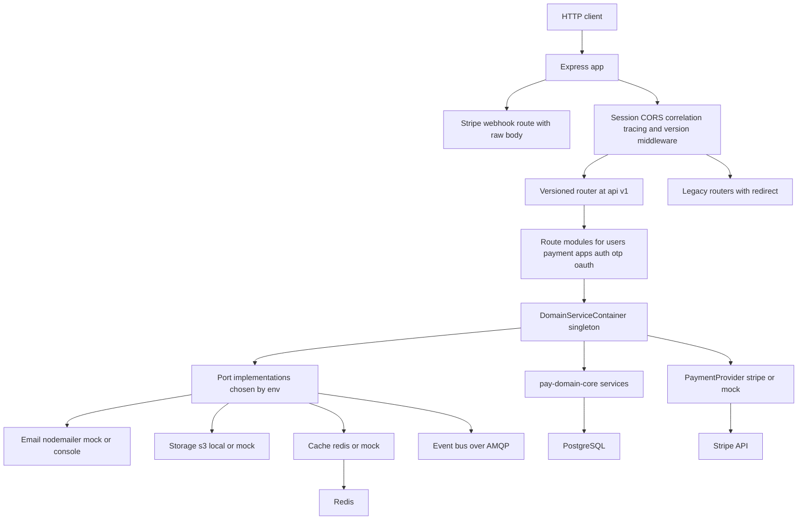

# Architecture

Pay is an Express application whose route handlers depend on a singleton container. The container builds domain services from `pay-domain-core` and infrastructure implementations ([server/services/DomainServiceContainer.ts:52-77](https://github.com/Jeffrey-Keyser/pay/blob/b20e905b08aa915debd6fa262a1f8015368cdb05/server/services/DomainServiceContainer.ts#L52-L77)).

## Entry points

- `bin/www.ts` imports tracing first, then loads the app and listens on `PORT` ([server/bin/www.ts:10-33](https://github.com/Jeffrey-Keyser/pay/blob/b20e905b08aa915debd6fa262a1f8015368cdb05/server/bin/www.ts#L10-L33)).
- `app.ts` mounts the Stripe webhook route before JSON parsing so signature checks receive the raw body ([server/app.ts:128-134](https://github.com/Jeffrey-Keyser/pay/blob/b20e905b08aa915debd6fa262a1f8015368cdb05/server/app.ts#L128-L134)).
- Swagger UI is mounted at `/api-docs` outside the test environment ([server/app.ts:155-166](https://github.com/Jeffrey-Keyser/pay/blob/b20e905b08aa915debd6fa262a1f8015368cdb05/server/app.ts#L155-L166)).
- **CORS** accepts exact allow-list origins, plus `ORIGIN_BASE_URL` and its subdomains. The decision is made by `isAllowedOrigin`, and malformed origins are rejected rather than thrown ([server/middleware/corsOrigin.ts](https://github.com/Jeffrey-Keyser/pay/blob/fa40c5038223c663f3410e91aa6fc807ad681b04/server/middleware/corsOrigin.ts), [server/app.ts](https://github.com/Jeffrey-Keyser/pay/blob/fa40c5038223c663f3410e91aa6fc807ad681b04/server/app.ts)).

## Contracts and components

- **Container members** expose repositories, password, token, email, payment provider, and the domain services ([server/services/DomainServiceContainer.ts:70-77](https://github.com/Jeffrey-Keyser/pay/blob/b20e905b08aa915debd6fa262a1f8015368cdb05/server/services/DomainServiceContainer.ts#L70-L77)).
- **Ports and adapters** are the documented anti-corruption layer: business logic depends on port interfaces, and factories select adapters ([CLAUDE.md:239-253](https://github.com/Jeffrey-Keyser/pay/blob/b20e905b08aa915debd6fa262a1f8015368cdb05/CLAUDE.md#L239-L253)). The port and adapter source files are not in this snapshot excerpt.
- **OTP attempts** are counted through `OtpPort.reserveAttempt`, a single conditional write that succeeds only while the OTP is unverified and under its attempt limit ([server/ports/OtpPort.ts](https://github.com/Jeffrey-Keyser/pay/blob/fa40c5038223c663f3410e91aa6fc807ad681b04/server/ports/OtpPort.ts), [server/adapters/otp/DatabaseOtpAdapter.ts](https://github.com/Jeffrey-Keyser/pay/blob/fa40c5038223c663f3410e91aa6fc807ad681b04/server/adapters/otp/DatabaseOtpAdapter.ts)).
- **OTP email verification** is bound to the address the OTP was issued for. `DatabaseOtpAdapter.markVerified` sets `email_verified` on the linked user only when that user's current email still matches the OTP row's email (case-insensitive). A user whose address changed after the OTP was issued is not marked verified by it. A regression test checks that the update is bound to the OTP row's email ([server/adapters/otp/DatabaseOtpAdapter.ts](https://github.com/Jeffrey-Keyser/pay/blob/ce4c9e3b5419aa0ba2d040e928a21d3bce3f849d/server/adapters/otp/DatabaseOtpAdapter.ts), [server/tests/security/otp-email-binding.test.ts](https://github.com/Jeffrey-Keyser/pay/blob/ce4c9e3b5419aa0ba2d040e928a21d3bce3f849d/server/tests/security/otp-email-binding.test.ts)).
- **Email, storage, and payment selection** use env schemas listing `nodemailer`, `mock`, `console`, `s3`, `local`, `mock`, and `stripe`/`mock` ([server/config/env.ts:63-73](https://github.com/Jeffrey-Keyser/pay/blob/b20e905b08aa915debd6fa262a1f8015368cdb05/server/config/env.ts#L63-L73), [server/config/env.ts:53-57](https://github.com/Jeffrey-Keyser/pay/blob/b20e905b08aa915debd6fa262a1f8015368cdb05/server/config/env.ts#L53-L57)).
- **Cache selection** via `CACHE_PROVIDER` is documented but its env schema is not in the excerpt ([CLAUDE.md:324](https://github.com/Jeffrey-Keyser/pay/blob/b20e905b08aa915debd6fa262a1f8015368cdb05/CLAUDE.md#L324)). Rate-limit counters use the `CachePort.increment` primitive, which is atomic; the Redis adapter runs INCR and EXPIRE in one MULTI transaction, and `GuestRateLimiter` uses it for guest rate limiting ([server/ports/CachePort.ts](https://github.com/Jeffrey-Keyser/pay/blob/1a5021a08cd2507dbb6bba7ccc6b5ba02bcef3c2/server/ports/CachePort.ts), [server/adapters/cache/RedisAdapter.ts](https://github.com/Jeffrey-Keyser/pay/blob/1a5021a08cd2507dbb6bba7ccc6b5ba02bcef3c2/server/adapters/cache/RedisAdapter.ts), [server/services/auth/GuestRateLimiter.ts](https://github.com/Jeffrey-Keyser/pay/blob/1a5021a08cd2507dbb6bba7ccc6b5ba02bcef3c2/server/services/auth/GuestRateLimiter.ts)).
- **Event bus** is enabled only when `RABBITMQ_URL` is set ([server/config/env.ts:223-225](https://github.com/Jeffrey-Keyser/pay/blob/b20e905b08aa915debd6fa262a1f8015368cdb05/server/config/env.ts#L223-L225)).
- **Payment provider** is an interface with a Stripe implementation; `PAYMENT_PROVIDER` selects the default ([docs/PAYMENT_PROVIDER_ABSTRACTION.md:13-16](https://github.com/Jeffrey-Keyser/pay/blob/b20e905b08aa915debd6fa262a1f8015368cdb05/docs/PAYMENT_PROVIDER_ABSTRACTION.md#L13-L16), [server/services/DomainServiceContainer.ts:105-106](https://github.com/Jeffrey-Keyser/pay/blob/b20e905b08aa915debd6fa262a1f8015368cdb05/server/services/DomainServiceContainer.ts#L105-L106)).
- **Stripe webhook active-owner exclusion** is a shared guarantee for `POST /api/v1/webhooks/stripe` and the legacy `/webhooks/stripe` mount. After signature verification and before durable-claim inspection, each delivery takes a per-event PostgreSQL advisory session lock held on a separate guard pool. A competing delivery of the same event receives a retryable 409 (contention) or 500 (guard acquisition failure) and does not invoke handlers. Different event IDs proceed independently. The design and the activation/rollback ordering are described in [docs/STRIPE_WEBHOOK_OWNERSHIP.md](https://github.com/Jeffrey-Keyser/pay/blob/1a5021a08cd2507dbb6bba7ccc6b5ba02bcef3c2/docs/STRIPE_WEBHOOK_OWNERSHIP.md); the guard is implemented in [server/services/StripeWebhookOwnership.ts](https://github.com/Jeffrey-Keyser/pay/blob/1a5021a08cd2507dbb6bba7ccc6b5ba02bcef3c2/server/services/StripeWebhookOwnership.ts). The guard does not withdraw side effects (emails, event-bus publications, committed handler writes) already produced before a session loss, so a Stripe retry may repeat a notification.
- **Tokens** are issued by `TokenServiceImpl`, which checks revocation and refresh sessions on verification ([server/infrastructure/TokenService.ts:132-143](https://github.com/Jeffrey-Keyser/pay/blob/b20e905b08aa915debd6fa262a1f8015368cdb05/server/infrastructure/TokenService.ts#L132-L143)). API and admin tokens are always time-bounded. Revocation is checked for service tokens as well as user tokens ([server/middleware/authMiddleware.ts](https://github.com/Jeffrey-Keyser/pay/blob/fa40c5038223c663f3410e91aa6fc807ad681b04/server/middleware/authMiddleware.ts)). The auth middleware records which kind of token authenticated a request (`user`, `api_key` or `service`) in `req.tokenType` ([server/middleware/authMiddleware.ts](https://github.com/Jeffrey-Keyser/pay/blob/b8012e55990bc34ead37bafdd471c1fd075df301/server/middleware/authMiddleware.ts)).
- **OAuth providers** return `OAuthUserInfo` with `emailVerified`. Google uses the `verified_email` flag, GitHub uses the primary verified address from `/user/emails`, and Microsoft is treated as unverified on multi-tenant authorities ([server/infrastructure/oauth/OAuthProviderStrategy.ts](https://github.com/Jeffrey-Keyser/pay/blob/fa40c5038223c663f3410e91aa6fc807ad681b04/server/infrastructure/oauth/OAuthProviderStrategy.ts), [server/infrastructure/oauth/MicrosoftOAuthStrategy.ts](https://github.com/Jeffrey-Keyser/pay/blob/fa40c5038223c663f3410e91aa6fc807ad681b04/server/infrastructure/oauth/MicrosoftOAuthStrategy.ts)).
- **Schemas**: the migration notes name `contact` and `billing` schemas ([docs/PROVIDER_AGNOSTIC_MIGRATION.md:22-27](https://github.com/Jeffrey-Keyser/pay/blob/b20e905b08aa915debd6fa262a1f8015368cdb05/docs/PROVIDER_AGNOSTIC_MIGRATION.md#L22-L27)).

## Access control

- **App registry:** the `/apps` routes are admin-only. `server/routes/apps.ts` applies `authenticateToken` and `requireAdmin()` at router level, so routes added later inherit the guard ([server/routes/apps.ts:22-36](https://github.com/Jeffrey-Keyser/pay/blob/3691e055cf05ba49dd332e6125b4f11e7497eb09/server/routes/apps.ts#L22-L36)). The only anonymous request is `GET /apps?visibility=public`, the public catalog of active EXTERNAL apps with the portfolio site hostnames (`jeffreykeyser.net` and `www.jeffreykeyser.net`) removed from the response. Registry rows are not changed; only the anonymous collection omits them ([server/services/AppService.ts](https://github.com/Jeffrey-Keyser/pay/blob/1a5021a08cd2507dbb6bba7ccc6b5ba02bcef3c2/server/services/AppService.ts), [server/routes/apps.ts](https://github.com/Jeffrey-Keyser/pay/blob/1a5021a08cd2507dbb6bba7ccc6b5ba02bcef3c2/server/routes/apps.ts)).
- **Admin token minting and revocation:** `POST /users/admin/generateToken` and `POST /users/admin/revokeToken` require `authenticateToken`, `requireAdmin()` and `requireUserSession()`. The last guard refuses API/admin tokens (`type: api_key`) with `403 USER_SESSION_REQUIRED`, so only an admin's signed-in session can mint or revoke tokens ([server/routes/users/admin.ts](https://github.com/Jeffrey-Keyser/pay/blob/b8012e55990bc34ead37bafdd471c1fd075df301/server/routes/users/admin.ts), [server/middleware/authMiddleware.ts](https://github.com/Jeffrey-Keyser/pay/blob/b8012e55990bc34ead37bafdd471c1fd075df301/server/middleware/authMiddleware.ts)).
- **User profiles:** `GET /users/:userId` requires authentication. Users can read their own profile, and admins can read any profile ([server/routes/users/profile.ts](https://github.com/Jeffrey-Keyser/pay/blob/3691e055cf05ba49dd332e6125b4f11e7497eb09/server/routes/users/profile.ts)). In `PATCH /users/:userId`, bad-request, validation, conflict, not-found, forbidden and unauthorized errors are passed to the error handler with their own status. A PostgreSQL unique-violation (`23505`) on update is returned as `409` with the message `User with this email already exists`. Other failures still fall through to the 500 path ([server/routes/users/profile.ts#L435-L444](https://github.com/Jeffrey-Keyser/pay/blob/f49ddcc1ccfb1f0bd634f8980da7e2a5a9092111/server/routes/users/profile.ts#L435-L444)). The route tests cover these cases, including a name-only update that keeps the stored email, and a PATCH to another account that is rejected with `403` before the user is read or updated ([server/tests/unit/routes/profileUpdate.route.test.ts](https://github.com/Jeffrey-Keyser/pay/blob/f49ddcc1ccfb1f0bd634f8980da7e2a5a9092111/server/tests/unit/routes/profileUpdate.route.test.ts)).
- **Password reset completion:** `POST /users/commands/resetPassword` validates the user id and new password, then calls `UserService.resetPasswordWithToken`. That method stores the new hash and clears the reset token in one conditional update, so a token works once. The password change also ends existing sessions. Unknown, used, expired and deleted-account cases return an invalid-token response ([server/routes/users/mfa.ts](https://github.com/Jeffrey-Keyser/pay/blob/b8012e55990bc34ead37bafdd471c1fd075df301/server/routes/users/mfa.ts), [server/services/UserService.ts](https://github.com/Jeffrey-Keyser/pay/blob/b8012e55990bc34ead37bafdd471c1fd075df301/server/services/UserService.ts)).
- **Login failures:** every credential failure on `POST /users/login` returns the same `Invalid email or password` message, so unknown, inactive and OAuth-only accounts cannot be told apart ([server/routes/users/mfa.ts](https://github.com/Jeffrey-Keyser/pay/blob/b8012e55990bc34ead37bafdd471c1fd075df301/server/routes/users/mfa.ts)).
- **Payment resources:** the payment routes changed in this commit require `authenticateToken`. Customers, subscriptions, and payment intents are checked against the caller through `PaymentOwnershipService`, and a resource owned by someone else is reported as not found ([server/services/PaymentOwnershipService.ts](https://github.com/Jeffrey-Keyser/pay/blob/3691e055cf05ba49dd332e6125b4f11e7497eb09/server/services/PaymentOwnershipService.ts)).
- **Verification codes:** `POST /verify-email`, `POST /otp/verify` and `POST /users/resend-verification` are rate-limited with `authRateLimiter` ([server/routes/emailVerification.ts](https://github.com/Jeffrey-Keyser/pay/blob/b8012e55990bc34ead37bafdd471c1fd075df301/server/routes/emailVerification.ts), [server/routes/otp.ts](https://github.com/Jeffrey-Keyser/pay/blob/fa40c5038223c663f3410e91aa6fc807ad681b04/server/routes/otp.ts)).

## Module-resolution constraint

The server uses ESM, so local TypeScript imports must use `.js` extensions ([server/package.json:5](https://github.com/Jeffrey-Keyser/pay/blob/b20e905b08aa915debd6fa262a1f8015368cdb05/server/package.json#L5), [CONTRIBUTING.md:231-236](https://github.com/Jeffrey-Keyser/pay/blob/b20e905b08aa915debd6fa262a1f8015368cdb05/CONTRIBUTING.md#L231-L236)).
