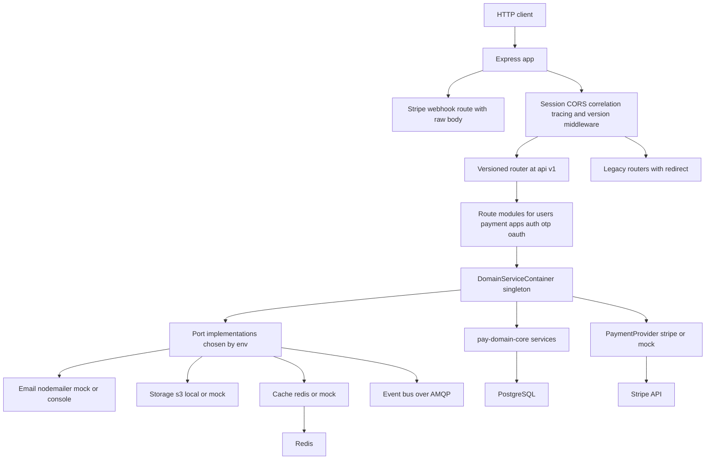

# Architecture

Pay is an Express application whose route handlers depend on a singleton container. The container builds domain services from `pay-domain-core` and infrastructure implementations ([server/services/DomainServiceContainer.ts:52-77](https://github.com/Jeffrey-Keyser/pay/blob/b20e905b08aa915debd6fa262a1f8015368cdb05/server/services/DomainServiceContainer.ts#L52-L77)).

## Entry points

- `bin/www.ts` imports tracing first, then loads the app and listens on `PORT` ([server/bin/www.ts:10-33](https://github.com/Jeffrey-Keyser/pay/blob/b20e905b08aa915debd6fa262a1f8015368cdb05/server/bin/www.ts#L10-L33)).
- `app.ts` mounts the Stripe webhook route before JSON parsing so signature checks receive the raw body ([server/app.ts:128-134](https://github.com/Jeffrey-Keyser/pay/blob/b20e905b08aa915debd6fa262a1f8015368cdb05/server/app.ts#L128-L134)).
- Swagger UI is mounted at `/api-docs` outside the test environment ([server/app.ts:155-166](https://github.com/Jeffrey-Keyser/pay/blob/b20e905b08aa915debd6fa262a1f8015368cdb05/server/app.ts#L155-L166)).

## Contracts and components

- **Container members** expose repositories, password, token, email, payment provider, and the domain services ([server/services/DomainServiceContainer.ts:70-77](https://github.com/Jeffrey-Keyser/pay/blob/b20e905b08aa915debd6fa262a1f8015368cdb05/server/services/DomainServiceContainer.ts#L70-L77)).
- **Ports and adapters** are the documented anti-corruption layer: business logic depends on port interfaces, and factories select adapters ([CLAUDE.md:239-253](https://github.com/Jeffrey-Keyser/pay/blob/b20e905b08aa915debd6fa262a1f8015368cdb05/CLAUDE.md#L239-L253)). The port and adapter source files are not in this snapshot excerpt.
- **Email, storage, and payment selection** use env schemas listing `nodemailer`, `mock`, `console`, `s3`, `local`, `mock`, and `stripe`/`mock` ([server/config/env.ts:63-73](https://github.com/Jeffrey-Keyser/pay/blob/b20e905b08aa915debd6fa262a1f8015368cdb05/server/config/env.ts#L63-L73), [server/config/env.ts:53-57](https://github.com/Jeffrey-Keyser/pay/blob/b20e905b08aa915debd6fa262a1f8015368cdb05/server/config/env.ts#L53-L57)).
- **Cache selection** via `CACHE_PROVIDER` is documented but its env schema is not in the excerpt ([CLAUDE.md:324](https://github.com/Jeffrey-Keyser/pay/blob/b20e905b08aa915debd6fa262a1f8015368cdb05/CLAUDE.md#L324)).
- **Event bus** is enabled only when `RABBITMQ_URL` is set ([server/config/env.ts:223-225](https://github.com/Jeffrey-Keyser/pay/blob/b20e905b08aa915debd6fa262a1f8015368cdb05/server/config/env.ts#L223-L225)).
- **Payment provider** is an interface with a Stripe implementation; `PAYMENT_PROVIDER` selects the default ([docs/PAYMENT_PROVIDER_ABSTRACTION.md:13-16](https://github.com/Jeffrey-Keyser/pay/blob/b20e905b08aa915debd6fa262a1f8015368cdb05/docs/PAYMENT_PROVIDER_ABSTRACTION.md#L13-L16), [server/services/DomainServiceContainer.ts:105-106](https://github.com/Jeffrey-Keyser/pay/blob/b20e905b08aa915debd6fa262a1f8015368cdb05/server/services/DomainServiceContainer.ts#L105-L106)).
- **Tokens** are issued by `TokenServiceImpl`, which checks revocation and refresh sessions on verification ([server/infrastructure/TokenService.ts:132-143](https://github.com/Jeffrey-Keyser/pay/blob/b20e905b08aa915debd6fa262a1f8015368cdb05/server/infrastructure/TokenService.ts#L132-L143)).
- **Schemas**: the migration notes name `contact` and `billing` schemas ([docs/PROVIDER_AGNOSTIC_MIGRATION.md:22-27](https://github.com/Jeffrey-Keyser/pay/blob/b20e905b08aa915debd6fa262a1f8015368cdb05/docs/PROVIDER_AGNOSTIC_MIGRATION.md#L22-L27)).

## Access control

- **App registry:** the `/apps` routes are admin-only. `server/routes/apps.ts` applies `authenticateToken` and `requireAdmin()` at router level, so routes added later inherit the guard ([server/routes/apps.ts:22-36](https://github.com/Jeffrey-Keyser/pay/blob/3691e055cf05ba49dd332e6125b4f11e7497eb09/server/routes/apps.ts#L22-L36)). The only anonymous request is `GET /apps?visibility=public`, the public catalog of active EXTERNAL apps (same source).
- **User profiles:** `GET /users/:userId` requires authentication. Users can read their own profile, and admins can read any profile ([server/routes/users/profile.ts](https://github.com/Jeffrey-Keyser/pay/blob/3691e055cf05ba49dd332e6125b4f11e7497eb09/server/routes/users/profile.ts)).
- **Payment resources:** the payment routes changed in this commit require `authenticateToken`. Customers, subscriptions, and payment intents are checked against the caller through `PaymentOwnershipService`, and a resource owned by someone else is reported as not found ([server/services/PaymentOwnershipService.ts](https://github.com/Jeffrey-Keyser/pay/blob/3691e055cf05ba49dd332e6125b4f11e7497eb09/server/services/PaymentOwnershipService.ts)).

## Module-resolution constraint

The server uses ESM, so local TypeScript imports must use `.js` extensions ([server/package.json:5](https://github.com/Jeffrey-Keyser/pay/blob/b20e905b08aa915debd6fa262a1f8015368cdb05/server/package.json#L5), [CONTRIBUTING.md:231-236](https://github.com/Jeffrey-Keyser/pay/blob/b20e905b08aa915debd6fa262a1f8015368cdb05/CONTRIBUTING.md#L231-L236)).
