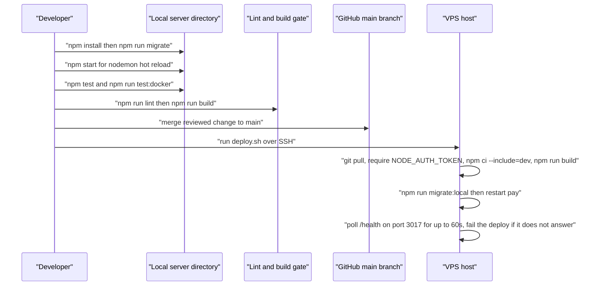

# Iteration Loop

The contributor loop runs from the `server/` directory. The scripts below are the ones defined in the snapshot.

## Steps

1. **Install and configure.** Run `npm install` in `server/`, copy `.env.example` to `.env`, and set database, Redis, JWT, and session values ([CONTRIBUTING.md:42-45](https://github.com/Jeffrey-Keyser/pay/blob/b20e905b08aa915debd6fa262a1f8015368cdb05/CONTRIBUTING.md#L42-L45), [CONTRIBUTING.md:53-73](https://github.com/Jeffrey-Keyser/pay/blob/b20e905b08aa915debd6fa262a1f8015368cdb05/CONTRIBUTING.md#L53-L73)). `server/.npmrc` reads the GitHub Packages token from `NODE_AUTH_TOKEN`, so that variable must be exported before installs that fetch scoped packages ([server/.npmrc](https://github.com/Jeffrey-Keyser/pay/blob/fa40c5038223c663f3410e91aa6fc807ad681b04/server/.npmrc)). Env files are git-ignored, while `.env.example` stays tracked ([.gitignore](https://github.com/Jeffrey-Keyser/pay/blob/fa40c5038223c663f3410e91aa6fc807ad681b04/.gitignore)).
2. **Migrate.** `npm run migrate` maps to `db-migrate up` ([server/package.json:19](https://github.com/Jeffrey-Keyser/pay/blob/b20e905b08aa915debd6fa262a1f8015368cdb05/server/package.json#L19)). The migration guide describes `node-pg-migrate`, but the package script is the source of truth ([docs/MIGRATION_SYSTEM_GUIDE.md:3](https://github.com/Jeffrey-Keyser/pay/blob/b20e905b08aa915debd6fa262a1f8015368cdb05/docs/MIGRATION_SYSTEM_GUIDE.md#L3)).
3. **Seed (optional).** `npm run seed:apps` is idempotent per the contributor guide ([server/package.json:38](https://github.com/Jeffrey-Keyser/pay/blob/b20e905b08aa915debd6fa262a1f8015368cdb05/server/package.json#L38), [CONTRIBUTING.md:118-125](https://github.com/Jeffrey-Keyser/pay/blob/b20e905b08aa915debd6fa262a1f8015368cdb05/CONTRIBUTING.md#L118-L125)).
4. **Run locally.** `npm start` runs nodemon over `ts-node ./bin/www.ts` ([server/package.json:9](https://github.com/Jeffrey-Keyser/pay/blob/b20e905b08aa915debd6fa262a1f8015368cdb05/server/package.json#L9)).
5. **Test.** `npm test` runs Jest on unit paths ([server/jest.config.cjs:6-10](https://github.com/Jeffrey-Keyser/pay/blob/b20e905b08aa915debd6fa262a1f8015368cdb05/server/jest.config.cjs#L6-L10)). `npm run test:docker` brings up `docker-compose.test.yml` and runs the test runner ([server/package.json:15](https://github.com/Jeffrey-Keyser/pay/blob/b20e905b08aa915debd6fa262a1f8015368cdb05/server/package.json#L15)). `npm run test:integration` runs Vitest against `tests/integration` ([server/package.json:14](https://github.com/Jeffrey-Keyser/pay/blob/b20e905b08aa915debd6fa262a1f8015368cdb05/server/package.json#L14)). The `/auth/me` token-type tests are in `server/tests/security/auth-me-token-types.test.ts`, which runs the real `authenticateToken` middleware ([server/tests/security/auth-me-token-types.test.ts](https://github.com/Jeffrey-Keyser/pay/blob/48044f710fc8e7bb1d335a3b3b256d916a3f5b27/server/tests/security/auth-me-token-types.test.ts)).
6. **Gate before commit.** `npm run lint` and `npm run build` are the documented checks ([CLAUDE.md:170-173](https://github.com/Jeffrey-Keyser/pay/blob/b20e905b08aa915debd6fa262a1f8015368cdb05/CLAUDE.md#L170-L173), [server/package.json:8](https://github.com/Jeffrey-Keyser/pay/blob/b20e905b08aa915debd6fa262a1f8015368cdb05/server/package.json#L8)).
7. **Deploy.** `deploy.sh` pulls `main`, then requires `NODE_AUTH_TOKEN`, either exported or loaded from `~/.pay-deploy.env`, and aborts before the install if it is missing ([deploy.sh:10-18](https://github.com/Jeffrey-Keyser/pay/blob/fa40c5038223c663f3410e91aa6fc807ad681b04/deploy.sh#L10-L18)). It then runs `npm ci --include=dev`, which installs exactly the lockfile and does not rewrite `server/package-lock.json`. `--include=dev` is kept because the build needs `tsc` and `@types` ([deploy.sh:19-22](https://github.com/Jeffrey-Keyser/pay/blob/48044f710fc8e7bb1d335a3b3b256d916a3f5b27/deploy.sh#L19-L22)). After that it builds, applies repo SQL migrations, frees port 3017, and restarts `pay` ([deploy.sh:5-36](https://github.com/Jeffrey-Keyser/pay/blob/48044f710fc8e7bb1d335a3b3b256d916a3f5b27/deploy.sh#L5-L36)). Last, it polls `http://localhost:3017/health` once every 2 seconds for up to 60 seconds. If the service answers, the script prints success and exits 0. Otherwise it prints the failure, shows the last 20 lines of `systemctl status pay`, and exits 1, so the deploy is recorded as failed ([deploy.sh:37-48](https://github.com/Jeffrey-Keyser/pay/blob/48044f710fc8e7bb1d335a3b3b256d916a3f5b27/deploy.sh#L37-L48)).

## CI status

Pipeline definitions are not in this snapshot excerpt. The README names GitHub Actions workflows only in the legacy AWS section ([README.md:187-195](https://github.com/Jeffrey-Keyser/pay/blob/b20e905b08aa915debd6fa262a1f8015368cdb05/README.md#L187-L195)), so the gate is currently manual and documented, not verified as automated.

## Schema changes

`deploy.sh` runs `migrate:local`, which executes `dist/scripts/run-local-migrations.js` ([deploy.sh:12-16](https://github.com/Jeffrey-Keyser/pay/blob/b20e905b08aa915debd6fa262a1f8015368cdb05/deploy.sh#L12-L16), [server/package.json:28](https://github.com/Jeffrey-Keyser/pay/blob/b20e905b08aa915debd6fa262a1f8015368cdb05/server/package.json#L28)). The script is not the same path as `npm run migrate`; contributors should run both when relevant.

## Adding endpoints

Add routes under `server/routes/`, document with Swagger JSDoc, and test both versioned and legacy paths ([CLAUDE.md:69-75](https://github.com/Jeffrey-Keyser/pay/blob/b20e905b08aa915debd6fa262a1f8015368cdb05/CLAUDE.md#L69-L75)).
