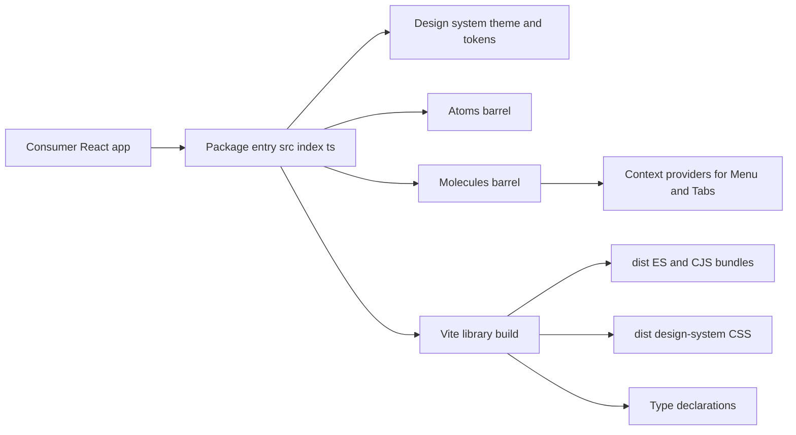

# Architecture

## Source layout

The project follows atomic design: `atoms/` holds basic building blocks, `molecules/` holds components composed of atoms, and `design-system/` holds theme and tokens ([CLAUDE.md:L9-L11](https://github.com/Jeffrey-Keyser/personal-ui-kit/blob/44280758a964365ad37e1aa195c65ec34889da00/CLAUDE.md#L9-L11)).

- The package entry exports `design-system`, `atoms`, and `molecules` ([ui-kit/src/index.ts:L2-L7](https://github.com/Jeffrey-Keyser/personal-ui-kit/blob/44280758a964365ad37e1aa195c65ec34889da00/ui-kit/src/index.ts#L2-L7)).
- The atoms barrel lists over 60 component modules ([ui-kit/src/atoms/index.ts:L1-L63](https://github.com/Jeffrey-Keyser/personal-ui-kit/blob/44280758a964365ad37e1aa195c65ec34889da00/ui-kit/src/atoms/index.ts#L1-L63)).
- The molecules barrel lists 22 modules ([ui-kit/src/molecules/index.ts:L1-L22](https://github.com/Jeffrey-Keyser/personal-ui-kit/blob/44280758a964365ad37e1aa195c65ec34889da00/ui-kit/src/molecules/index.ts#L1-L22)).

## Contracts

- **Menu** exports `LegacyMenu` and `MenuNew`; a comment says the new one is default, but the export is named `MenuNew` ([ui-kit/src/molecules/Menu/index.ts:L1-L6](https://github.com/Jeffrey-Keyser/personal-ui-kit/blob/44280758a964365ad37e1aa195c65ec34889da00/ui-kit/src/molecules/Menu/index.ts#L1-L6)). Canonical choice is unclear.
- **Menu context** throws if `useMenuContext` runs outside `MenuProvider` ([ui-kit/src/molecules/Menu/MenuContext.tsx:L33-L38](https://github.com/Jeffrey-Keyser/personal-ui-kit/blob/44280758a964365ad37e1aa195c65ec34889da00/ui-kit/src/molecules/Menu/MenuContext.tsx#L33-L38)).
- **Tabs context** follows the same pattern ([ui-kit/src/molecules/Tabs/TabsContext.tsx:L35-L40](https://github.com/Jeffrey-Keyser/personal-ui-kit/blob/44280758a964365ad37e1aa195c65ec34889da00/ui-kit/src/molecules/Tabs/TabsContext.tsx#L35-L40)).
- **Peer dependencies** are react, react-dom, react-i18next, i18next, and styled-components ([ui-kit/package.json:L51-L57](https://github.com/Jeffrey-Keyser/personal-ui-kit/blob/44280758a964365ad37e1aa195c65ec34889da00/ui-kit/package.json#L51-L57)).

## Build outputs

- Vite builds `src/index.ts` as a library and externalizes peer dependencies ([ui-kit/vite.config.ts:L35-L42](https://github.com/Jeffrey-Keyser/personal-ui-kit/blob/44280758a964365ad37e1aa195c65ec34889da00/ui-kit/vite.config.ts#L35-L42)).
- Font and token CSS are copied into `dist/design-system` ([ui-kit/vite.config.ts:L21-L32](https://github.com/Jeffrey-Keyser/personal-ui-kit/blob/44280758a964365ad37e1aa195c65ec34889da00/ui-kit/vite.config.ts#L21-L32)) and exposed through package exports ([ui-kit/package.json:L18-L19](https://github.com/Jeffrey-Keyser/personal-ui-kit/blob/44280758a964365ad37e1aa195c65ec34889da00/ui-kit/package.json#L18-L19)).
- Type declarations come from `vite-plugin-dts` ([ui-kit/vite.config.ts:L16-L20](https://github.com/Jeffrey-Keyser/personal-ui-kit/blob/44280758a964365ad37e1aa195c65ec34889da00/ui-kit/vite.config.ts#L16-L20)).

Note: the CLAUDE.md file mentions UMD output ([CLAUDE.md:L19](https://github.com/Jeffrey-Keyser/personal-ui-kit/blob/44280758a964365ad37e1aa195c65ec34889da00/CLAUDE.md#L19)), but the current build config lists only `es` and `cjs` ([ui-kit/vite.config.ts:L39](https://github.com/Jeffrey-Keyser/personal-ui-kit/blob/44280758a964365ad37e1aa195c65ec34889da00/ui-kit/vite.config.ts#L39)). The current config wins.
