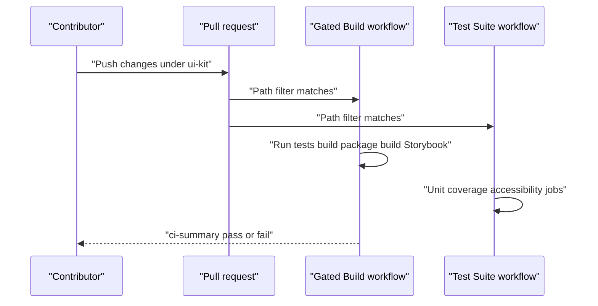

# Iteration Loop

## Local workflow

All commands run from the `ui-kit/` directory ([CLAUDE.md:L25](https://github.com/Jeffrey-Keyser/personal-ui-kit/blob/44280758a964365ad37e1aa195c65ec34889da00/CLAUDE.md#L25)).

- `npm run dev` starts Vite ([ui-kit/package.json:L39](https://github.com/Jeffrey-Keyser/personal-ui-kit/blob/44280758a964365ad37e1aa195c65ec34889da00/ui-kit/package.json#L39)).
- `npm run storybook` starts Storybook on port 6006 ([ui-kit/package.json:L45](https://github.com/Jeffrey-Keyser/personal-ui-kit/blob/44280758a964365ad37e1aa195c65ec34889da00/ui-kit/package.json#L45)).
- `npm test` runs `vitest run` ([ui-kit/package.json:L42](https://github.com/Jeffrey-Keyser/personal-ui-kit/blob/44280758a964365ad37e1aa195c65ec34889da00/ui-kit/package.json#L42)). Tests use jsdom and match `src/**/*.test.{ts,tsx}` ([ui-kit/vite.config.ts:L56-L58](https://github.com/Jeffrey-Keyser/personal-ui-kit/blob/44280758a964365ad37e1aa195c65ec34889da00/ui-kit/vite.config.ts#L56-L58)).
- `npm run build` runs the library build ([ui-kit/package.json:L40](https://github.com/Jeffrey-Keyser/personal-ui-kit/blob/44280758a964365ad37e1aa195c65ec34889da00/ui-kit/package.json#L40)).

## Adding a component

Each component should include an implementation, Storybook stories, React Testing Library tests, a README, and barrel exports ([CLAUDE.md:L49-L55](https://github.com/Jeffrey-Keyser/personal-ui-kit/blob/44280758a964365ad37e1aa195c65ec34889da00/CLAUDE.md#L49-L55)). Atoms are registered in the atoms barrel ([ui-kit/src/atoms/index.ts:L1-L63](https://github.com/Jeffrey-Keyser/personal-ui-kit/blob/44280758a964365ad37e1aa195c65ec34889da00/ui-kit/src/atoms/index.ts#L1-L63)).

## CI loop

- The Gated Build workflow runs tests, a package build, and a Storybook build on matching paths ([.github/workflows/ci.yml:L5-L14](https://github.com/Jeffrey-Keyser/personal-ui-kit/blob/44280758a964365ad37e1aa195c65ec34889da00/.github/workflows/ci.yml#L5-L14)). Its summary job fails if any required job fails ([.github/workflows/ci.yml:L153-L179](https://github.com/Jeffrey-Keyser/personal-ui-kit/blob/44280758a964365ad37e1aa195c65ec34889da00/.github/workflows/ci.yml#L153-L179)).
- The Test Suite runs unit tests on Node 18, 20, and 22 ([.github/workflows/test.yml:L38-L40](https://github.com/Jeffrey-Keyser/personal-ui-kit/blob/44280758a964365ad37e1aa195c65ec34889da00/.github/workflows/test.yml#L38-L40)).
- The accessibility job only warns when no jest-axe matcher is found; it does not fail ([.github/workflows/test.yml:L159-L167](https://github.com/Jeffrey-Keyser/personal-ui-kit/blob/44280758a964365ad37e1aa195c65ec34889da00/.github/workflows/test.yml#L159-L167)).
