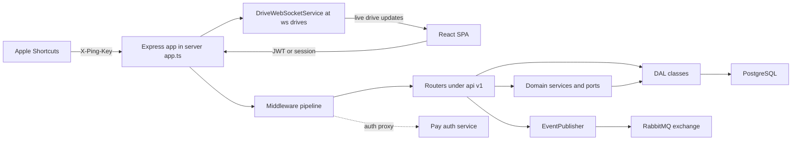

# Architecture

Ping has two runtime parts: an Express API in `server/` and a Vite-built React single-page app in `client/` ([README.md:L34-L35](https://github.com/Jeffrey-Keyser/ping/blob/86038591cb036f4b90ee00318760515952cc0ab2/README.md#L34-L35)). The diagram shows components that the excerpts confirm. Production wiring beyond these excerpts is not shown.

## Components

- **Entry points.** `server/app.ts` builds a `ServerConfig` and calls `createServerlessAppSync` ([server/app.ts:L1-L5](https://github.com/Jeffrey-Keyser/ping/blob/86038591cb036f4b90ee00318760515952cc0ab2/server/app.ts#L1-L5), [server/app.ts:L319](https://github.com/Jeffrey-Keyser/ping/blob/86038591cb036f4b90ee00318760515952cc0ab2/server/app.ts#L319)). `server/bin/www.ts` listens on `config.PORT` and attaches the drive WebSocket and cron subscriber ([server/bin/www.ts:L23](https://github.com/Jeffrey-Keyser/ping/blob/86038591cb036f4b90ee00318760515952cc0ab2/server/bin/www.ts#L23), [server/bin/www.ts:L27-L34](https://github.com/Jeffrey-Keyser/ping/blob/86038591cb036f4b90ee00318760515952cc0ab2/server/bin/www.ts#L27-L34)). The same file also starts `arrivalDwellWorker` ([server/bin/www.ts](https://github.com/Jeffrey-Keyser/ping/blob/c7a003f89bb14a959bb433f8aa02a61ac81775ed/server/bin/www.ts)).
- **Routers.** The root router serves `/` and `/ping` ([server/routes/index.ts:L6-L16](https://github.com/Jeffrey-Keyser/ping/blob/86038591cb036f4b90ee00318760515952cc0ab2/server/routes/index.ts#L6-L16)). The v1 router mounts feature routers, including location pings, drives, and Bluetooth events ([server/routes/versions/v1/index.ts:L108](https://github.com/Jeffrey-Keyser/ping/blob/86038591cb036f4b90ee00318760515952cc0ab2/server/routes/versions/v1/index.ts#L108), [server/routes/versions/v1/index.ts:L207](https://github.com/Jeffrey-Keyser/ping/blob/86038591cb036f4b90ee00318760515952cc0ab2/server/routes/versions/v1/index.ts#L207), [server/routes/versions/v1/index.ts:L220](https://github.com/Jeffrey-Keyser/ping/blob/86038591cb036f4b90ee00318760515952cc0ab2/server/routes/versions/v1/index.ts#L220)).
- **Auth.** `setupPayAuth` supplies auth middleware and `/auth` routes ([server/app.ts:L70](https://github.com/Jeffrey-Keyser/ping/blob/86038591cb036f4b90ee00318760515952cc0ab2/server/app.ts#L70), [server/app.ts:L252](https://github.com/Jeffrey-Keyser/ping/blob/86038591cb036f4b90ee00318760515952cc0ab2/server/app.ts#L252)). Shortcut-facing routes such as location pings and health sync are public to Pay auth but check `X-Ping-Key` ([server/app.ts:L100-L104](https://github.com/Jeffrey-Keyser/ping/blob/86038591cb036f4b90ee00318760515952cc0ab2/server/app.ts#L100-L104)).
- **User resolution guard.** `resolveUserData` in `server/middleware/auth.ts` wraps the library's user-resolution middleware. A Pay principal whose id is not a UUID, such as the system admin token with id `admin-system`, cannot map to a Ping user. Per the merged PR description, passing that id to `ping.get_or_create_user($1::uuid)` failed with Postgres 22P02 and returned 500. The guard returns 401 with `success: false` on user-scoped `/api` routes. On public routes and `/auth/*` it skips resolution and calls `next()` ([server/middleware/auth.ts:L61-L88](https://github.com/Jeffrey-Keyser/ping/blob/4251764f43dc5cf7c361dc50848d3035afaab269/server/middleware/auth.ts#L61-L88); test coverage in [server/tests/__tests__/unit/middleware/resolveUserData.test.ts](https://github.com/Jeffrey-Keyser/ping/blob/4251764f43dc5cf7c361dc50848d3035afaab269/server/tests/__tests__/unit/middleware/resolveUserData.test.ts)).
- **Sessions.** `express-session` uses a database store in the `ping` schema with a 24-hour TTL ([server/app.ts:L178-L188](https://github.com/Jeffrey-Keyser/ping/blob/86038591cb036f4b90ee00318760515952cc0ab2/server/app.ts#L178-L188)).
- **Domain.** Ports declare repository and publisher contracts such as `PingRepository` and `DriveEventPublisher` ([server/domain/ports/index.ts:L17](https://github.com/Jeffrey-Keyser/ping/blob/86038591cb036f4b90ee00318760515952cc0ab2/server/domain/ports/index.ts#L17), [server/domain/ports/index.ts:L95-L97](https://github.com/Jeffrey-Keyser/ping/blob/86038591cb036f4b90ee00318760515952cc0ab2/server/domain/ports/index.ts#L95-L97)). `ZoneResolutionService` matches coordinates to zones by haversine distance ([server/domain/services/ZoneResolutionService.ts:L9](https://github.com/Jeffrey-Keyser/ping/blob/86038591cb036f4b90ee00318760515952cc0ab2/server/domain/services/ZoneResolutionService.ts#L9)). When a location request names a `zoneId`, `PingService` uses that zone instead of coordinate matching ([server/domain/services/PingService.ts](https://github.com/Jeffrey-Keyser/ping/blob/c7a003f89bb14a959bb433f8aa02a61ac81775ed/server/domain/services/PingService.ts)).
- **Minimum stay.** `DurablePingService` delegates arrival handling to `ArrivalDwellService`, which stores pending arrivals and creates a visit only after the zone's `dwellMinutes` has elapsed ([server/services/ArrivalDwellService.ts](https://github.com/Jeffrey-Keyser/ping/blob/c7a003f89bb14a959bb433f8aa02a61ac81775ed/server/services/ArrivalDwellService.ts), [server/services/DurablePingService.ts](https://github.com/Jeffrey-Keyser/ping/blob/c7a003f89bb14a959bb433f8aa02a61ac81775ed/server/services/DurablePingService.ts), [server/services/container.ts](https://github.com/Jeffrey-Keyser/ping/blob/c7a003f89bb14a959bb433f8aa02a61ac81775ed/server/services/container.ts)). `ArrivalDwellWorker` re-checks pending deadlines every 15 seconds ([server/services/ArrivalDwellWorker.ts](https://github.com/Jeffrey-Keyser/ping/blob/c7a003f89bb14a959bb433f8aa02a61ac81775ed/server/services/ArrivalDwellWorker.ts)).
- **Data access.** DAL classes are static, require `userId` on each call, and use raw SQL ([server/dal/DriveDal.ts:L37-L40](https://github.com/Jeffrey-Keyser/ping/blob/86038591cb036f4b90ee00318760515952cc0ab2/server/dal/DriveDal.ts#L37-L40)). `VisitDal.create` depends on a partial unique index and returns `null` when another arrival wins ([server/dal/VisitDal.ts:L49-L58](https://github.com/Jeffrey-Keyser/ping/blob/86038591cb036f4b90ee00318760515952cc0ab2/server/dal/VisitDal.ts#L49-L58)). Zone reads and writes include `dwell_minutes` ([server/dal/ZoneDal.ts](https://github.com/Jeffrey-Keyser/ping/blob/c7a003f89bb14a959bb433f8aa02a61ac81775ed/server/dal/ZoneDal.ts)). Migration 027 adds that column and the `pending_arrivals` and `location_dwell_state` tables ([server/db/schema/027-visit-dwell.sql](https://github.com/Jeffrey-Keyser/ping/blob/c7a003f89bb14a959bb433f8aa02a61ac81775ed/server/db/schema/027-visit-dwell.sql)).
- **Events.** `EventPublisher` connects to `RABBITMQ_URL` and publishes to the `PingExchange` ([server/services/EventPublisher.ts:L64](https://github.com/Jeffrey-Keyser/ping/blob/86038591cb036f4b90ee00318760515952cc0ab2/server/services/EventPublisher.ts#L64), [server/services/EventPublisher.ts:L118-L121](https://github.com/Jeffrey-Keyser/ping/blob/86038591cb036f4b90ee00318760515952cc0ab2/server/services/EventPublisher.ts#L118-L121)). Publish failures are logged, not rethrown ([server/services/EventPublisher.ts:L130-L131](https://github.com/Jeffrey-Keyser/ping/blob/86038591cb036f4b90ee00318760515952cc0ab2/server/services/EventPublisher.ts#L130-L131)). Arrival and departure events for dwell-confirmed visits are published by `ArrivalDwellService` ([server/services/ArrivalDwellService.ts](https://github.com/Jeffrey-Keyser/ping/blob/c7a003f89bb14a959bb433f8aa02a61ac81775ed/server/services/ArrivalDwellService.ts)).
- **Live drives.** `DriveWebSocketService` handles upgrades on `/ws/drives` and checks the API key before upgrading ([server/services/DriveWebSocketService.ts:L119](https://github.com/Jeffrey-Keyser/ping/blob/86038591cb036f4b90ee00318760515952cc0ab2/server/services/DriveWebSocketService.ts#L119), [server/services/DriveWebSocketService.ts:L131-L136](https://github.com/Jeffrey-Keyser/ping/blob/86038591cb036f4b90ee00318760515952cc0ab2/server/services/DriveWebSocketService.ts#L131-L136)). Each accepted socket carries the authenticated numeric Ping account id. Waypoint, drive-started, and drive-ended broadcasts go only to that owner's sockets, and a missing or invalid owner id sends no record payload. The legacy `PING_API_KEY` path resolves its account through `PING_API_KEY_USER_UUID` and `UserResolutionService`. Route callers pass the authenticated user id into the broadcast methods ([server/services/DriveWebSocketService.ts](https://github.com/Jeffrey-Keyser/ping/blob/ff477c4c1817b0fa549e82be4b32b5c8f2f83159/server/services/DriveWebSocketService.ts), [server/routes/drives.ts](https://github.com/Jeffrey-Keyser/ping/blob/ff477c4c1817b0fa549e82be4b32b5c8f2f83159/server/routes/drives.ts), [server/routes/bluetooth.ts](https://github.com/Jeffrey-Keyser/ping/blob/ff477c4c1817b0fa549e82be4b32b5c8f2f83159/server/routes/bluetooth.ts)).
- **Telemetry.** `sendTelemetryEvent` posts fire-and-forget events to `ANALYTICS_PULSE_URL` ([server/services/telemetry.ts:L11-L22](https://github.com/Jeffrey-Keyser/ping/blob/86038591cb036f4b90ee00318760515952cc0ab2/server/services/telemetry.ts#L11-L22)).
- **Operational scripts.** `scripts/seed-grocery-zones.ts` loads `server/.env`, opens its own pool, and delegates to `server/scripts/groceryZoneProvisioning.ts` ([scripts/seed-grocery-zones.ts:L36](https://github.com/Jeffrey-Keyser/ping/blob/86038591cb036f4b90ee00318760515952cc0ab2/scripts/seed-grocery-zones.ts#L36), [scripts/seed-grocery-zones.ts:L49](https://github.com/Jeffrey-Keyser/ping/blob/86038591cb036f4b90ee00318760515952cc0ab2/scripts/seed-grocery-zones.ts#L49)).
- **Client.** Containers are exported from `client/src/containers/index.ts` ([client/src/containers/index.ts:L1-L15](https://github.com/Jeffrey-Keyser/ping/blob/86038591cb036f4b90ee00318760515952cc0ab2/client/src/containers/index.ts#L1-L15)). The zone setup page includes a Minimum stay form that saves `dwellMinutes` through `updateZone` ([client/src/containers/ZoneSetup/components/ZoneCard.tsx](https://github.com/Jeffrey-Keyser/ping/blob/c7a003f89bb14a959bb433f8aa02a61ac81775ed/client/src/containers/ZoneSetup/components/ZoneCard.tsx)).
- **Lambda fallback.** `server/lambda.ts` re-exports the handler ([server/lambda.ts:L1](https://github.com/Jeffrey-Keyser/ping/blob/86038591cb036f4b90ee00318760515952cc0ab2/server/lambda.ts#L1)). The README describes the Terraform stack as unused and kept for fallback ([README.md:L139](https://github.com/Jeffrey-Keyser/ping/blob/86038591cb036f4b90ee00318760515952cc0ab2/README.md#L139)).

## Contracts

- Mobile clients receive a `success` plus `data` envelope, and errors use `success: false` ([docs/MOBILE_INTEGRATION.md:L21-L37](https://github.com/Jeffrey-Keyser/ping/blob/86038591cb036f4b90ee00318760515952cc0ab2/docs/MOBILE_INTEGRATION.md#L21-L37)).
- Location submissions accept an optional `X-Idempotency-Key` for safe retransmission ([docs/MOBILE_INTEGRATION.md:L78](https://github.com/Jeffrey-Keyser/ping/blob/86038591cb036f4b90ee00318760515952cc0ab2/docs/MOBILE_INTEGRATION.md#L78)).
- Location submissions also accept optional `zoneId` (a UUID owned by the caller) and `capturedAt` (an ISO timestamp with timezone, at most one minute in the future). A new arrival returns `visit: null` with `pendingArrival` until the zone's `dwellMinutes` (default 5) has elapsed. A departure before the deadline marks the candidate `passing_through` ([server/routes/location-pings.ts](https://github.com/Jeffrey-Keyser/ping/blob/c7a003f89bb14a959bb433f8aa02a61ac81775ed/server/routes/location-pings.ts), [server/services/ArrivalDwellService.ts](https://github.com/Jeffrey-Keyser/ping/blob/c7a003f89bb14a959bb433f8aa02a61ac81775ed/server/services/ArrivalDwellService.ts), [docs/MOBILE_INTEGRATION.md](https://github.com/Jeffrey-Keyser/ping/blob/c7a003f89bb14a959bb433f8aa02a61ac81775ed/docs/MOBILE_INTEGRATION.md)).
- Zone create and update requests accept `dwellMinutes`, a whole number from 0 to 1440. Zero confirms arrivals immediately ([server/routes/zones.ts](https://github.com/Jeffrey-Keyser/ping/blob/c7a003f89bb14a959bb433f8aa02a61ac81775ed/server/routes/zones.ts)).
- Drive start and end requests (`/drives/start` and `/drives/end` under the v1 API) parse `lat` and `lng` with `Coordinates.parseCoordinate` before `Coordinates.create`. Numeric strings from Shortcuts are therefore accepted, matching location pings. Missing, non-numeric, or out-of-range values return `400` with `success: false` and a message such as `lat is required` or `lng must be between -180 and 180` ([server/routes/drives.ts](https://github.com/Jeffrey-Keyser/ping/blob/258fed1951c81034cf66cdc8db0e668583a83d79/server/routes/drives.ts), [server/tests/__tests__/unit/routes/drive-socket-ownership.test.ts](https://github.com/Jeffrey-Keyser/ping/blob/258fed1951c81034cf66cdc8db0e668583a83d79/server/tests/__tests__/unit/routes/drive-socket-ownership.test.ts)).
- Event shapes and routing keys come from `@jeffrey-keyser/message-contracts` ([server/services/EventPublisher.ts:L2](https://github.com/Jeffrey-Keyser/ping/blob/86038591cb036f4b90ee00318760515952cc0ab2/server/services/EventPublisher.ts#L2)).
- A Pay principal with a non-UUID id receives `401` with `error: "Unauthorized"` and the message `Token is not associated with a Ping user` on user-scoped `/api` routes ([server/middleware/auth.ts:L61-L88](https://github.com/Jeffrey-Keyser/ping/blob/4251764f43dc5cf7c361dc50848d3035afaab269/server/middleware/auth.ts#L61-L88)).
- Drive WebSocket messages are scoped to the authenticated owner account. Clients that cannot be identified receive no waypoint or drive lifecycle payload ([server/services/DriveWebSocketService.ts](https://github.com/Jeffrey-Keyser/ping/blob/ff477c4c1817b0fa549e82be4b32b5c8f2f83159/server/services/DriveWebSocketService.ts)).
