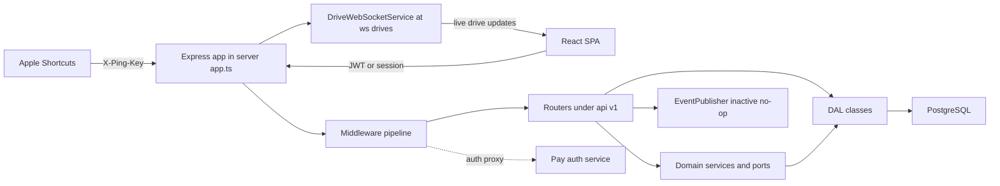

# Architecture

Ping has two runtime parts: an Express API in `server/` and a Vite-built React single-page app in `client/` ([README.md:L34-L35](https://github.com/Jeffrey-Keyser/ping/blob/86038591cb036f4b90ee00318760515952cc0ab2/README.md#L34-L35)). The diagram shows components that the excerpts confirm. Production wiring beyond these excerpts is not shown.

## Components

- **Entry points.** `server/app.ts` builds a `ServerConfig` and calls `createServerlessAppSync` ([server/app.ts:L1-L5](https://github.com/Jeffrey-Keyser/ping/blob/86038591cb036f4b90ee00318760515952cc0ab2/server/app.ts#L1-L5), [server/app.ts:L319](https://github.com/Jeffrey-Keyser/ping/blob/86038591cb036f4b90ee00318760515952cc0ab2/server/app.ts#L319)). `server/bin/www.ts` listens on `config.PORT` and attaches the drive WebSocket and cron subscriber ([server/bin/www.ts:L23](https://github.com/Jeffrey-Keyser/ping/blob/86038591cb036f4b90ee00318760515952cc0ab2/server/bin/www.ts#L23), [server/bin/www.ts:L27-L34](https://github.com/Jeffrey-Keyser/ping/blob/86038591cb036f4b90ee00318760515952cc0ab2/server/bin/www.ts#L27-L34)). The same file also starts `arrivalDwellWorker` ([server/bin/www.ts](https://github.com/Jeffrey-Keyser/ping/blob/c7a003f89bb14a959bb433f8aa02a61ac81775ed/server/bin/www.ts)). It starts `captureAttentionWorker` only when `captureAttentionAlertsAvailable` is true. Otherwise it logs that VAPID keys are not configured and capture-attention alerts are unavailable ([server/bin/www.ts](https://github.com/Jeffrey-Keyser/ping/blob/bb7fa57f78b9894f98f4a93fd7b2f50a6974b1c1/server/bin/www.ts)).
- **Routers.** The root router serves `/` and `/ping` ([server/routes/index.ts:L6-L16](https://github.com/Jeffrey-Keyser/ping/blob/86038591cb036f4b90ee00318760515952cc0ab2/server/routes/index.ts#L6-L16)). The v1 router mounts feature routers, including location pings, drives, and Bluetooth events ([server/routes/versions/v1/index.ts:L108](https://github.com/Jeffrey-Keyser/ping/blob/86038591cb036f4b90ee00318760515952cc0ab2/server/routes/versions/v1/index.ts#L108), [server/routes/versions/v1/index.ts:L207](https://github.com/Jeffrey-Keyser/ping/blob/86038591cb036f4b90ee00318760515952cc0ab2/server/routes/versions/v1/index.ts#L207), [server/routes/versions/v1/index.ts:L220](https://github.com/Jeffrey-Keyser/ping/blob/86038591cb036f4b90ee00318760515952cc0ab2/server/routes/versions/v1/index.ts#L220)). It also mounts `/push-subscriptions` and lists it in the v1 endpoint index ([server/routes/versions/v1/index.ts](https://github.com/Jeffrey-Keyser/ping/blob/bb7fa57f78b9894f98f4a93fd7b2f50a6974b1c1/server/routes/versions/v1/index.ts)).
- **Auth.** `setupPayAuth` supplies auth middleware and `/auth` routes ([server/app.ts:L70](https://github.com/Jeffrey-Keyser/ping/blob/86038591cb036f4b90ee00318760515952cc0ab2/server/app.ts#L70), [server/app.ts:L252](https://github.com/Jeffrey-Keyser/ping/blob/86038591cb036f4b90ee00318760515952cc0ab2/server/app.ts#L252)). Shortcut-facing routes such as location pings and health sync are public to Pay auth but check `X-Ping-Key` ([server/app.ts:L100-L104](https://github.com/Jeffrey-Keyser/ping/blob/86038591cb036f4b90ee00318760515952cc0ab2/server/app.ts#L100-L104)).
- **User resolution guard.** `resolveUserData` in `server/middleware/auth.ts` wraps the library's user-resolution middleware. A Pay principal whose id is not a UUID, such as the system admin token with id `admin-system`, cannot map to a Ping user. Per the merged PR description, passing that id to `ping.get_or_create_user($1::uuid)` failed with Postgres 22P02 and returned 500. The guard returns 401 with `success: false` on user-scoped `/api` routes. On public routes and `/auth/*` it skips resolution and calls `next()` ([server/middleware/auth.ts:L61-L88](https://github.com/Jeffrey-Keyser/ping/blob/4251764f43dc5cf7c361dc50848d3035afaab269/server/middleware/auth.ts#L61-L88); test coverage in [server/tests/__tests__/unit/middleware/resolveUserData.test.ts](https://github.com/Jeffrey-Keyser/ping/blob/4251764f43dc5cf7c361dc50848d3035afaab269/server/tests/__tests__/unit/middleware/resolveUserData.test.ts)).
- **Sessions.** `express-session` uses a database store in the `ping` schema with a 24-hour TTL ([server/app.ts:L178-L188](https://github.com/Jeffrey-Keyser/ping/blob/86038591cb036f4b90ee00318760515952cc0ab2/server/app.ts#L178-L188)).
- **Domain.** Ports declare repository and publisher contracts such as `PingRepository` and `DriveEventPublisher` ([server/domain/ports/index.ts:L17](https://github.com/Jeffrey-Keyser/ping/blob/86038591cb036f4b90ee00318760515952cc0ab2/server/domain/ports/index.ts#L17), [server/domain/ports/index.ts:L95-L97](https://github.com/Jeffrey-Keyser/ping/blob/86038591cb036f4b90ee00318760515952cc0ab2/server/domain/ports/index.ts#L95-L97)). `ZoneResolutionService` matches coordinates to zones by haversine distance ([server/domain/services/ZoneResolutionService.ts:L9](https://github.com/Jeffrey-Keyser/ping/blob/86038591cb036f4b90ee00318760515952cc0ab2/server/domain/services/ZoneResolutionService.ts#L9)). When a location request names a `zoneId`, `PingService` uses that zone instead of coordinate matching ([server/domain/services/PingService.ts](https://github.com/Jeffrey-Keyser/ping/blob/c7a003f89bb14a959bb433f8aa02a61ac81775ed/server/domain/services/PingService.ts)).
- **Minimum stay.** `DurablePingService` delegates arrival handling to `ArrivalDwellService`, which stores pending arrivals and creates a visit only after the zone's `dwellMinutes` has elapsed ([server/services/ArrivalDwellService.ts](https://github.com/Jeffrey-Keyser/ping/blob/c7a003f89bb14a959bb433f8aa02a61ac81775ed/server/services/ArrivalDwellService.ts), [server/services/DurablePingService.ts](https://github.com/Jeffrey-Keyser/ping/blob/c7a003f89bb14a959bb433f8aa02a61ac81775ed/server/services/DurablePingService.ts), [server/services/container.ts](https://github.com/Jeffrey-Keyser/ping/blob/c7a003f89bb14a959bb433f8aa02a61ac81775ed/server/services/container.ts)). `ArrivalDwellWorker` re-checks pending deadlines every 15 seconds ([server/services/ArrivalDwellWorker.ts](https://github.com/Jeffrey-Keyser/ping/blob/c7a003f89bb14a959bb433f8aa02a61ac81775ed/server/services/ArrivalDwellWorker.ts)).
- **Collection alerts (capture attention).** The container sets `captureAttentionAlertsAvailable` to true only when both `VAPID_PUBLIC_KEY` and `VAPID_PRIVATE_KEY` are configured. It builds a `CaptureAttentionWorker` around a `CaptureAttentionNotifier` that uses `CaptureHealthDal`, `PushSubscriptionDal`, `CaptureAttentionAlertDal`, and a `web-push` sender whose VAPID subject is `VAPID_SUBJECT` or, if unset, `ORIGIN_BASE_URL` ([server/services/container.ts](https://github.com/Jeffrey-Keyser/ping/blob/bb7fa57f78b9894f98f4a93fd7b2f50a6974b1c1/server/services/container.ts), [server/config/env.ts](https://github.com/Jeffrey-Keyser/ping/blob/bb7fa57f78b9894f98f4a93fd7b2f50a6974b1c1/server/config/env.ts)). The worker runs a check on start and then every 30 minutes. It skips a tick while one is still running and logs failures for retry ([server/services/CaptureAttentionWorker.ts](https://github.com/Jeffrey-Keyser/ping/blob/bb7fa57f78b9894f98f4a93fd7b2f50a6974b1c1/server/services/CaptureAttentionWorker.ts)). For each user with a push subscription, the notifier computes status with the existing `buildCaptureHealth` policy. It notifies only for automatic sources in `needs_attention` that have a `lastReceivedAt`. An episode is identified by user, source key, and `lastReceivedAt`. `CaptureAttentionAlertDal.recordEpisode` inserts it with `ON CONFLICT DO NOTHING`, so each episode is notified at most once, including across restarts. A push service response of 404 or 410 removes that subscription. If no send succeeds, `forgetEpisode` deletes the episode so the next check retries it. A failure for one user is logged, and the check continues with the other users ([server/services/CaptureAttentionNotifier.ts](https://github.com/Jeffrey-Keyser/ping/blob/bb7fa57f78b9894f98f4a93fd7b2f50a6974b1c1/server/services/CaptureAttentionNotifier.ts), [server/dal/CaptureAttentionAlertDal.ts](https://github.com/Jeffrey-Keyser/ping/blob/bb7fa57f78b9894f98f4a93fd7b2f50a6974b1c1/server/dal/CaptureAttentionAlertDal.ts)).
- **Data access.** DAL classes are static, require `userId` on each call, and use raw SQL ([server/dal/DriveDal.ts:L37-L40](https://github.com/Jeffrey-Keyser/ping/blob/86038591cb036f4b90ee00318760515952cc0ab2/server/dal/DriveDal.ts#L37-L40)). `VisitDal.create` depends on a partial unique index and returns `null` when another arrival wins ([server/dal/VisitDal.ts:L49-L58](https://github.com/Jeffrey-Keyser/ping/blob/86038591cb036f4b90ee00318760515952cc0ab2/server/dal/VisitDal.ts#L49-L58)). `VisitDal.findVisitCovering(userId, at)` returns the user's visit covering a moment: a closed visit with `started_at <= at <= ended_at`, or the active visit with `started_at <= at`, latest start first. A record that is not active and has no `ended_at` never matches ([server/dal/VisitDal.ts](https://github.com/Jeffrey-Keyser/ping/blob/e536c1512e89ea4183b29206a7115894f80fc3c3/server/dal/VisitDal.ts)). Expense reads in `ExpenseDal` left-join `ping.zones` on `zone_id` and the same `user_id` to return `placeName` ([server/dal/ExpenseDal.ts](https://github.com/Jeffrey-Keyser/ping/blob/e536c1512e89ea4183b29206a7115894f80fc3c3/server/dal/ExpenseDal.ts)). Zone reads and writes include `dwell_minutes` ([server/dal/ZoneDal.ts](https://github.com/Jeffrey-Keyser/ping/blob/c7a003f89bb14a959bb433f8aa02a61ac81775ed/server/dal/ZoneDal.ts)). Migration 027 adds that column and the `pending_arrivals` and `location_dwell_state` tables ([server/db/schema/027-visit-dwell.sql](https://github.com/Jeffrey-Keyser/ping/blob/c7a003f89bb14a959bb433f8aa02a61ac81775ed/server/db/schema/027-visit-dwell.sql)). Migration 028 adds `ping.push_subscriptions`, which has a unique `endpoint`, and `ping.capture_attention_alerts`, which is keyed by `(user_id, source_key, episode_last_received_at)` ([server/db/schema/028-capture-attention-push.sql](https://github.com/Jeffrey-Keyser/ping/blob/bb7fa57f78b9894f98f4a93fd7b2f50a6974b1c1/server/db/schema/028-capture-attention-push.sql)). `PushSubscriptionDal.upsertSubscription` upserts on `endpoint`, so a re-registered endpoint is reassigned to the latest user ([server/dal/PushSubscriptionDal.ts](https://github.com/Jeffrey-Keyser/ping/blob/bb7fa57f78b9894f98f4a93fd7b2f50a6974b1c1/server/dal/PushSubscriptionDal.ts)). `PushSubscriptionDal.removeAllByUser(userId)` deletes every `ping.push_subscriptions` row for that user and returns the number of rows removed ([server/dal/PushSubscriptionDal.ts](https://github.com/Jeffrey-Keyser/ping/blob/12a682396d61b07e8518b4c79fe446ff3f04d655/server/dal/PushSubscriptionDal.ts)).
- **Events.** `EventPublisher` keeps its callable interface, but every publishing method now resolves without connecting to RabbitMQ, asserting an exchange, or publishing a message. `isConnected` always reports `disconnected`, and `close` is safe to repeat. Suppressed personal payloads are not logged ([server/services/EventPublisher.ts](https://github.com/Jeffrey-Keyser/ping/blob/03ee2f4b952bdcf9d5397284b5751a50c8d5513c/server/services/EventPublisher.ts), [docs/designs/routine-event-channel-inactive.md](https://github.com/Jeffrey-Keyser/ping/blob/03ee2f4b952bdcf9d5397284b5751a50c8d5513c/docs/designs/routine-event-channel-inactive.md)). The production container supplies one shared inactive adapter to `DriveService` and `DurablePingService` ([docs/designs/routine-event-channel-inactive.md](https://github.com/Jeffrey-Keyser/ping/blob/03ee2f4b952bdcf9d5397284b5751a50c8d5513c/docs/designs/routine-event-channel-inactive.md)). Arrival and departure events for dwell-confirmed visits were published by `ArrivalDwellService` before this change ([server/services/ArrivalDwellService.ts](https://github.com/Jeffrey-Keyser/ping/blob/c7a003f89bb14a959bb433f8aa02a61ac81775ed/server/services/ArrivalDwellService.ts)). Automatic weekly personal digest delivery is now disabled. `DigestService.generateAndDeliver` resolves without querying personal statistics, formatting a digest, connecting to the broker, asserting an exchange, or publishing. `CronSubscriber` acknowledges matching `ping-weekly-digest` triggers and logs that delivery is disabled. `DigestService.getStatus` reports `deliveryState: 'disabled'` with unset timestamp and result fields ([server/services/DigestService.ts](https://github.com/Jeffrey-Keyser/ping/blob/b9a0295b7e1bc91b8abbcf11d527b8fb58aab10a/server/services/DigestService.ts), [server/services/CronSubscriber.ts](https://github.com/Jeffrey-Keyser/ping/blob/b9a0295b7e1bc91b8abbcf11d527b8fb58aab10a/server/services/CronSubscriber.ts), [server/routes/diagnostics.ts](https://github.com/Jeffrey-Keyser/ping/blob/b9a0295b7e1bc91b8abbcf11d527b8fb58aab10a/server/routes/diagnostics.ts)).
- **Live drives.** `DriveWebSocketService` handles upgrades on `/ws/drives` and checks the API key before upgrading ([server/services/DriveWebSocketService.ts:L119](https://github.com/Jeffrey-Keyser/ping/blob/86038591cb036f4b90ee00318760515952cc0ab2/server/services/DriveWebSocketService.ts#L119), [server/services/DriveWebSocketService.ts:L131-L136](https://github.com/Jeffrey-Keyser/ping/blob/86038591cb036f4b90ee00318760515952cc0ab2/server/services/DriveWebSocketService.ts#L131-L136)). Each accepted socket carries the authenticated numeric Ping account id. Waypoint, drive-started, and drive-ended broadcasts go only to that owner's sockets, and a missing or invalid owner id sends no record payload. The legacy `PING_API_KEY` path resolves its account through `PING_API_KEY_USER_UUID` and `UserResolutionService`. Route callers pass the authenticated user id into the broadcast methods ([server/services/DriveWebSocketService.ts](https://github.com/Jeffrey-Keyser/ping/blob/ff477c4c1817b0fa549e82be4b32b5c8f2f83159/server/services/DriveWebSocketService.ts), [server/routes/drives.ts](https://github.com/Jeffrey-Keyser/ping/blob/ff477c4c1817b0fa549e82be4b32b5c8f2f83159/server/routes/drives.ts), [server/routes/bluetooth.ts](https://github.com/Jeffrey-Keyser/ping/blob/ff477c4c1817b0fa549e82be4b32b5c8f2f83159/server/routes/bluetooth.ts)).
- **Telemetry.** `sendTelemetryEvent` keeps its callable interface but no longer sends network requests. It logs a bounded set of fields through the server logger: `type`, plus `method`, `statusCode` and `latencyMs` for endpoint hits, or `latencyMs` for zone resolution latency. Routes, personal metadata, drive IDs, zone names and caller timestamps are excluded, and a logger failure is contained. `ANALYTICS_PULSE_URL` remains a compatible config value with no effect on this sender ([server/services/telemetry.ts](https://github.com/Jeffrey-Keyser/ping/blob/fa26c56e872f22f1d71dd625498d1404bebcbbef/server/services/telemetry.ts), [server/middleware/telemetry.ts](https://github.com/Jeffrey-Keyser/ping/blob/fa26c56e872f22f1d71dd625498d1404bebcbbef/server/middleware/telemetry.ts), [docs/designs/local-routine-telemetry.md](https://github.com/Jeffrey-Keyser/ping/blob/fa26c56e872f22f1d71dd625498d1404bebcbbef/docs/designs/local-routine-telemetry.md)).
- **Operational scripts.** `scripts/seed-grocery-zones.ts` loads `server/.env`, opens its own pool, and delegates to `server/scripts/groceryZoneProvisioning.ts` ([scripts/seed-grocery-zones.ts:L36](https://github.com/Jeffrey-Keyser/ping/blob/86038591cb036f4b90ee00318760515952cc0ab2/scripts/seed-grocery-zones.ts#L36), [scripts/seed-grocery-zones.ts:L49](https://github.com/Jeffrey-Keyser/ping/blob/86038591cb036f4b90ee00318760515952cc0ab2/scripts/seed-grocery-zones.ts#L49)).
- **Client.** Containers are exported from `client/src/containers/index.ts` ([client/src/containers/index.ts:L1-L15](https://github.com/Jeffrey-Keyser/ping/blob/86038591cb036f4b90ee00318760515952cc0ab2/client/src/containers/index.ts#L1-L15)). The zone setup page includes a Minimum stay form that saves `dwellMinutes` through `updateZone` ([client/src/containers/ZoneSetup/components/ZoneCard.tsx](https://github.com/Jeffrey-Keyser/ping/blob/c7a003f89bb14a959bb433f8aa02a61ac81775ed/client/src/containers/ZoneSetup/components/ZoneCard.tsx)). The client `Expense` model has an optional `placeName`, and the Spending purchase sheet shows a read-only Place fact when it is non-blank after trimming. An absent, `null`, or blank value shows no Place row, and viewing the fact sends no create or update request ([client/src/models/ping.ts](https://github.com/Jeffrey-Keyser/ping/blob/e536c1512e89ea4183b29206a7115894f80fc3c3/client/src/models/ping.ts), [client/src/containers/Expenses/PurchaseSheet.tsx](https://github.com/Jeffrey-Keyser/ping/blob/e536c1512e89ea4183b29206a7115894f80fc3c3/client/src/containers/Expenses/PurchaseSheet.tsx), [client/src/containers/Expenses/Expenses.view.test.tsx](https://github.com/Jeffrey-Keyser/ping/blob/e536c1512e89ea4183b29206a7115894f80fc3c3/client/src/containers/Expenses/Expenses.view.test.tsx)).
- **Spending prior-period comparison (client).** `priorWindow(period, window)` in `spending.ts` picks the window to compare against. For `month` (month to date) it uses the previous month from day 1 to the same day, clamped to that month's length, so Mar 1–31 compares with Feb 1–28. For `last` it uses the whole month before. For `7d` and `custom` it uses a window of equal calendar length that ends the day before the current start. January rolls back to December of the prior year ([client/src/containers/Expenses/spending.ts](https://github.com/Jeffrey-Keyser/ping/blob/9dfa0672eedff1802926557602c500ce27702f97/client/src/containers/Expenses/spending.ts), [client/src/containers/Expenses/spending.test.ts](https://github.com/Jeffrey-Keyser/ping/blob/9dfa0672eedff1802926557602c500ce27702f97/client/src/containers/Expenses/spending.test.ts)). `Expenses` makes a second read-only `useGetExpensesQuery` call for the prior window, padded one day on each side. It merges both reads and dedupes them by id. `compareSpending` runs `analyzeSpending` on both windows with the same merchant and category filter and the same local-day bucketing. The result is `comparable` only when both headline currencies are known and equal. Only then does it produce a signed `difference`, whose label has a `+` prefix when positive. Amounts in different currencies are never summed ([client/src/containers/Expenses/Expenses.tsx](https://github.com/Jeffrey-Keyser/ping/blob/9dfa0672eedff1802926557602c500ce27702f97/client/src/containers/Expenses/Expenses.tsx), [client/src/containers/Expenses/spending.ts](https://github.com/Jeffrey-Keyser/ping/blob/9dfa0672eedff1802926557602c500ce27702f97/client/src/containers/Expenses/spending.ts)).
  - **Section states.** A "Compared with …" section (`data-testid="spending-comparison"`) is the third item of the first metrics row, after Total and the 7-day average. Its heading shows both ranges. While the prior read loads, it shows `Loading comparison…`. If the read fails, it shows `Couldn't load comparison` with a `Retry comparison` button and `Not available · prior read failed · never $0`. If the prior window has no purchases, it says so and notes that Ping only sees recorded purchases. If the currencies differ or one is unknown, it shows each total in its own currency with `Not comparable in one currency` ([client/src/containers/Expenses/Expenses.tsx](https://github.com/Jeffrey-Keyser/ping/blob/9dfa0672eedff1802926557602c500ce27702f97/client/src/containers/Expenses/Expenses.tsx), [client/src/containers/Expenses/Expenses.view.test.tsx](https://github.com/Jeffrey-Keyser/ping/blob/9dfa0672eedff1802926557602c500ce27702f97/client/src/containers/Expenses/Expenses.view.test.tsx)).
  - **Layout.** The first row adds a `.metricsFirst` class, which sets three equal columns at `min-width: 1024px`. The base `.metrics` auto-fit rule is unchanged, and there is no phone override, so the sections stack on phones. A style contract test checks these rules ([client/src/containers/Expenses/Expenses.module.css](https://github.com/Jeffrey-Keyser/ping/blob/9dfa0672eedff1802926557602c500ce27702f97/client/src/containers/Expenses/Expenses.module.css), [client/src/containers/Expenses/__tests__/PhoneControlSizing.test.ts](https://github.com/Jeffrey-Keyser/ping/blob/9dfa0672eedff1802926557602c500ce27702f97/client/src/containers/Expenses/__tests__/PhoneControlSizing.test.ts)).
- **Visits go to date (client).** `VisitsTimeline` renders a labelled `Go to date` date input next to the Today button. The input shows the current target date and its `max` is today's local date. Choosing a past date sets `?date=` in the URL, keeps the other query parameters, and scrolls the timeline to that day's row. Browser Back restores the prior target. Clearing the input or choosing today calls the same `scrollToToday` handler as the Today button. Future dates, values that are not `yyyy-MM-dd`, and values that do not parse to that same calendar date are ignored. The control only changes the view and sends no mutations ([client/src/containers/Visits/components/VisitsTimeline.tsx](https://github.com/Jeffrey-Keyser/ping/blob/4b965762aa45cd52fe695fda93e94934be5472b8/client/src/containers/Visits/components/VisitsTimeline.tsx), [client/src/containers/Visits/__tests__/VisitsGoToDate.test.tsx](https://github.com/Jeffrey-Keyser/ping/blob/4b965762aa45cd52fe695fda93e94934be5472b8/client/src/containers/Visits/__tests__/VisitsGoToDate.test.tsx)). Its label and input styles use the shared `--review-control-*` tokens. At widths up to 767px the input uses a 16px font, and both label and input have a 44px minimum height. A style contract test checks these rules ([client/src/containers/Visits/components/VisitsTimeline.module.css](https://github.com/Jeffrey-Keyser/ping/blob/4b965762aa45cd52fe695fda93e94934be5472b8/client/src/containers/Visits/components/VisitsTimeline.module.css), [client/src/styles/__tests__/reviewTokens.test.ts](https://github.com/Jeffrey-Keyser/ping/blob/4b965762aa45cd52fe695fda93e94934be5472b8/client/src/styles/__tests__/reviewTokens.test.ts)).
- **Dashboard header (client).** The Dashboard Overview header uses the shared `--review-*` tokens. `.container` takes its top and side padding from `--review-page-pad-top` and `--review-page-inset-x` (the bottom stays 40px) and its font from `--review-body-font`. `.heroHeadline` keeps `margin: 0` and uses `--review-title-font`, `-size`, `-weight`, `-tracking`, `-leading`, and `-color`. `.heroMeta` uses `--review-eyebrow-font`, `-size`, `-transform`, and `-color`. The 768px media rule no longer overrides `.container` padding, and the 480px rule no longer sets a 28px headline size. A style contract test in `reviewTokens.test.ts` checks these bindings ([client/src/containers/Dashboard/Dashboard.module.css](https://github.com/Jeffrey-Keyser/ping/blob/d6d23583ae9c7c1d1fc5176885812f15d1403fbb/client/src/containers/Dashboard/Dashboard.module.css), [client/src/styles/__tests__/reviewTokens.test.ts](https://github.com/Jeffrey-Keyser/ping/blob/d6d23583ae9c7c1d1fc5176885812f15d1403fbb/client/src/styles/__tests__/reviewTokens.test.ts)).
- **Weight figures (client).** `client/src/utils/weightFormat.ts` holds the shared weight formatters. `formatWeightValue` returns the value with one decimal, or `WEIGHT_MISSING` (the em dash `—`) for `null` or `undefined`. `formatWeightChange` returns an arrow and sign, such as `↓ −2.3`, `↑ +1.2`, or `→ ±0.0`. `formatWindowDays` returns ` · 1 day` for one day, ` · N days` otherwise, and an empty string when the window is missing or zero ([client/src/utils/weightFormat.ts](https://github.com/Jeffrey-Keyser/ping/blob/c021675d7a9111ea9b58a43d28e955b8d2ef5523/client/src/utils/weightFormat.ts), [client/src/utils/weightFormat.test.ts](https://github.com/Jeffrey-Keyser/ping/blob/c021675d7a9111ea9b58a43d28e955b8d2ef5523/client/src/utils/weightFormat.test.ts)). The Dashboard Weight hero tile, `WeightTrendCard`, `WeightStats`, and `WeightTable` use these helpers instead of local copies, so the hero tile and trend card render the same change text, for example `↓ −2.3 lb · 1 day`. The hero tile previously always said `days`. The trend card's missing hero value and missing tooltip value now show `—` instead of `-` ([client/src/containers/Dashboard/Dashboard.tsx](https://github.com/Jeffrey-Keyser/ping/blob/c021675d7a9111ea9b58a43d28e955b8d2ef5523/client/src/containers/Dashboard/Dashboard.tsx), [client/src/containers/Dashboard/components/WeightTrendCard.tsx](https://github.com/Jeffrey-Keyser/ping/blob/c021675d7a9111ea9b58a43d28e955b8d2ef5523/client/src/containers/Dashboard/components/WeightTrendCard.tsx), [client/src/containers/Weight/components/WeightStats.tsx](https://github.com/Jeffrey-Keyser/ping/blob/c021675d7a9111ea9b58a43d28e955b8d2ef5523/client/src/containers/Weight/components/WeightStats.tsx), [client/src/containers/Weight/components/WeightTable.tsx](https://github.com/Jeffrey-Keyser/ping/blob/c021675d7a9111ea9b58a43d28e955b8d2ef5523/client/src/containers/Weight/components/WeightTable.tsx), [client/src/containers/Dashboard/__tests__/WeightFigureCohesion.test.tsx](https://github.com/Jeffrey-Keyser/ping/blob/c021675d7a9111ea9b58a43d28e955b8d2ef5523/client/src/containers/Dashboard/__tests__/WeightFigureCohesion.test.tsx)). Weight dates use `client/src/utils/calendarDate.ts`. It adds `formatCalendarDayWithYear` (`Wed, Oct 7, 2026`), which the weight drawer's delete confirmation uses. It also adds `formatCalendarRange`, which the Weight page uses for its window label: `Oct 7, 2026` for a single day, `Oct 5 – 11, 2026` within a month, `Sep 30 – Oct 2, 2026` across months, and `Dec 30, 2025 – Jan 4, 2026` across years. Both return an empty string for blank or invalid input. The trend chart's month ticks, single-point label, hover label, and `aria-label` use `formatCalendarMonthDay` and `formatCalendarDay` ([client/src/utils/calendarDate.ts](https://github.com/Jeffrey-Keyser/ping/blob/c021675d7a9111ea9b58a43d28e955b8d2ef5523/client/src/utils/calendarDate.ts), [client/src/utils/__tests__/calendarDate.test.ts](https://github.com/Jeffrey-Keyser/ping/blob/c021675d7a9111ea9b58a43d28e955b8d2ef5523/client/src/utils/__tests__/calendarDate.test.ts), [client/src/containers/Weight/Weight.tsx](https://github.com/Jeffrey-Keyser/ping/blob/c021675d7a9111ea9b58a43d28e955b8d2ef5523/client/src/containers/Weight/Weight.tsx), [client/src/containers/Weight/components/WeightDrawer.tsx](https://github.com/Jeffrey-Keyser/ping/blob/c021675d7a9111ea9b58a43d28e955b8d2ef5523/client/src/containers/Weight/components/WeightDrawer.tsx), [client/src/containers/Weight/components/WeightTrendChart.tsx](https://github.com/Jeffrey-Keyser/ping/blob/c021675d7a9111ea9b58a43d28e955b8d2ef5523/client/src/containers/Weight/components/WeightTrendChart.tsx)).
- **Weight trend chart on phones (client).** `WeightTrendChart` reads `useIsPhone()` from `components/notebook` and takes its dimensions from the pure `chartGeometry(isPhone)` in `chartGeometry.ts`, replacing the former module constants. The desktop geometry keeps the previous values: a 900×300 viewBox, padding 40/48/24/32 (left, right, top, bottom), axis and date labels at 10, the latest-value label at 12, the hover readout at 11, a 10px transparent hit circle per dot, and no limit on date labels. The phone geometry uses a 360×220 viewBox with the same padding, axis and date labels at 11, latest and hover readout at 12, a 22px hit radius, and at most 4 date labels. When there are more month ticks than allowed, the chart keeps the first tick and every `ceil(n / max)`-th tick, capped at the limit. On phones only, a line under the chart shows the latest weigh-in as `<weight> lb · <day>` using `formatCalendarDay`, styled by the `.readout` class (mono, 13px, tabular numbers). Hover mapping uses the active geometry width, and `onDotClick` receives the dot's date at both widths. Tests also check that rendering sends no `fetch` request ([client/src/containers/Weight/components/chartGeometry.ts](https://github.com/Jeffrey-Keyser/ping/blob/d19266aa61aac03a4b6e9ec8fcac7a13f911a352/client/src/containers/Weight/components/chartGeometry.ts), [client/src/containers/Weight/components/WeightTrendChart.tsx](https://github.com/Jeffrey-Keyser/ping/blob/d19266aa61aac03a4b6e9ec8fcac7a13f911a352/client/src/containers/Weight/components/WeightTrendChart.tsx), [client/src/containers/Weight/components/WeightTrendChart.module.css](https://github.com/Jeffrey-Keyser/ping/blob/d19266aa61aac03a4b6e9ec8fcac7a13f911a352/client/src/containers/Weight/components/WeightTrendChart.module.css), [client/src/containers/Weight/__tests__/WeightTrendChartPhone.test.tsx](https://github.com/Jeffrey-Keyser/ping/blob/d19266aa61aac03a4b6e9ec8fcac7a13f911a352/client/src/containers/Weight/__tests__/WeightTrendChartPhone.test.tsx)).
- **Collection alerts setting (client).** `UserProfile` renders `CollectionAlertsSetting`, a switch that loads its state from `GET /api/v1/push-subscriptions`. The switch is disabled while loading or saving, when the browser lacks service worker, `PushManager`, or `Notification` support, and when the server reports alerts as unavailable. Each case shows a notice ([client/src/components/user/CollectionAlertsSetting.tsx](https://github.com/Jeffrey-Keyser/ping/blob/bb7fa57f78b9894f98f4a93fd7b2f50a6974b1c1/client/src/components/user/CollectionAlertsSetting.tsx), [client/src/components/user/UserProfile.tsx](https://github.com/Jeffrey-Keyser/ping/blob/bb7fa57f78b9894f98f4a93fd7b2f50a6974b1c1/client/src/components/user/UserProfile.tsx)). A hint under the switch says `Turning alerts off stops them on every device.` When the user turns alerts off, the switch takes its new state from the `subscribed` value that `unsubscribeFromPushAlerts` returns. If opt-out fails, the switch stays On and the error `Could not turn off collection alerts. Try again.` is shown ([client/src/components/user/CollectionAlertsSetting.tsx](https://github.com/Jeffrey-Keyser/ping/blob/12a682396d61b07e8518b4c79fe446ff3f04d655/client/src/components/user/CollectionAlertsSetting.tsx), [client/src/containers/__tests__/CollectionAlerts.test.tsx](https://github.com/Jeffrey-Keyser/ping/blob/12a682396d61b07e8518b4c79fe446ff3f04d655/client/src/containers/__tests__/CollectionAlerts.test.tsx)). To turn alerts on, `client/src/utils/pushAlerts.ts` registers `/sw.js`, requests notification permission, reuses or creates a push subscription with the server's VAPID public key, and POSTs `subscription.toJSON()` ([client/src/utils/pushAlerts.ts](https://github.com/Jeffrey-Keyser/ping/blob/bb7fa57f78b9894f98f4a93fd7b2f50a6974b1c1/client/src/utils/pushAlerts.ts)). To turn them off, `unsubscribeFromPushAlerts` first sends an account-wide `DELETE` with the body `{ all: true }`, even when the browser has no local subscription. If the response is not OK, it throws and leaves the local push subscription in place so the user can retry. On success it unsubscribes the local subscription, if one exists, and returns `{ available: true, publicKey: null, subscribed }` with the server's `subscribed` value. Requests send the `accessToken` from local storage as a bearer token and include credentials ([client/src/utils/pushAlerts.ts](https://github.com/Jeffrey-Keyser/ping/blob/12a682396d61b07e8518b4c79fe446ff3f04d655/client/src/utils/pushAlerts.ts), [client/src/utils/pushAlerts.test.ts](https://github.com/Jeffrey-Keyser/ping/blob/12a682396d61b07e8518b4c79fe446ff3f04d655/client/src/utils/pushAlerts.test.ts)). The service worker shows each push as a notification, with the default title `Ping collection alert`. On click it follows only same-origin paths. It focuses a window already at that path, otherwise navigates an existing same-origin window, otherwise opens a new one ([client/public/sw.js](https://github.com/Jeffrey-Keyser/ping/blob/bb7fa57f78b9894f98f4a93fd7b2f50a6974b1c1/client/public/sw.js)).
- **Lambda fallback.** `server/lambda.ts` re-exports the handler ([server/lambda.ts:L1](https://github.com/Jeffrey-Keyser/ping/blob/86038591cb036f4b90ee00318760515952cc0ab2/server/lambda.ts#L1)). The README describes the Terraform stack as unused and kept for fallback ([README.md:L139](https://github.com/Jeffrey-Keyser/ping/blob/86038591cb036f4b90ee00318760515952cc0ab2/README.md#L139)).

## Contracts

- Mobile clients receive a `success` plus `data` envelope, and errors use `success: false` ([docs/MOBILE_INTEGRATION.md:L21-L37](https://github.com/Jeffrey-Keyser/ping/blob/86038591cb036f4b90ee00318760515952cc0ab2/docs/MOBILE_INTEGRATION.md#L21-L37)).
- Location submissions accept an optional `X-Idempotency-Key` for safe retransmission ([docs/MOBILE_INTEGRATION.md:L78](https://github.com/Jeffrey-Keyser/ping/blob/86038591cb036f4b90ee00318760515952cc0ab2/docs/MOBILE_INTEGRATION.md#L78)).
- Location submissions also accept optional `zoneId` (a UUID owned by the caller) and `capturedAt` (an ISO timestamp with timezone, at most one minute in the future). A new arrival returns `visit: null` with `pendingArrival` until the zone's `dwellMinutes` (default 5) has elapsed. A departure before the deadline marks the candidate `passing_through` ([server/routes/location-pings.ts](https://github.com/Jeffrey-Keyser/ping/blob/c7a003f89bb14a959bb433f8aa02a61ac81775ed/server/routes/location-pings.ts), [server/services/ArrivalDwellService.ts](https://github.com/Jeffrey-Keyser/ping/blob/c7a003f89bb14a959bb433f8aa02a61ac81775ed/server/services/ArrivalDwellService.ts), [docs/MOBILE_INTEGRATION.md](https://github.com/Jeffrey-Keyser/ping/blob/c7a003f89bb14a959bb433f8aa02a61ac81775ed/docs/MOBILE_INTEGRATION.md)).
- Zone create and update requests accept `dwellMinutes`, a whole number from 0 to 1440. Zero confirms arrivals immediately ([server/routes/zones.ts](https://github.com/Jeffrey-Keyser/ping/blob/c7a003f89bb14a959bb433f8aa02a61ac81775ed/server/routes/zones.ts)).
- Drive start and end requests (`/drives/start` and `/drives/end` under the v1 API) parse `lat` and `lng` with `Coordinates.parseCoordinate` before `Coordinates.create`. Numeric strings from Shortcuts are therefore accepted, matching location pings. Missing, non-numeric, or out-of-range values return `400` with `success: false` and a message such as `lat is required` or `lng must be between -180 and 180` ([server/routes/drives.ts](https://github.com/Jeffrey-Keyser/ping/blob/258fed1951c81034cf66cdc8db0e668583a83d79/server/routes/drives.ts), [server/tests/__tests__/unit/routes/drive-socket-ownership.test.ts](https://github.com/Jeffrey-Keyser/ping/blob/258fed1951c81034cf66cdc8db0e668583a83d79/server/tests/__tests__/unit/routes/drive-socket-ownership.test.ts)).
- Expense capture (`POST /api/v1/expenses`) and correction (`PUT /api/v1/expenses/:id`) validate `amount` as a whole value in `ExpenseApplicationService`. A JSON number must be finite. A string is trimmed and must be a complete signed decimal with optional fractional part and exponent, such as `"42.50"`, `" -12.5 "`, `"+12.5"`, `".5"`, `"5."`, or `"1e3"`. Malformed text such as `"1,234.56"`, `"12.50oops"`, `"0x10"`, or `"12 34"`, blank strings, arrays, objects, booleans, and non-finite values return `400` with `success: false` and `amount must be a valid number`, and no expense is created or updated. A missing or `null` capture amount returns `amount is required`. An omitted correction amount leaves the stored value unchanged. The earlier `parseFloat` parsing accepted leading numeric prefixes, so input like `"12.50oops"` was stored as 12.5 ([server/services/ExpenseApplicationService.ts](https://github.com/Jeffrey-Keyser/ping/blob/dcd067c598286b5217dc46d0e80193ed39dc9176/server/services/ExpenseApplicationService.ts), [server/routes/expenses.ts](https://github.com/Jeffrey-Keyser/ping/blob/dcd067c598286b5217dc46d0e80193ed39dc9176/server/routes/expenses.ts), [server/tests/__tests__/unit/routes/expense-amount-validation.test.ts](https://github.com/Jeffrey-Keyser/ping/blob/dcd067c598286b5217dc46d0e80193ed39dc9176/server/tests/__tests__/unit/routes/expense-amount-validation.test.ts)).
- When an expense capture carries an `X-Idempotency-Key` that is already stored, the current stored record is returned with `replayed: true` before the repeated body is validated, and no new write occurs. A new key's body is validated before any write ([server/tests/__tests__/unit/services/ExpenseApplicationService.test.ts](https://github.com/Jeffrey-Keyser/ping/blob/dcd067c598286b5217dc46d0e80193ed39dc9176/server/tests/__tests__/unit/services/ExpenseApplicationService.test.ts), [server/tests/__tests__/unit/routes/expense-amount-validation.test.ts](https://github.com/Jeffrey-Keyser/ping/blob/dcd067c598286b5217dc46d0e80193ed39dc9176/server/tests/__tests__/unit/routes/expense-amount-validation.test.ts)).
- When a new expense capture omits both `zoneId` and `visitId`, `ExpenseApplicationService.createExpense` calls `VisitDal.findVisitCovering` with the authenticated user and the `expenseTimestamp` (or the current time when it is omitted). A covering visit sets `visitId`, and also `zoneId` when that visit has a zone. A capture outside any visit, or one whose visit lookup throws, is stored unlinked; a failed lookup never blocks capture. A supplied `zoneId` or `visitId` skips the inference. Keyed replays and updates never run it ([server/services/ExpenseApplicationService.ts](https://github.com/Jeffrey-Keyser/ping/blob/e536c1512e89ea4183b29206a7115894f80fc3c3/server/services/ExpenseApplicationService.ts), [server/routes/expenses.ts](https://github.com/Jeffrey-Keyser/ping/blob/e536c1512e89ea4183b29206a7115894f80fc3c3/server/routes/expenses.ts), [server/tests/__tests__/unit/services/ExpenseApplicationService.test.ts](https://github.com/Jeffrey-Keyser/ping/blob/e536c1512e89ea4183b29206a7115894f80fc3c3/server/tests/__tests__/unit/services/ExpenseApplicationService.test.ts), [server/tests/integration/expense-visit-link.test.ts](https://github.com/Jeffrey-Keyser/ping/blob/e536c1512e89ea4183b29206a7115894f80fc3c3/server/tests/integration/expense-visit-link.test.ts)).
- Expense records read with their category (`ExpenseWithCategory`) include `placeName`: the name of the linked zone owned by the same user, or `null` when the expense is unlinked ([server/types/expense.ts](https://github.com/Jeffrey-Keyser/ping/blob/e536c1512e89ea4183b29206a7115894f80fc3c3/server/types/expense.ts), [server/dal/ExpenseDal.ts](https://github.com/Jeffrey-Keyser/ping/blob/e536c1512e89ea4183b29206a7115894f80fc3c3/server/dal/ExpenseDal.ts), [server/routes/expenses.ts](https://github.com/Jeffrey-Keyser/ping/blob/e536c1512e89ea4183b29206a7115894f80fc3c3/server/routes/expenses.ts)).
- Routine event payload types are imported as type-only from `@jeffrey-keyser/message-contracts`. The inactive publisher no longer uses the exchange name or routing keys from that package ([server/services/EventPublisher.ts](https://github.com/Jeffrey-Keyser/ping/blob/03ee2f4b952bdcf9d5397284b5751a50c8d5513c/server/services/EventPublisher.ts)).
- A Pay principal with a non-UUID id receives `401` with `error: "Unauthorized"` and the message `Token is not associated with a Ping user` on user-scoped `/api` routes ([server/middleware/auth.ts:L61-L88](https://github.com/Jeffrey-Keyser/ping/blob/4251764f43dc5cf7c361dc50848d3035afaab269/server/middleware/auth.ts#L61-L88)).
- Drive WebSocket messages are scoped to the authenticated owner account. Clients that cannot be identified receive no waypoint or drive lifecycle payload ([server/services/DriveWebSocketService.ts](https://github.com/Jeffrey-Keyser/ping/blob/ff477c4c1817b0fa549e82be4b32b5c8f2f83159/server/services/DriveWebSocketService.ts)).
- The user profile PATCH handler in `server/routes/users.ts` rejects a non-object body, non-string `firstName`, `lastName`, or `email`, and an `email` that does not match a basic `local@domain.tld` pattern, each with `400` and `success: false` before calling the Pay service. When the Pay service rejects an update with a status below 500, the handler reads the message from `error`, `message`, or `error.message` and logs the rejection at warn level rather than error level. Pay 5xx responses are still logged at error level. The same warn/error split applies to the user GET handler ([server/routes/users.ts](https://github.com/Jeffrey-Keyser/ping/blob/30abcead3d758d46da48d18414f86aa6a177e6ce/server/routes/users.ts), [server/tests/__tests__/unit/routes/user-profile.test.ts](https://github.com/Jeffrey-Keyser/ping/blob/30abcead3d758d46da48d18414f86aa6a177e6ce/server/tests/__tests__/unit/routes/user-profile.test.ts)).
- `/api/v1/push-subscriptions` accepts Web UI session auth only. A non-blank `X-Ping-Key` header returns `403`, and a request without a resolved user returns `401`. `GET` returns `available` (true only when both VAPID keys are set), `publicKey` (`null` when unavailable), and `subscribed`. `POST` requires an `https://` `endpoint` plus non-blank `p256dh` and `auth`, either under `keys` or at the top level. Otherwise it returns `400`. On success it upserts the subscription and returns `subscribed: true` ([server/routes/push-subscriptions.ts](https://github.com/Jeffrey-Keyser/ping/blob/bb7fa57f78b9894f98f4a93fd7b2f50a6974b1c1/server/routes/push-subscriptions.ts), [server/tests/__tests__/unit/routes/push-subscriptions.test.ts](https://github.com/Jeffrey-Keyser/ping/blob/bb7fa57f78b9894f98f4a93fd7b2f50a6974b1c1/server/tests/__tests__/unit/routes/push-subscriptions.test.ts)). `DELETE` has two forms. With `all: true` in a JSON object body, or `all=true` in the query string, it calls `PushSubscriptionDal.removeAllByUser` for the session user only, and returns `{ success: true, data: { subscribed: false } }`. The `403` and `401` checks run first, so an `X-Ping-Key` caller or an unauthenticated caller removes nothing. Otherwise it takes `endpoint` from the JSON body or query string and returns `400` when it is missing, including for an empty body. It removes only the caller's row and returns whether any subscriptions remain ([server/routes/push-subscriptions.ts](https://github.com/Jeffrey-Keyser/ping/blob/12a682396d61b07e8518b4c79fe446ff3f04d655/server/routes/push-subscriptions.ts), [server/tests/__tests__/unit/routes/push-subscriptions.test.ts](https://github.com/Jeffrey-Keyser/ping/blob/12a682396d61b07e8518b4c79fe446ff3f04d655/server/tests/__tests__/unit/routes/push-subscriptions.test.ts)).
- A capture-attention push payload is JSON with `title` (`<label> needs you`), `body` (`Nothing received since YYYY-MM-DD`), `url` (`/tutorials/<setupSlug>`), `label`, and `lastReceivedAt`. It carries no capture metrics ([server/services/CaptureAttentionNotifier.ts](https://github.com/Jeffrey-Keyser/ping/blob/bb7fa57f78b9894f98f4a93fd7b2f50a6974b1c1/server/services/CaptureAttentionNotifier.ts), [server/tests/__tests__/unit/services/CaptureAttentionNotifier.test.ts](https://github.com/Jeffrey-Keyser/ping/blob/bb7fa57f78b9894f98f4a93fd7b2f50a6974b1c1/server/tests/__tests__/unit/services/CaptureAttentionNotifier.test.ts)).
