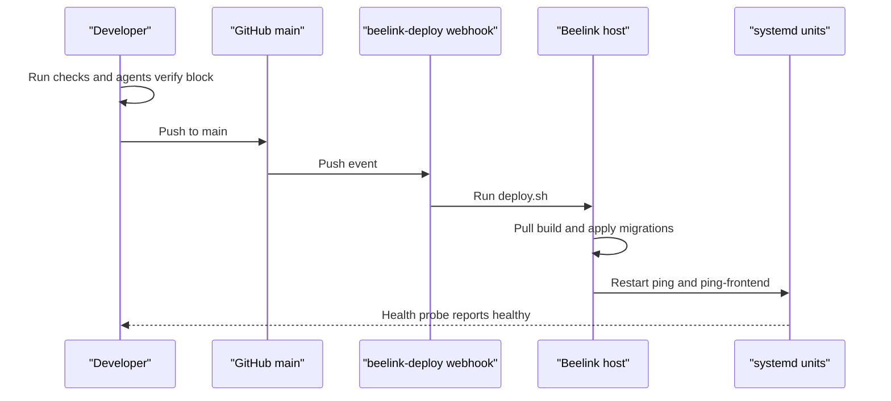

# Iteration Loop

This page describes the workflow the repository actually defines. The excerpts do not show branch protection or review gates, so none are assumed.

## Local setup

- Docker path: copy the Docker env example, then run `./scripts/docker-dev.sh` ([README.md:L52-L54](https://github.com/Jeffrey-Keyser/ping/blob/86038591cb036f4b90ee00318760515952cc0ab2/README.md#L52-L54)). The dev Dockerfiles for the server and client read the GitHub Packages token as a BuildKit secret named `github_token`. `docker-compose.dev.yml` takes that secret from the `GITHUB_TOKEN` environment variable and mounts it only for the `npm ci` step. The token is not passed as a build argument or image `ENV` ([docker-compose.dev.yml](https://github.com/Jeffrey-Keyser/ping/blob/912cfbe0b3aa749d2325ad1f3d0f3672b6340910/docker-compose.dev.yml), [Dockerfile.dev.server](https://github.com/Jeffrey-Keyser/ping/blob/912cfbe0b3aa749d2325ad1f3d0f3672b6340910/Dockerfile.dev.server), [Dockerfile.dev.client](https://github.com/Jeffrey-Keyser/ping/blob/912cfbe0b3aa749d2325ad1f3d0f3672b6340910/Dockerfile.dev.client)).
- Manual path: the server runs on port 3001 and the client on port 3002 ([README.md:L57-L58](https://github.com/Jeffrey-Keyser/ping/blob/86038591cb036f4b90ee00318760515952cc0ab2/README.md#L57-L58)). The server dev script runs `ts-node ./bin/www.ts` ([server/package.json:L8](https://github.com/Jeffrey-Keyser/ping/blob/86038591cb036f4b90ee00318760515952cc0ab2/server/package.json#L8)).
- Collection alerts require optional `VAPID_PUBLIC_KEY` and `VAPID_PRIVATE_KEY`, and accept an optional `VAPID_SUBJECT`. When either key is unset, the push-subscriptions API reports `available: false` and the capture-attention worker is not started ([server/config/env.ts](https://github.com/Jeffrey-Keyser/ping/blob/bb7fa57f78b9894f98f4a93fd7b2f50a6974b1c1/server/config/env.ts), [server/bin/www.ts](https://github.com/Jeffrey-Keyser/ping/blob/bb7fa57f78b9894f98f4a93fd7b2f50a6974b1c1/server/bin/www.ts), [server/routes/push-subscriptions.ts](https://github.com/Jeffrey-Keyser/ping/blob/bb7fa57f78b9894f98f4a93fd7b2f50a6974b1c1/server/routes/push-subscriptions.ts)).

## Checks

- Server unit tests: `npm test` runs `npx vitest run` ([server/package.json:L14](https://github.com/Jeffrey-Keyser/ping/blob/86038591cb036f4b90ee00318760515952cc0ab2/server/package.json#L14)). Its include globs cover `tests/__tests__`, `domain`, and `routes` ([server/vitest.config.ts:L12-L16](https://github.com/Jeffrey-Keyser/ping/blob/86038591cb036f4b90ee00318760515952cc0ab2/server/vitest.config.ts#L12-L16)).
- Integration tests: `npm run test:integration` uses a separate config ([server/package.json:L17](https://github.com/Jeffrey-Keyser/ping/blob/86038591cb036f4b90ee00318760515952cc0ab2/server/package.json#L17)). That config expects a test database on port 5433 by default ([server/vitest.config.integration.ts:L30-L31](https://github.com/Jeffrey-Keyser/ping/blob/86038591cb036f4b90ee00318760515952cc0ab2/server/vitest.config.integration.ts#L30-L31)).
- Replay tests: a config targets `tests/replay`, but no matching npm script appears in the excerpts ([server/vitest.config.replay.ts:L3](https://github.com/Jeffrey-Keyser/ping/blob/86038591cb036f4b90ee00318760515952cc0ab2/server/vitest.config.replay.ts#L3)).
- Dwell tests: `server/tests/dwell/` includes a Postgres test suite and a README, with a separate `server/vitest.config.dwell.ts`. The diff does not show an npm script for this config ([server/vitest.config.dwell.ts](https://github.com/Jeffrey-Keyser/ping/blob/c7a003f89bb14a959bb433f8aa02a61ac81775ed/server/vitest.config.dwell.ts), [server/tests/dwell/README.md](https://github.com/Jeffrey-Keyser/ping/blob/c7a003f89bb14a959bb433f8aa02a61ac81775ed/server/tests/dwell/README.md)).
- Docker test run: `npm run test:docker` uses `docker-compose.test.yml`, which is not in the excerpts ([server/package.json:L19](https://github.com/Jeffrey-Keyser/ping/blob/86038591cb036f4b90ee00318760515952cc0ab2/server/package.json#L19)).
- Client tests: `npm run test` runs Vitest once ([client/package.json:L41](https://github.com/Jeffrey-Keyser/ping/blob/86038591cb036f4b90ee00318760515952cc0ab2/client/package.json#L41)).
- Lint: `npm run lint` runs ESLint over `.ts` files ([server/package.json:L11](https://github.com/Jeffrey-Keyser/ping/blob/86038591cb036f4b90ee00318760515952cc0ab2/server/package.json#L11)).

## Agent verification

Coding agents must run the `agents:verify` block in `AGENTS.md` before finishing ([AGENTS.md:L31-L35](https://github.com/Jeffrey-Keyser/ping/blob/86038591cb036f4b90ee00318760515952cc0ab2/AGENTS.md#L31-L35)). It checks four things:

- the `pay-auth-integration` version pin ([AGENTS.md:L37-L40](https://github.com/Jeffrey-Keyser/ping/blob/86038591cb036f4b90ee00318760515952cc0ab2/AGENTS.md#L37-L40));
- no forbidden private-subpath imports, where missing optional source roots are skipped and an empty set fails ([AGENTS.md:L44-L55](https://github.com/Jeffrey-Keyser/ping/blob/86038591cb036f4b90ee00318760515952cc0ab2/AGENTS.md#L44-L55));
- at most one `new PayAuth(` occurrence ([AGENTS.md:L58](https://github.com/Jeffrey-Keyser/ping/blob/86038591cb036f4b90ee00318760515952cc0ab2/AGENTS.md#L58));
- installed binaries, then client and server build and test ([AGENTS.md:L63-L67](https://github.com/Jeffrey-Keyser/ping/blob/86038591cb036f4b90ee00318760515952cc0ab2/AGENTS.md#L63-L67)).

## Push and deploy

The README says a push to `main` deploys automatically ([README.md:L63](https://github.com/Jeffrey-Keyser/ping/blob/86038591cb036f4b90ee00318760515952cc0ab2/README.md#L63)). The webhook configuration is not in the repo, so its exact behavior is unknown.

`deploy.sh` does the following:

- fast-forward pulls `origin main` ([deploy.sh:L8](https://github.com/Jeffrey-Keyser/ping/blob/86038591cb036f4b90ee00318760515952cc0ab2/deploy.sh#L8)). If the pulled `deploy.sh` differs from the running copy, it re-executes the pulled script with `PING_DEPLOY_REEXEC=1` before any build or migration step, so the new release's migrations run first ([deploy.sh](https://github.com/Jeffrey-Keyser/ping/blob/fa26c56e872f22f1d71dd625498d1404bebcbbef/deploy.sh));
- builds the server with dev dependencies included, then the client ([deploy.sh:L15-L18](https://github.com/Jeffrey-Keyser/ping/blob/86038591cb036f4b90ee00318760515952cc0ab2/deploy.sh#L15-L18), [deploy.sh:L23-L25](https://github.com/Jeffrey-Keyser/ping/blob/86038591cb036f4b90ee00318760515952cc0ab2/deploy.sh#L23-L25));
- runs the migration helpers before restart and stops on failure. These include the visit dwell helper and, after it, the capture-attention push helper `node dist/db/applyCaptureAttentionPush.js` ([deploy.sh:L30](https://github.com/Jeffrey-Keyser/ping/blob/86038591cb036f4b90ee00318760515952cc0ab2/deploy.sh#L30), [deploy.sh:L34](https://github.com/Jeffrey-Keyser/ping/blob/86038591cb036f4b90ee00318760515952cc0ab2/deploy.sh#L34), [deploy.sh:L37](https://github.com/Jeffrey-Keyser/ping/blob/86038591cb036f4b90ee00318760515952cc0ab2/deploy.sh#L37), [deploy.sh](https://github.com/Jeffrey-Keyser/ping/blob/bb7fa57f78b9894f98f4a93fd7b2f50a6974b1c1/deploy.sh));
- restarts both units ([deploy.sh:L44-L45](https://github.com/Jeffrey-Keyser/ping/blob/86038591cb036f4b90ee00318760515952cc0ab2/deploy.sh#L44-L45));
- polls health for up to 30 attempts and exits non-zero on failure ([deploy.sh:L47-L57](https://github.com/Jeffrey-Keyser/ping/blob/86038591cb036f4b90ee00318760515952cc0ab2/deploy.sh#L47-L57)).

## Database changes

- The migration helpers are the ones `deploy.sh` runs before restart ([deploy.sh:L28-L37](https://github.com/Jeffrey-Keyser/ping/blob/86038591cb036f4b90ee00318760515952cc0ab2/deploy.sh#L28-L37)).
- Migration 027 (`server/db/schema/027-visit-dwell.sql`) is applied by `server/db/applyVisitDwell.ts`. It is additive: it adds `ping.zones.dwell_minutes` (default 5, range 0 to 1440), a `location_dwell_state` table, and a `pending_arrivals` table with a partial unique index for one pending arrival per account. The helper sets a 5-second lock timeout and a 60-second statement timeout, checks the resulting column default, and rolls back on failure. It does not infer or repair legacy outcomes ([server/db/schema/027-visit-dwell.sql](https://github.com/Jeffrey-Keyser/ping/blob/c7a003f89bb14a959bb433f8aa02a61ac81775ed/server/db/schema/027-visit-dwell.sql), [server/db/applyVisitDwell.ts](https://github.com/Jeffrey-Keyser/ping/blob/c7a003f89bb14a959bb433f8aa02a61ac81775ed/server/db/applyVisitDwell.ts)).
- Migration 028 (`server/db/schema/028-capture-attention-push.sql`) is applied by `server/db/applyCaptureAttentionPush.ts`. It is additive and uses `CREATE TABLE IF NOT EXISTS` for `ping.push_subscriptions` and `ping.capture_attention_alerts`. The helper runs inside a transaction with a 5-second lock timeout and a 60-second statement timeout. It checks the expected column names, types, and nullability of both tables through `information_schema`, and rolls back on any mismatch or error. On failure it exits non-zero with a message that services were not restarted ([server/db/schema/028-capture-attention-push.sql](https://github.com/Jeffrey-Keyser/ping/blob/bb7fa57f78b9894f98f4a93fd7b2f50a6974b1c1/server/db/schema/028-capture-attention-push.sql), [server/db/applyCaptureAttentionPush.ts](https://github.com/Jeffrey-Keyser/ping/blob/bb7fa57f78b9894f98f4a93fd7b2f50a6974b1c1/server/db/applyCaptureAttentionPush.ts)).
- `CLAUDE.md` documents `server/db/deploy.sh`, a `db-deploy` command, and Sequelize CLI generation ([CLAUDE.md:L102-L111](https://github.com/Jeffrey-Keyser/ping/blob/86038591cb036f4b90ee00318760515952cc0ab2/CLAUDE.md#L102-L111)). How these relate to the deploy helpers is unknown from the excerpts.
- Location replay migration 026 must be applied before the new service starts, and old location writers must be drained first ([docs/MOBILE_INTEGRATION.md:L355](https://github.com/Jeffrey-Keyser/ping/blob/86038591cb036f4b90ee00318760515952cc0ab2/docs/MOBILE_INTEGRATION.md#L355)). Migration 027 has the same prerequisite for the new dwell processing protocol ([docs/MOBILE_INTEGRATION.md](https://github.com/Jeffrey-Keyser/ping/blob/c7a003f89bb14a959bb433f8aa02a61ac81775ed/docs/MOBILE_INTEGRATION.md)).
