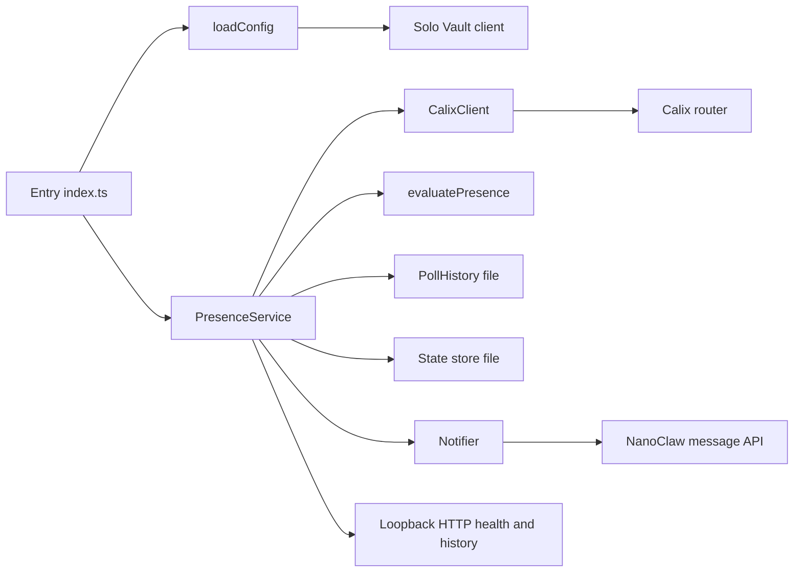

# Architecture

The process has one entry point that loads configuration and runs either a single dry-run evaluation or the long-running service. [src/index.ts:L4-L10](https://github.com/Jeffrey-Keyser/presence-signal/blob/e14bb8a187e751f1ab035cc5654aa16d7f9b491b/src/index.ts#L4-L10)

## Components

- **Configuration** reads environment variables and optional Solo Vault secrets, and parses the target file. [src/config.ts:L55-L72](https://github.com/Jeffrey-Keyser/presence-signal/blob/e14bb8a187e751f1ab035cc5654aa16d7f9b491b/src/config.ts#L55-L72)
- **Router client** runs a nonce, login, and device-table sequence, then keeps only active rows. [src/calix.ts:L110-L138](https://github.com/Jeffrey-Keyser/presence-signal/blob/e14bb8a187e751f1ab035cc5654aa16d7f9b491b/src/calix.ts#L110-L138)
- **Presence evaluation** is a pure function over clients and prior state. [src/presence.ts:L20-L25](https://github.com/Jeffrey-Keyser/presence-signal/blob/e14bb8a187e751f1ab035cc5654aa16d7f9b491b/src/presence.ts#L20-L25)
- **Poll history** keeps 24 hours of snapshots with atomic replacement. [src/poll-history.ts:L5](https://github.com/Jeffrey-Keyser/presence-signal/blob/e14bb8a187e751f1ab035cc5654aa16d7f9b491b/src/poll-history.ts#L5)

## Contracts

- **State file** holds four fields: `ownerLastSeenAt`, `qualifyingStreak`, `notified`, `departureStreak`. [src/types.ts:L12-L17](https://github.com/Jeffrey-Keyser/presence-signal/blob/e14bb8a187e751f1ab035cc5654aa16d7f9b491b/src/types.ts#L12-L17)
- **Notification body** posts `recipient`, `content`, `template`, and `priority`. [src/notifier.ts:L10-L15](https://github.com/Jeffrey-Keyser/presence-signal/blob/e14bb8a187e751f1ab035cc5654aa16d7f9b491b/src/notifier.ts#L10-L15)
- **Health** returns 503 when degraded. [src/service.ts:L139-L143](https://github.com/Jeffrey-Keyser/presence-signal/blob/e14bb8a187e751f1ab035cc5654aa16d7f9b491b/src/service.ts#L139-L143)
- **History** accepts `minutes` from 1 to 1440, default 30. [src/service.ts:L146-L157](https://github.com/Jeffrey-Keyser/presence-signal/blob/e14bb8a187e751f1ab035cc5654aa16d7f9b491b/src/service.ts#L146-L157)
- **Targets** require unique labels, valid MAC addresses, and no duplicate or owner MAC. [src/config.ts:L15-L27](https://github.com/Jeffrey-Keyser/presence-signal/blob/e14bb8a187e751f1ab035cc5654aa16d7f9b491b/src/config.ts#L15-L27)

## Notes

The router client disables TLS certificate verification. [src/calix.ts:L35](https://github.com/Jeffrey-Keyser/presence-signal/blob/e14bb8a187e751f1ab035cc5654aa16d7f9b491b/src/calix.ts#L35) The HTTP server listens only on 127.0.0.1. [src/service.ts:L165](https://github.com/Jeffrey-Keyser/presence-signal/blob/e14bb8a187e751f1ab035cc5654aa16d7f9b491b/src/service.ts#L165)
