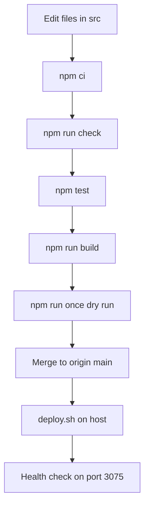

# Iteration Loop

The package scripts define the local loop: install, type-check, test, build, and a dry-run evaluation. [package.json:L8-L12](https://github.com/Jeffrey-Keyser/presence-signal/blob/e14bb8a187e751f1ab035cc5654aa16d7f9b491b/package.json#L8-L12)

## Local steps

1. Install with `npm ci`. [README.md:L59-L60](https://github.com/Jeffrey-Keyser/presence-signal/blob/e14bb8a187e751f1ab035cc5654aa16d7f9b491b/README.md#L59-L60)
2. Run `npm run check` for type checking without emitting files. [package.json:L9](https://github.com/Jeffrey-Keyser/presence-signal/blob/e14bb8a187e751f1ab035cc5654aa16d7f9b491b/package.json#L9)
3. Run `npm test`. It runs `test/*.test.ts` with tsx. [package.json:L11](https://github.com/Jeffrey-Keyser/presence-signal/blob/e14bb8a187e751f1ab035cc5654aa16d7f9b491b/package.json#L11) The test files are not in the excerpts, so their coverage is unknown.
4. Run `npm run build`, which compiles `src` to `dist`. [package.json:L8](https://github.com/Jeffrey-Keyser/presence-signal/blob/e14bb8a187e751f1ab035cc5654aa16d7f9b491b/package.json#L8) [tsconfig.json:L6-L7](https://github.com/Jeffrey-Keyser/presence-signal/blob/e14bb8a187e751f1ab035cc5654aa16d7f9b491b/tsconfig.json#L6-L7)
5. Run `npm run once` to authenticate and evaluate once without notifying, saving state, or writing history. [README.md:L64-L65](https://github.com/Jeffrey-Keyser/presence-signal/blob/e14bb8a187e751f1ab035cc5654aa16d7f9b491b/README.md#L64-L65) [src/service.ts:L76](https://github.com/Jeffrey-Keyser/presence-signal/blob/e14bb8a187e751f1ab035cc5654aa16d7f9b491b/src/service.ts#L76)

## Deploy steps

`deploy.sh` pulls `origin main` with fast-forward only, installs, builds, restarts the unit, and polls health for up to 20 seconds. [deploy.sh:L4-L14](https://github.com/Jeffrey-Keyser/presence-signal/blob/e14bb8a187e751f1ab035cc5654aa16d7f9b491b/deploy.sh#L4-L14)

## CI

No CI workflow file appears in the provided excerpts. Whether CI runs on pushes or pull requests is unknown.

## Config changes

Changing the detection rule requires stopping the service and resetting `qualifyingStreak` and `notified` in the state file. [README.md:L48-L50](https://github.com/Jeffrey-Keyser/presence-signal/blob/e14bb8a187e751f1ab035cc5654aa16d7f9b491b/README.md#L48-L50) Reporting label edits alone do not change detection. [AGENTS.md:L11-L13](https://github.com/Jeffrey-Keyser/presence-signal/blob/e14bb8a187e751f1ab035cc5654aa16d7f9b491b/AGENTS.md#L11-L13)
