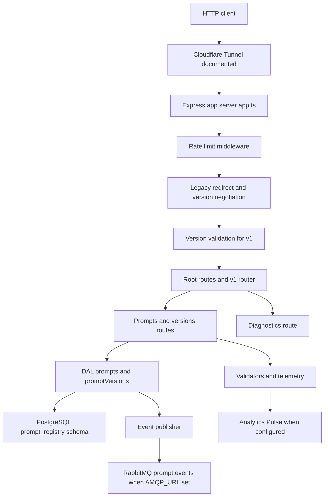

# Architecture

The service is a single Node process. `server/app.ts` passes a `ServerConfig` to `@jeffrey-keyser/express-server-factory`, which creates the Express app ([server/app.ts:L1-L5](https://github.com/Jeffrey-Keyser/prompt-registry/blob/b7f7231f81a8c395e85de5d77c5d0f477e443daa/server/app.ts#L1-L5), [server/app.ts:L40-L46](https://github.com/Jeffrey-Keyser/prompt-registry/blob/b7f7231f81a8c395e85de5d77c5d0f477e443daa/server/app.ts#L40-L46)). Initialization is cached so the app is created once ([server/app.ts:L153-L158](https://github.com/Jeffrey-Keyser/prompt-registry/blob/b7f7231f81a8c395e85de5d77c5d0f477e443daa/server/app.ts#L153-L158)).

## Bootstrap

`server/bin/www.ts` initializes RabbitMQ, obtains the app, and calls `listen` on `config.PORT` ([server/bin/www.ts:L13-L24](https://github.com/Jeffrey-Keyser/prompt-registry/blob/b7f7231f81a8c395e85de5d77c5d0f477e443daa/server/bin/www.ts#L13-L24)). A RabbitMQ connection failure is logged and startup continues ([server/services/promptEventPublisher.ts:L55-L59](https://github.com/Jeffrey-Keyser/prompt-registry/blob/b7f7231f81a8c395e85de5d77c5d0f477e443daa/server/services/promptEventPublisher.ts#L55-L59)).

## Server factory contract

- Auth is disabled and there is no auth middleware ([server/app.ts:L74-L76](https://github.com/Jeffrey-Keyser/prompt-registry/blob/b7f7231f81a8c395e85de5d77c5d0f477e443daa/server/app.ts#L74-L76)).
- CORS allows GET, POST, PUT, DELETE, and OPTIONS from configured origins ([server/app.ts:L48-L62](https://github.com/Jeffrey-Keyser/prompt-registry/blob/b7f7231f81a8c395e85de5d77c5d0f477e443daa/server/app.ts#L48-L62)).
- JSON bodies are capped at 1mb ([server/app.ts:L66-L69](https://github.com/Jeffrey-Keyser/prompt-registry/blob/b7f7231f81a8c395e85de5d77c5d0f477e443daa/server/app.ts#L66-L69)).
- `/health` is enabled with a database check ([server/app.ts:L78-L86](https://github.com/Jeffrey-Keyser/prompt-registry/blob/b7f7231f81a8c395e85de5d77c5d0f477e443daa/server/app.ts#L78-L86)).
- Swagger is enabled unless `NODE_ENV` is `test` ([server/app.ts:L88-L89](https://github.com/Jeffrey-Keyser/prompt-registry/blob/b7f7231f81a8c395e85de5d77c5d0f477e443daa/server/app.ts#L88-L89)).

## Middleware

- `middleware/rateLimiting.ts` keys by `CF-Connecting-IP`, falls back to the request IP, and returns a JSON 429 with `code` and `message` ([server/middleware/rateLimiting.ts:L8-L26](https://github.com/Jeffrey-Keyser/prompt-registry/blob/b7f7231f81a8c395e85de5d77c5d0f477e443daa/server/middleware/rateLimiting.ts#L8-L26)). Limiters are skipped in the test environment ([server/app.ts:L123-L124](https://github.com/Jeffrey-Keyser/prompt-registry/blob/b7f7231f81a8c395e85de5d77c5d0f477e443daa/server/app.ts#L123-L124)).
- `middleware/versioning.ts` reads `Accept-Version`, defaults to 1, sets `API-Version`, and redirects `/v1/*` to `/api/v1/*` with 301 ([server/middleware/versioning.ts:L23-L43](https://github.com/Jeffrey-Keyser/prompt-registry/blob/b7f7231f81a8c395e85de5d77c5d0f477e443daa/server/middleware/versioning.ts#L23-L43), [server/middleware/versioning.ts:L55-L70](https://github.com/Jeffrey-Keyser/prompt-registry/blob/b7f7231f81a8c395e85de5d77c5d0f477e443daa/server/middleware/versioning.ts#L55-L70)).

## Routes

- Root routes return API info, `/ping` returns `pong`, and `/health` is handled by the factory ([server/routes/index.ts:L6-L18](https://github.com/Jeffrey-Keyser/prompt-registry/blob/b7f7231f81a8c395e85de5d77c5d0f477e443daa/server/routes/index.ts#L6-L18)).
- The v1 router mounts `/diagnostics` and `/prompts` ([server/routes/versions/v1/index.ts:L30-L34](https://github.com/Jeffrey-Keyser/prompt-registry/blob/b7f7231f81a8c395e85de5d77c5d0f477e443daa/server/routes/versions/v1/index.ts#L30-L34)).
- The prompts router mounts `/:key/versions` and `/:key/restore` ([server/routes/prompts.ts:L30-L32](https://github.com/Jeffrey-Keyser/prompt-registry/blob/b7f7231f81a8c395e85de5d77c5d0f477e443daa/server/routes/prompts.ts#L30-L32)). The excerpt is partial, so other handlers may exist.
- Success responses use `{ success, data }` ([server/routes/prompts.ts:L284-L287](https://github.com/Jeffrey-Keyser/prompt-registry/blob/b7f7231f81a8c395e85de5d77c5d0f477e443daa/server/routes/prompts.ts#L284-L287)). Version routes return `{ success, error }` on failures ([server/routes/promptVersions.ts:L122-L126](https://github.com/Jeffrey-Keyser/prompt-registry/blob/b7f7231f81a8c395e85de5d77c5d0f477e443daa/server/routes/promptVersions.ts#L122-L126)). Error shapes are therefore not uniform.

## Data access

The DAL in `server/dal/` owns SQL. `createPrompt` and `updatePrompt` write a version row in the same transaction ([server/dal/prompts.ts:L127-L169](https://github.com/Jeffrey-Keyser/prompt-registry/blob/b7f7231f81a8c395e85de5d77c5d0f477e443daa/server/dal/prompts.ts#L127-L169), [server/dal/prompts.ts:L193-L293](https://github.com/Jeffrey-Keyser/prompt-registry/blob/b7f7231f81a8c395e85de5d77c5d0f477e443daa/server/dal/prompts.ts#L193-L293)). Schema for the base table is in `001_prompts_table.sql`, which does not show the `version`, `tags`, or `parameters` columns the DAL queries ([server/db/schema/001_prompts_table.sql:L6-L13](https://github.com/Jeffrey-Keyser/prompt-registry/blob/b7f7231f81a8c395e85de5d77c5d0f477e443daa/server/db/schema/001_prompts_table.sql#L6-L13)).

## Services, events, and domain

- Validators cover tags, descriptions, and parameter definitions ([server/services/tagValidator.ts:L17-L19](https://github.com/Jeffrey-Keyser/prompt-registry/blob/b7f7231f81a8c395e85de5d77c5d0f477e443daa/server/services/tagValidator.ts#L17-L19), [server/services/descriptionValidator.ts:L14](https://github.com/Jeffrey-Keyser/prompt-registry/blob/b7f7231f81a8c395e85de5d77c5d0f477e443daa/server/services/descriptionValidator.ts#L14)).
- Event contract: `PromptEvent` has `type`, `key`, `namespace`, `version`, `timestamp`, and `actor` ([server/types/events.ts:L3-L10](https://github.com/Jeffrey-Keyser/prompt-registry/blob/b7f7231f81a8c395e85de5d77c5d0f477e443daa/server/types/events.ts#L3-L10)).
- `server/domain/` holds health-check services and value objects. The entity and repository index files are empty placeholders ([server/domain/entities/index.ts:L1-L5](https://github.com/Jeffrey-Keyser/prompt-registry/blob/b7f7231f81a8c395e85de5d77c5d0f477e443daa/server/domain/entities/index.ts#L1-L5), [server/domain/repositories/index.ts:L1-L5](https://github.com/Jeffrey-Keyser/prompt-registry/blob/b7f7231f81a8c395e85de5d77c5d0f477e443daa/server/domain/repositories/index.ts#L1-L5)).
