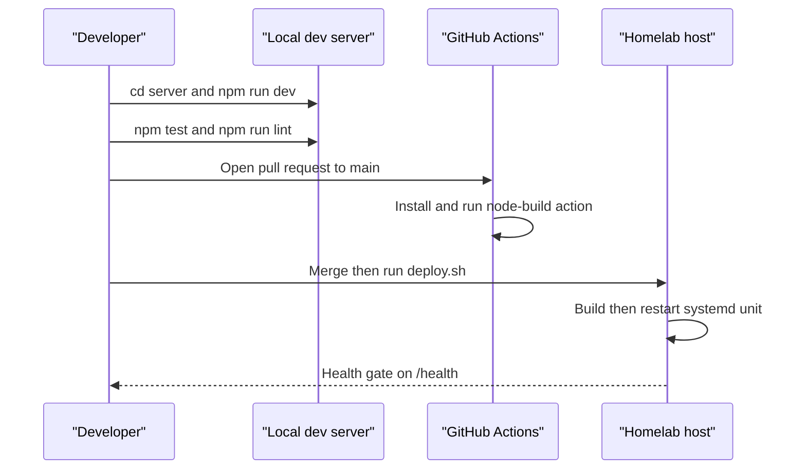

# Iteration loop

This page describes the workflow implied by the scripts and CI config in this snapshot. Two deploy paths are documented, and this page notes where they differ.

## Steps

1. **Environment.** Create `server/.env` from `.env.example` ([README.md:L171-L176](https://github.com/Jeffrey-Keyser/prompt-registry/blob/b7f7231f81a8c395e85de5d77c5d0f477e443daa/README.md#L171-L176), [CLAUDE.md:L29](https://github.com/Jeffrey-Keyser/prompt-registry/blob/b7f7231f81a8c395e85de5d77c5d0f477e443daa/CLAUDE.md#L29)). The example file is not in this snapshot. An optional Nix shell pins Node 24 ([docs/nix-development.md:L3-L7](https://github.com/Jeffrey-Keyser/prompt-registry/blob/b7f7231f81a8c395e85de5d77c5d0f477e443daa/docs/nix-development.md#L3-L7)).
2. **Database.** Run `cd server/db && ./deploy.sh`. It applies `db/schema` and related SQL directories ([server/db/deploy.sh:L13-L27](https://github.com/Jeffrey-Keyser/prompt-registry/blob/b7f7231f81a8c395e85de5d77c5d0f477e443daa/server/db/deploy.sh#L13-L27)). It also creates a `user_sessions` table, a template artifact since no session code is wired in `app.ts` ([server/db/deploy.sh:L30-L33](https://github.com/Jeffrey-Keyser/prompt-registry/blob/b7f7231f81a8c395e85de5d77c5d0f477e443daa/server/db/deploy.sh#L30-L33)).
3. **Run.** `cd server && npm run dev` runs `ts-node ./bin/www.ts` ([server/package.json:L7](https://github.com/Jeffrey-Keyser/prompt-registry/blob/b7f7231f81a8c395e85de5d77c5d0f477e443daa/server/package.json#L7)).
4. **Test.** `npm test`, `npm run test:watch`, and `npm run test:coverage` run Jest ([server/package.json:L11-L13](https://github.com/Jeffrey-Keyser/prompt-registry/blob/b7f7231f81a8c395e85de5d77c5d0f477e443daa/server/package.json#L11-L13)). Jest loads `tests/setup.ts` ([server/jest.config.js:L20](https://github.com/Jeffrey-Keyser/prompt-registry/blob/b7f7231f81a8c395e85de5d77c5d0f477e443daa/server/jest.config.js#L20)).
5. **Lint and build.** `npm run lint` uses ESLint with the flat config ([server/package.json:L10](https://github.com/Jeffrey-Keyser/prompt-registry/blob/b7f7231f81a8c395e85de5d77c5d0f477e443daa/server/package.json#L10), [server/eslint.config.js:L8-L48](https://github.com/Jeffrey-Keyser/prompt-registry/blob/b7f7231f81a8c395e85de5d77c5d0f477e443daa/server/eslint.config.js#L8-L48)). `npm run build` runs `tsc` ([server/package.json:L8](https://github.com/Jeffrey-Keyser/prompt-registry/blob/b7f7231f81a8c395e85de5d77c5d0f477e443daa/server/package.json#L8)).
6. **Shell scripts.** New scripts must be committed with the executable bit ([CLAUDE.md:L271-L287](https://github.com/Jeffrey-Keyser/prompt-registry/blob/b7f7231f81a8c395e85de5d77c5d0f477e443daa/CLAUDE.md#L271-L287)).
7. **Pull request.** CI runs on pull requests to `main`. The backend job uses Node 20 and `npm ci` in `main/server` ([.github/workflows/ci-cd-pipeline.yml:L3-L7](https://github.com/Jeffrey-Keyser/prompt-registry/blob/b7f7231f81a8c395e85de5d77c5d0f477e443daa/.github/workflows/ci-cd-pipeline.yml#L3-L7), [.github/workflows/ci-cd-pipeline.yml:L9-L39](https://github.com/Jeffrey-Keyser/prompt-registry/blob/b7f7231f81a8c395e85de5d77c5d0f477e443daa/.github/workflows/ci-cd-pipeline.yml#L9-L39)). The workflow has no deploy job. The composite action's internal steps are not in this snapshot, so the claimed install, lint, and test coverage is documented in [CLAUDE.md:L154](https://github.com/Jeffrey-Keyser/prompt-registry/blob/b7f7231f81a8c395e85de5d77c5d0f477e443daa/CLAUDE.md#L154) only.
8. **Deploy.** The repo's `deploy.sh` pulls `main`, runs `npm ci --include=dev` and `npm run build` in `server`, stops the unit, frees the port, and starts it ([deploy.sh:L17-L34](https://github.com/Jeffrey-Keyser/prompt-registry/blob/b7f7231f81a8c395e85de5d77c5d0f477e443daa/deploy.sh#L17-L34)). The CLAUDE.md process is a manual build followed by `systemctl restart` ([CLAUDE.md:L253-L256](https://github.com/Jeffrey-Keyser/prompt-registry/blob/b7f7231f81a8c395e85de5d77c5d0f477e443daa/CLAUDE.md#L253-L256)). Which path the homelab uses is not verifiable here.
9. **Health gate.** `deploy.sh` polls the health URL for up to 45 seconds and prints the unit journal on failure ([deploy.sh:L36-L49](https://github.com/Jeffrey-Keyser/prompt-registry/blob/b7f7231f81a8c395e85de5d77c5d0f477e443daa/deploy.sh#L36-L49)).

## Notes

- Pushes to `main` or `develop` trigger the workflow, but the backend job only runs for pull requests ([.github/workflows/ci-cd-pipeline.yml:L5-L12](https://github.com/Jeffrey-Keyser/prompt-registry/blob/b7f7231f81a8c395e85de5d77c5d0f477e443daa/.github/workflows/ci-cd-pipeline.yml#L5-L12)).
- The README's Terraform and AWS deploy sections are template-era. CLAUDE.md states no AWS or Terraform is required ([CLAUDE.md:L155](https://github.com/Jeffrey-Keyser/prompt-registry/blob/b7f7231f81a8c395e85de5d77c5d0f477e443daa/CLAUDE.md#L155)).
