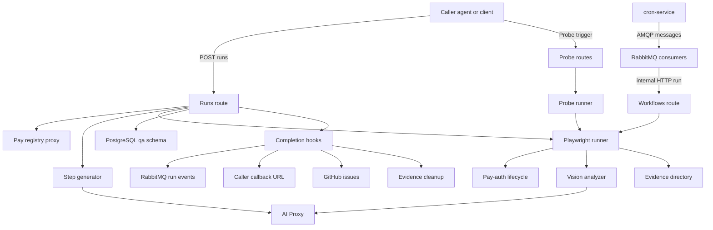

# Architecture

QA Patrol is a single Express 5 process. `src/bin/www.ts` loads the app and listens on the configured port ([src/bin/www.ts:L8-L13](https://github.com/Jeffrey-Keyser/qa-patrol/blob/f9b3dd00ba79e6fc176957326134666ddbb039b5/src/bin/www.ts#L8-L13)). After startup it syncs scheduled workflows and registers the evidence-cleanup cron job ([src/bin/www.ts:L17-L43](https://github.com/Jeffrey-Keyser/qa-patrol/blob/f9b3dd00ba79e6fc176957326134666ddbb039b5/src/bin/www.ts#L17-L43)).

## Composition

`src/app.ts` builds the server with `createExpressApp` and mounts `/evidence`, `/dashboard`, `/`, and `/api/v1` ([src/app.ts:L94-L99](https://github.com/Jeffrey-Keyser/qa-patrol/blob/f9b3dd00ba79e6fc176957326134666ddbb039b5/src/app.ts#L94-L99)). Version negotiation runs first, and unsupported `/api/vN/` paths return 404 ([src/app.ts:L112-L117](https://github.com/Jeffrey-Keyser/qa-patrol/blob/f9b3dd00ba79e6fc176957326134666ddbb039b5/src/app.ts#L112-L117), [src/middleware/versioning.ts:L28-L33](https://github.com/Jeffrey-Keyser/qa-patrol/blob/f9b3dd00ba79e6fc176957326134666ddbb039b5/src/middleware/versioning.ts#L28-L33)). The server factory's own auth option is disabled ([src/app.ts:L81](https://github.com/Jeffrey-Keyser/qa-patrol/blob/f9b3dd00ba79e6fc176957326134666ddbb039b5/src/app.ts#L81)). Pay-auth applies only to target apps.

## Components and contracts

- **v1 router**: mounts apps, runs, workflows, summary, evidence, dashboard, and probe routes ([src/routes/versions/v1/index.ts:L12-L18](https://github.com/Jeffrey-Keyser/qa-patrol/blob/f9b3dd00ba79e6fc176957326134666ddbb039b5/src/routes/versions/v1/index.ts#L12-L18)).
- **Runs**: synchronous execution and the completion fan-out ([src/routes/versions/v1/runs.ts:L256-L293](https://github.com/Jeffrey-Keyser/qa-patrol/blob/f9b3dd00ba79e6fc176957326134666ddbb039b5/src/routes/versions/v1/runs.ts#L256-L293)).
- **Workflows**: a run links back to its workflow through `workflow_id` ([src/routes/versions/v1/workflows.ts:L230-L237](https://github.com/Jeffrey-Keyser/qa-patrol/blob/f9b3dd00ba79e6fc176957326134666ddbb039b5/src/routes/versions/v1/workflows.ts#L230-L237)). Cron jobs are registered or removed on create, update, and delete ([src/routes/versions/v1/workflows.ts:L61-L63](https://github.com/Jeffrey-Keyser/qa-patrol/blob/f9b3dd00ba79e6fc176957326134666ddbb039b5/src/routes/versions/v1/workflows.ts#L61-L63), [src/routes/versions/v1/workflows.ts:L169-L171](https://github.com/Jeffrey-Keyser/qa-patrol/blob/f9b3dd00ba79e6fc176957326134666ddbb039b5/src/routes/versions/v1/workflows.ts#L169-L171)).
- **Playwright runner**: defaults to a 1920x1080 viewport and a 120000 ms timeout ([src/services/playwright-runner.ts:L146-L147](https://github.com/Jeffrey-Keyser/qa-patrol/blob/f9b3dd00ba79e6fc176957326134666ddbb039b5/src/services/playwright-runner.ts#L146-L147)). It captures console errors and responses with status 400 or higher, and screenshots each step by default ([src/services/playwright-runner.ts:L177-L196](https://github.com/Jeffrey-Keyser/qa-patrol/blob/f9b3dd00ba79e6fc176957326134666ddbb039b5/src/services/playwright-runner.ts#L177-L196), [src/services/playwright-runner.ts:L312-L316](https://github.com/Jeffrey-Keyser/qa-patrol/blob/f9b3dd00ba79e6fc176957326134666ddbb039b5/src/services/playwright-runner.ts#L312-L316)).
- **Auth**: the detector looks for pay-auth markers in page HTML and fails safe to none ([src/services/auth-detector.ts:L32-L47](https://github.com/Jeffrey-Keyser/qa-patrol/blob/f9b3dd00ba79e6fc176957326134666ddbb039b5/src/services/auth-detector.ts#L32-L47)). The lifecycle tries saved state first, then a single password fallback ([src/services/auth-lifecycle.ts:L70-L117](https://github.com/Jeffrey-Keyser/qa-patrol/blob/f9b3dd00ba79e6fc176957326134666ddbb039b5/src/services/auth-lifecycle.ts#L70-L117)). Login tries three methods in order ([src/services/auth.ts:L37-L70](https://github.com/Jeffrey-Keyser/qa-patrol/blob/f9b3dd00ba79e6fc176957326134666ddbb039b5/src/services/auth.ts#L37-L70)).
- **Step generation**: AI output must be a JSON array of known actions ([src/services/step-generator.ts:L59-L73](https://github.com/Jeffrey-Keyser/qa-patrol/blob/f9b3dd00ba79e6fc176957326134666ddbb039b5/src/services/step-generator.ts#L59-L73)).
- **Vision analysis**: runs only when `options.enableVisionAnalysis` is set ([src/services/playwright-runner.ts:L337](https://github.com/Jeffrey-Keyser/qa-patrol/blob/f9b3dd00ba79e6fc176957326134666ddbb039b5/src/services/playwright-runner.ts#L337)).
- **Probes**: the trigger route returns 202 and runs the probe in the background ([src/routes/versions/v1/probe-runs.ts:L189-L193](https://github.com/Jeffrey-Keyser/qa-patrol/blob/f9b3dd00ba79e6fc176957326134666ddbb039b5/src/routes/versions/v1/probe-runs.ts#L189-L193)). The probe registry's methods currently throw "not implemented" ([src/services/probe-registry.ts:L24-L31](https://github.com/Jeffrey-Keyser/qa-patrol/blob/f9b3dd00ba79e6fc176957326134666ddbb039b5/src/services/probe-registry.ts#L24-L31)).
- **Completion hooks**: RabbitMQ publish, callback webhook, GitHub issues, and evidence cleanup, with cleanup skipped on error ([src/routes/versions/v1/runs.ts:L259-L288](https://github.com/Jeffrey-Keyser/qa-patrol/blob/f9b3dd00ba79e6fc176957326134666ddbb039b5/src/routes/versions/v1/runs.ts#L259-L288)). The README lists Telegram alerts ([README.md:L237](https://github.com/Jeffrey-Keyser/qa-patrol/blob/f9b3dd00ba79e6fc176957326134666ddbb039b5/README.md#L237)), but no Telegram step appears in these hooks, and no notifier module is in the attached excerpts.
- **Events**: the publisher uses the exchange defined by the message-contracts package ([src/services/rabbitmq-publisher.ts:L57-L59](https://github.com/Jeffrey-Keyser/qa-patrol/blob/f9b3dd00ba79e6fc176957326134666ddbb039b5/src/services/rabbitmq-publisher.ts#L57-L59)). It publishes failed or completed run routing keys ([src/services/rabbitmq-publisher.ts:L128-L131](https://github.com/Jeffrey-Keyser/qa-patrol/blob/f9b3dd00ba79e6fc176957326134666ddbb039b5/src/services/rabbitmq-publisher.ts#L128-L131)).
- **Consumers**: evidence cleanup, probe triggers, and workflow runs ([src/services/rabbitmq-consumer.ts:L92-L109](https://github.com/Jeffrey-Keyser/qa-patrol/blob/f9b3dd00ba79e6fc176957326134666ddbb039b5/src/services/rabbitmq-consumer.ts#L92-L109)).
- **Data access**: the DAL uses one shared pool ([src/db/connection.ts:L4](https://github.com/Jeffrey-Keyser/qa-patrol/blob/f9b3dd00ba79e6fc176957326134666ddbb039b5/src/db/connection.ts#L4)).

## Flowchart

## Data model

Documented tables are `qa.runs` and `qa.workflows` ([CLAUDE.md:L46-L47](https://github.com/Jeffrey-Keyser/qa-patrol/blob/f9b3dd00ba79e6fc176957326134666ddbb039b5/CLAUDE.md#L46-L47)). Probe tables are referenced by DAL code ([src/dal/probe-runs.ts:L4-L48](https://github.com/Jeffrey-Keyser/qa-patrol/blob/f9b3dd00ba79e6fc176957326134666ddbb039b5/src/dal/probe-runs.ts#L4-L48)). Migration files are not in the attached excerpts, so their exact schema is unknown.
