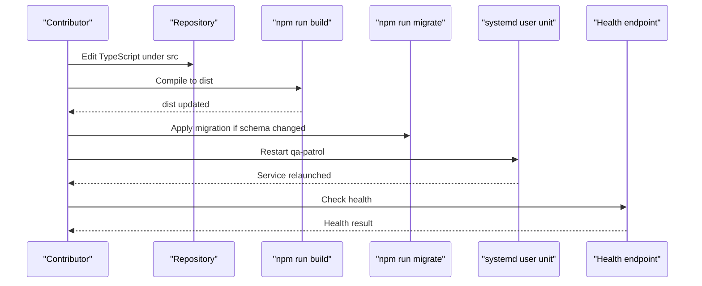

# Iteration Loop

A change to QA Patrol is a TypeScript edit, a build, optional migration, a service restart, and a health check. This page lists the commands that exist in the attached source. CI configuration is not in the attached excerpts, so CI behavior is unknown here.

## Scripts

- `npm run dev` runs `ts-node src/bin/www.ts` without a compile step ([package.json:L6](https://github.com/Jeffrey-Keyser/qa-patrol/blob/f9b3dd00ba79e6fc176957326134666ddbb039b5/package.json#L6)).
- `npm run build` runs `tsc`. It reads `src/**/*.ts` and writes to `dist` ([package.json:L7](https://github.com/Jeffrey-Keyser/qa-patrol/blob/f9b3dd00ba79e6fc176957326134666ddbb039b5/package.json#L7), [tsconfig.json:L6](https://github.com/Jeffrey-Keyser/qa-patrol/blob/f9b3dd00ba79e6fc176957326134666ddbb039b5/tsconfig.json#L6), [tsconfig.json:L19](https://github.com/Jeffrey-Keyser/qa-patrol/blob/f9b3dd00ba79e6fc176957326134666ddbb039b5/tsconfig.json#L19)).
- `npm start` runs `node dist/bin/www.js`, so a build must come first ([package.json:L8](https://github.com/Jeffrey-Keyser/qa-patrol/blob/f9b3dd00ba79e6fc176957326134666ddbb039b5/package.json#L8)).
- `npm test` runs `node --test test/*.test.js` ([package.json:L10](https://github.com/Jeffrey-Keyser/qa-patrol/blob/f9b3dd00ba79e6fc176957326134666ddbb039b5/package.json#L10)). The test files are not in the attached excerpts, so coverage is unknown.
- `npm run proof:ping` is an operator-only live proof ([package.json:L9](https://github.com/Jeffrey-Keyser/qa-patrol/blob/f9b3dd00ba79e6fc176957326134666ddbb039b5/package.json#L9)). The proof doc says CI does not run it ([docs/ping-auth-proof.md:L24](https://github.com/Jeffrey-Keyser/qa-patrol/blob/f9b3dd00ba79e6fc176957326134666ddbb039b5/docs/ping-auth-proof.md#L24)). Contributors should not run it as part of a normal change.

## Migrations

- `npm run migrate:create -- <name>` writes a new file with the next timestamp, stepping by 1000 ([scripts/create-migration.js:L27](https://github.com/Jeffrey-Keyser/qa-patrol/blob/f9b3dd00ba79e6fc176957326134666ddbb039b5/scripts/create-migration.js#L27)). The template has `up` and `down` stubs ([scripts/create-migration.js:L31-L39](https://github.com/Jeffrey-Keyser/qa-patrol/blob/f9b3dd00ba79e6fc176957326134666ddbb039b5/scripts/create-migration.js#L31-L39)).
- `npm run migrate` loads `.env` and requires the `DATABASE_USER`, `DATABASE_HOST`, and `DATABASE_NAME` variables ([scripts/run-migrate.js:L6-L13](https://github.com/Jeffrey-Keyser/qa-patrol/blob/f9b3dd00ba79e6fc176957326134666ddbb039b5/scripts/run-migrate.js#L6-L13)). It then runs node-pg-migrate `up` ([scripts/run-migrate.js:L19](https://github.com/Jeffrey-Keyser/qa-patrol/blob/f9b3dd00ba79e6fc176957326134666ddbb039b5/scripts/run-migrate.js#L19)).
- `npm run migrate:down` runs the same tool with `down` ([scripts/run-migrate-down.js:L19](https://github.com/Jeffrey-Keyser/qa-patrol/blob/f9b3dd00ba79e6fc176957326134666ddbb039b5/scripts/run-migrate-down.js#L19)).
- The migration config targets schema `qa` and TypeScript files ([database.json:L2-L6](https://github.com/Jeffrey-Keyser/qa-patrol/blob/f9b3dd00ba79e6fc176957326134666ddbb039b5/database.json#L2-L6)).

## Restart and verify

After a build and any migration, the documented restart is `systemctl --user restart qa-patrol` ([CLAUDE.md:L20](https://github.com/Jeffrey-Keyser/qa-patrol/blob/f9b3dd00ba79e6fc176957326134666ddbb039b5/CLAUDE.md#L20)). The README suggests checking `/health` and then smoke-testing with a small step array ([README.md:L19-L30](https://github.com/Jeffrey-Keyser/qa-patrol/blob/f9b3dd00ba79e6fc176957326134666ddbb039b5/README.md#L19-L30)).

## Deploy path

- The README names a beelink-deploy webhook as the deploy mechanism ([README.md:L59](https://github.com/Jeffrey-Keyser/qa-patrol/blob/f9b3dd00ba79e6fc176957326134666ddbb039b5/README.md#L59)). Its configuration is not in the attached excerpts.
- The README's controlled procedure is: confirm no active QA runs, build, restart the user unit, and check `http://127.0.0.1:3042/health`. Until a repository deploy script exists, push with `[skip deploy]` ([README.md:L286](https://github.com/Jeffrey-Keyser/qa-patrol/blob/f9b3dd00ba79e6fc176957326134666ddbb039b5/README.md#L286)).
- The README says a dev-inbox post-merge hook runs `scripts/post-merge-qa.sh` ([README.md:L239](https://github.com/Jeffrey-Keyser/qa-patrol/blob/f9b3dd00ba79e6fc176957326134666ddbb039b5/README.md#L239)). That script is not in the attached excerpts.

## Change cycle

