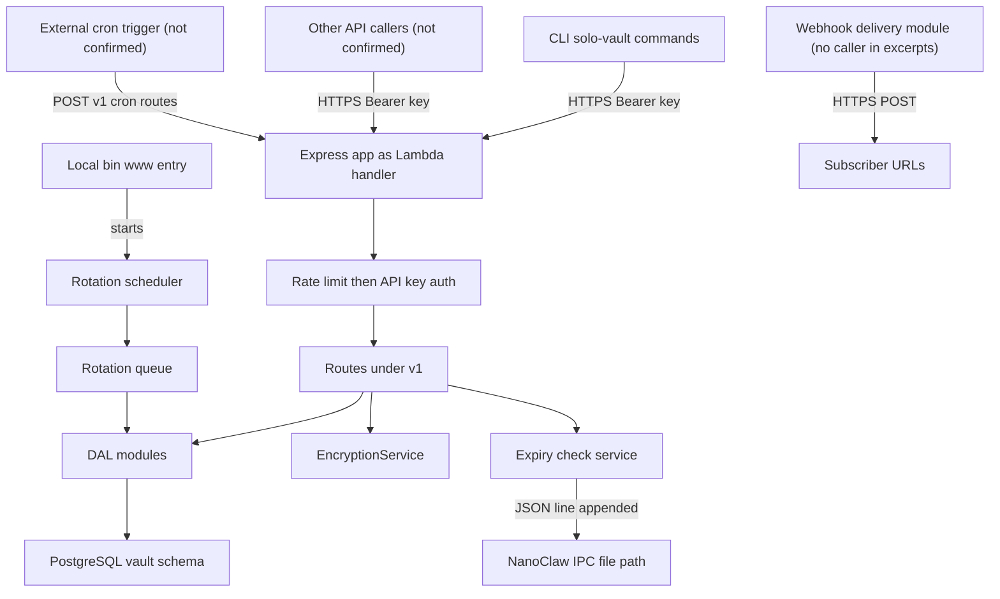

# Architecture

Solo Vault is a two-package repository. An Express API server runs on Lambda, and a Commander CLI calls that API ([package.json:L7-L10](https://github.com/Jeffrey-Keyser/solo-vault/blob/b629632e1fea8586822c2bfd99be1e588e825813/package.json#L7-L10), [cli/package.json:L6-L8](https://github.com/Jeffrey-Keyser/solo-vault/blob/b629632e1fea8586822c2bfd99be1e588e825813/cli/package.json#L6-L8)). The root scripts delegate to `server`.

## Components

- **App composition** (`server/app.ts`): builds the app with `createServerlessApp`. It sets a CORS allowlist, JSON limit, and disables built-in auth because API keys are used ([server/app.ts:L54-L80](https://github.com/Jeffrey-Keyser/solo-vault/blob/b629632e1fea8586822c2bfd99be1e588e825813/server/app.ts#L54-L80)). It exports `handler` and `expressApp` ([server/app.ts:L147-L156](https://github.com/Jeffrey-Keyser/solo-vault/blob/b629632e1fea8586822c2bfd99be1e588e825813/server/app.ts#L147-L156)).
- **Startup gate**: `schemaReady` runs `assertSchemaReady` unless `NODE_ENV` is `test`. On failure it logs FATAL and exits ([server/app.ts:L30-L38](https://github.com/Jeffrey-Keyser/solo-vault/blob/b629632e1fea8586822c2bfd99be1e588e825813/server/app.ts#L30-L38)). The check covers `secrets`, `api_keys`, and `audit_log` columns ([server/db/schema-check.ts:L7-L45](https://github.com/Jeffrey-Keyser/solo-vault/blob/b629632e1fea8586822c2bfd99be1e588e825813/server/db/schema-check.ts#L7-L45)).
- **Local entry** (`server/bin/www.ts`): awaits `schemaReady`, listens on `PORT`, and starts the rotation scheduler when not in test mode ([server/bin/www.ts:L18-L30](https://github.com/Jeffrey-Keyser/solo-vault/blob/b629632e1fea8586822c2bfd99be1e588e825813/server/bin/www.ts#L18-L30)). The Lambda handler does not start the scheduler in the excerpts.
- **Middleware order**: `authRateLimiter`, `apiKeyAuth`, then `writeRateLimiter` ([server/app.ts:L140-L143](https://github.com/Jeffrey-Keyser/solo-vault/blob/b629632e1fea8586822c2bfd99be1e588e825813/server/app.ts#L140-L143)). Public paths are `/`, `/health`, `/ping`, and `/api-docs` ([server/middleware/api-key-auth.ts:L7](https://github.com/Jeffrey-Keyser/solo-vault/blob/b629632e1fea8586822c2bfd99be1e588e825813/server/middleware/api-key-auth.ts#L7)).
- **Authorization helpers**: `requirePermission`, `requireAdmin`, `requireProjectAccess`, and `requireEnvironmentAccess` ([server/middleware/api-key-auth.ts:L111-L234](https://github.com/Jeffrey-Keyser/solo-vault/blob/b629632e1fea8586822c2bfd99be1e588e825813/server/middleware/api-key-auth.ts#L111-L234)). Which helpers the secrets routes use is not in the excerpts. The rotation-policy routes use their own `ensureSecretAccess` and `ensurePolicyAccess` checks against the target secret's project and environment ([server/routes/rotation-policies.ts:L16-L47](https://github.com/Jeffrey-Keyser/solo-vault/blob/efcc33c93ab268159923e87f5e36232498624778/server/routes/rotation-policies.ts#L16-L47)).
- **Routes**: mounted under `/v1` for secrets, api-keys, health, cron, audit, webhooks, and rotation-policies ([server/app.ts:L118-L127](https://github.com/Jeffrey-Keyser/solo-vault/blob/b629632e1fea8586822c2bfd99be1e588e825813/server/app.ts#L118-L127)). Swagger comments and the README use `/api/v1` ([server/routes/api-keys.ts:L16](https://github.com/Jeffrey-Keyser/solo-vault/blob/b629632e1fea8586822c2bfd99be1e588e825813/server/routes/api-keys.ts#L16), [README.md:L66](https://github.com/Jeffrey-Keyser/solo-vault/blob/b629632e1fea8586822c2bfd99be1e588e825813/README.md#L66)). The external prefix is unverified.
- **Data access**: modules for API keys, audit, rotation, rotation policies, expiry alerts, and webhooks. The pool comes from `databaseConfig` ([server/db/connection.ts:L4](https://github.com/Jeffrey-Keyser/solo-vault/blob/b629632e1fea8586822c2bfd99be1e588e825813/server/db/connection.ts#L4)). The secrets DAL is not in the excerpts.
- **Encryption**: AES-256-GCM with a 16-byte IV and a fixed salt, `solo-vault-salt` ([server/services/encryption.ts:L4-L6](https://github.com/Jeffrey-Keyser/solo-vault/blob/b629632e1fea8586822c2bfd99be1e588e825813/server/services/encryption.ts#L4-L6)).
- **Background services**: the scheduler checks every 60 seconds and skips duplicate runs within 2 minutes ([server/services/rotation-scheduler.ts:L7-L8](https://github.com/Jeffrey-Keyser/solo-vault/blob/b629632e1fea8586822c2bfd99be1e588e825813/server/services/rotation-scheduler.ts#L7-L8)). The expiry check writes alerts to an IPC path ([server/services/expiry-check.ts:L5](https://github.com/Jeffrey-Keyser/solo-vault/blob/b629632e1fea8586822c2bfd99be1e588e825813/server/services/expiry-check.ts#L5)).
- **Webhook delivery**: signs payloads with HMAC-SHA256 and retries up to three attempts ([server/services/webhook-delivery.ts:L3](https://github.com/Jeffrey-Keyser/solo-vault/blob/b629632e1fea8586822c2bfd99be1e588e825813/server/services/webhook-delivery.ts#L3), [server/services/webhook-delivery.ts:L45-L52](https://github.com/Jeffrey-Keyser/solo-vault/blob/b629632e1fea8586822c2bfd99be1e588e825813/server/services/webhook-delivery.ts#L45-L52)). No caller is in the excerpts.

## Contracts

- **Response envelope**: successes return `success` and `data` ([server/routes/webhooks.ts:L72-L75](https://github.com/Jeffrey-Keyser/solo-vault/blob/b629632e1fea8586822c2bfd99be1e588e825813/server/routes/webhooks.ts#L72-L75)). Errors return `success: false`, `error`, and a `code` from a fixed set ([server/types/index.ts:L92-L103](https://github.com/Jeffrey-Keyser/solo-vault/blob/b629632e1fea8586822c2bfd99be1e588e825813/server/types/index.ts#L92-L103)).
- **Auth header**: the CLI sends `Authorization: Bearer` with JSON ([cli/src/lib/api-client.ts:L76-L80](https://github.com/Jeffrey-Keyser/solo-vault/blob/b629632e1fea8586822c2bfd99be1e588e825813/cli/src/lib/api-client.ts#L76-L80)).
- **Scope**: a null `project` means all projects, and a null `environment` means all environments ([server/types/index.ts:L61-L62](https://github.com/Jeffrey-Keyser/solo-vault/blob/b629632e1fea8586822c2bfd99be1e588e825813/server/types/index.ts#L61-L62), [server/dal/api-keys.ts:L210-L229](https://github.com/Jeffrey-Keyser/solo-vault/blob/b629632e1fea8586822c2bfd99be1e588e825813/server/dal/api-keys.ts#L210-L229)). Rotation-policy routes apply these rules to the policy's target secret. Creating a policy checks the requested secret, GET, PUT, and DELETE on `/:id` resolve the policy's secret first, and the list is filtered to secrets in the key's scope ([server/routes/rotation-policies.ts:L131-L133](https://github.com/Jeffrey-Keyser/solo-vault/blob/efcc33c93ab268159923e87f5e36232498624778/server/routes/rotation-policies.ts#L131-L133), [server/routes/rotation-policies.ts:L202-L206](https://github.com/Jeffrey-Keyser/solo-vault/blob/efcc33c93ab268159923e87f5e36232498624778/server/routes/rotation-policies.ts#L202-L206), [server/dal/rotation-policies.ts:L113-L131](https://github.com/Jeffrey-Keyser/solo-vault/blob/efcc33c93ab268159923e87f5e36232498624778/server/dal/rotation-policies.ts#L113-L131)).
- **Rotation schedules**: policies take a 5-field cron expression ([server/routes/rotation-policies.ts:L72-L75](https://github.com/Jeffrey-Keyser/solo-vault/blob/b629632e1fea8586822c2bfd99be1e588e825813/server/routes/rotation-policies.ts#L72-L75), [server/utils/cron.ts:L7-L32](https://github.com/Jeffrey-Keyser/solo-vault/blob/b629632e1fea8586822c2bfd99be1e588e825813/server/utils/cron.ts#L7-L32)).
