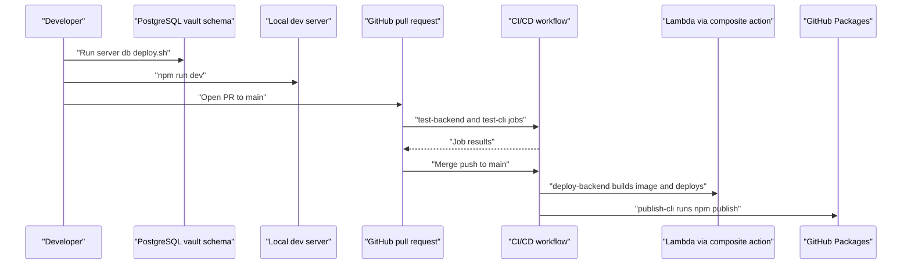

# Iteration Loop

Solo Vault uses `main` as its deploy branch. Pull requests run CI jobs, and pushes to `main` deploy the server and publish the CLI ([.github/workflows/ci-cd-pipeline.yml:L3-L7](https://github.com/Jeffrey-Keyser/solo-vault/blob/b629632e1fea8586822c2bfd99be1e588e825813/.github/workflows/ci-cd-pipeline.yml#L3-L7)).

## Local loop

1. **Install and configure.** Run `npm install` in `server/` and copy `.env.example` to `.env` ([CLAUDE.md:L33-L35](https://github.com/Jeffrey-Keyser/solo-vault/blob/b629632e1fea8586822c2bfd99be1e588e825813/CLAUDE.md#L33-L35)). Required variables include `VAULT_ENCRYPTION_KEY` and `CORS_ALLOWED_ORIGINS` outside test mode ([server/config/env.ts:L117-L138](https://github.com/Jeffrey-Keyser/solo-vault/blob/b629632e1fea8586822c2bfd99be1e588e825813/server/config/env.ts#L117-L138)).
2. **Apply the database.** Run `./deploy.sh` from `server/db/`. It applies migrations, schema, stored procedures, session tables, and seeders in development ([server/db/deploy.sh:L35-L67](https://github.com/Jeffrey-Keyser/solo-vault/blob/b629632e1fea8586822c2bfd99be1e588e825813/server/db/deploy.sh#L35-L67)).
3. **Start the server.** Run `npm run dev` from the repo root, which delegates to `server` ([package.json:L7](https://github.com/Jeffrey-Keyser/solo-vault/blob/b629632e1fea8586822c2bfd99be1e588e825813/package.json#L7), [server/package.json:L8](https://github.com/Jeffrey-Keyser/solo-vault/blob/b629632e1fea8586822c2bfd99be1e588e825813/server/package.json#L8)).
4. **Test the CLI locally.** Run `npm run build` and `npm link` in `cli/` ([cli/package.json:L10](https://github.com/Jeffrey-Keyser/solo-vault/blob/b629632e1fea8586822c2bfd99be1e588e825813/cli/package.json#L10), [CLAUDE.md:L44-L48](https://github.com/Jeffrey-Keyser/solo-vault/blob/b629632e1fea8586822c2bfd99be1e588e825813/CLAUDE.md#L44-L48)).

## Change checklist

- **Schema changes** need a SQL file and an update to `EXPECTED_COLUMNS`. The schema-check file says to keep them in sync ([server/db/schema-check.ts:L3-L6](https://github.com/Jeffrey-Keyser/solo-vault/blob/b629632e1fea8586822c2bfd99be1e588e825813/server/db/schema-check.ts#L3-L6)). Deploy renders `{{SCHEMA}}` and applies files in filename order ([server/db/deploy.sh:L16-L19](https://github.com/Jeffrey-Keyser/solo-vault/blob/b629632e1fea8586822c2bfd99be1e588e825813/server/db/deploy.sh#L16-L19)).
- **CLI commands** are registered in `cli/src/index.ts` ([cli/src/index.ts:L36-L43](https://github.com/Jeffrey-Keyser/solo-vault/blob/b629632e1fea8586822c2bfd99be1e588e825813/cli/src/index.ts#L36-L43)).
- **Lint** runs `eslint . --ext .ts` in `server/` ([server/package.json:L11](https://github.com/Jeffrey-Keyser/solo-vault/blob/b629632e1fea8586822c2bfd99be1e588e825813/server/package.json#L11)). The excerpts do not show lint in CI.

## Tests

- **Server** tests run with `npm test` (Jest) ([server/package.json:L12](https://github.com/Jeffrey-Keyser/solo-vault/blob/b629632e1fea8586822c2bfd99be1e588e825813/server/package.json#L12)). The Jest setup file `tests/setup.ts` is not in the excerpts ([server/jest.config.js:L20](https://github.com/Jeffrey-Keyser/solo-vault/blob/b629632e1fea8586822c2bfd99be1e588e825813/server/jest.config.js#L20)).
- **CLI** tests use Jest with roots at `tests` ([cli/package.json:L12](https://github.com/Jeffrey-Keyser/solo-vault/blob/b629632e1fea8586822c2bfd99be1e588e825813/cli/package.json#L12), [cli/jest.config.js:L4](https://github.com/Jeffrey-Keyser/solo-vault/blob/b629632e1fea8586822c2bfd99be1e588e825813/cli/jest.config.js#L4)).

## CI gates

- **test-backend** runs on pull requests only. It uses the external `node-build` composite action with Node 20 and `npm ci` ([.github/workflows/ci-cd-pipeline.yml:L11-L40](https://github.com/Jeffrey-Keyser/solo-vault/blob/b629632e1fea8586822c2bfd99be1e588e825813/.github/workflows/ci-cd-pipeline.yml#L11-L40)). The workflow excerpt does not show a test command, so whether tests run depends on that action.
- **test-cli** runs on pull requests and executes `npm run build` ([.github/workflows/ci-cd-pipeline.yml:L43-L71](https://github.com/Jeffrey-Keyser/solo-vault/blob/b629632e1fea8586822c2bfd99be1e588e825813/.github/workflows/ci-cd-pipeline.yml#L43-L71)). It does not run the Jest suite in the excerpt.

## Release path

- **deploy-backend** runs only on pushes to `main`. It builds `Dockerfile_Server` and deploys through the `ecr-lambda-deploy` composite action ([.github/workflows/ci-cd-pipeline.yml:L73-L119](https://github.com/Jeffrey-Keyser/solo-vault/blob/b629632e1fea8586822c2bfd99be1e588e825813/.github/workflows/ci-cd-pipeline.yml#L73-L119)).
- **publish-cli** runs on pushes to `main`. It builds and runs `npm publish` to GitHub Packages ([.github/workflows/ci-cd-pipeline.yml:L121-L151](https://github.com/Jeffrey-Keyser/solo-vault/blob/b629632e1fea8586822c2bfd99be1e588e825813/.github/workflows/ci-cd-pipeline.yml#L121-L151)). The version comes from `cli/package.json` ([cli/package.json:L3](https://github.com/Jeffrey-Keyser/solo-vault/blob/b629632e1fea8586822c2bfd99be1e588e825813/cli/package.json#L3)). The workflow does not bump it.
- **Infrastructure** is changed by manual workflows: `terraform_bootstrap.yml` (plan, apply, or destroy) and `terraform_deploy.yml` ([.github/workflows/terraform_bootstrap.yml:L3-L5](https://github.com/Jeffrey-Keyser/solo-vault/blob/b629632e1fea8586822c2bfd99be1e588e825813/.github/workflows/terraform_bootstrap.yml#L3-L5), [.github/workflows/terraform_deploy.yml:L3-L4](https://github.com/Jeffrey-Keyser/solo-vault/blob/b629632e1fea8586822c2bfd99be1e588e825813/.github/workflows/terraform_deploy.yml#L3-L4)).
