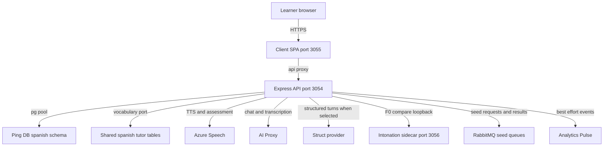

# Architecture

## Components

- **Express server.** The app is built from a shared server factory with pay-auth, an API-key guard, and a database health check at `/health` ([app.ts:1-5](https://github.com/Jeffrey-Keyser/spanish-studio/blob/e93efeff9acd23c86435e82003bab960a94bfd38/server/src/app.ts#L1-L5), [app.ts:53-74](https://github.com/Jeffrey-Keyser/spanish-studio/blob/e93efeff9acd23c86435e82003bab960a94bfd38/server/src/app.ts#L53-L74)).
- **v1 router.** It mounts level, tts, conversations, settings, and reading routes under `/api/v1` ([index.ts:10-14](https://github.com/Jeffrey-Keyser/spanish-studio/blob/e93efeff9acd23c86435e82003bab960a94bfd38/server/src/routes/versions/v1/index.ts#L10-L14)).
- **Process entry.** It listens on the configured port and starts the Reading outbox publisher and seed-result consumer only when their flags are enabled ([www.ts:14-25](https://github.com/Jeffrey-Keyser/spanish-studio/blob/e93efeff9acd23c86435e82003bab960a94bfd38/server/src/bin/www.ts#L14-L25)).
- **Client SPA.** It calls `/api` through the Vite proxy in dev and preview ([vite.config.ts:15-33](https://github.com/Jeffrey-Keyser/spanish-studio/blob/e93efeff9acd23c86435e82003bab960a94bfd38/client/vite.config.ts#L15-L33)).
- **Intonation sidecar.** It exposes `/health` and `/compare` for learner-versus-reference F0 comparison and is described as internal-only ([app.py:3-7](https://github.com/Jeffrey-Keyser/spanish-studio/blob/e93efeff9acd23c86435e82003bab960a94bfd38/intonation-sidecar/app.py#L3-L7)). Malformed input returns a 400 so the Node caller can degrade ([app.py:16-18](https://github.com/Jeffrey-Keyser/spanish-studio/blob/e93efeff9acd23c86435e82003bab960a94bfd38/intonation-sidecar/app.py#L16-L18)).

## Contracts

- Routes accept an API key as `x-api-key`, a Bearer token, or an `apiKey` query parameter ([README.md:111-113](https://github.com/Jeffrey-Keyser/spanish-studio/blob/e93efeff9acd23c86435e82003bab960a94bfd38/README.md#L111-L113)).
- Conversation history routes also require a valid `x-session-id` UUID ([conversations.ts:290-293](https://github.com/Jeffrey-Keyser/spanish-studio/blob/e93efeff9acd23c86435e82003bab960a94bfd38/server/src/routes/versions/v1/conversations.ts#L290-L293)).
- Provider ports isolate vendors: DialogueGenerator, SpeechSynthesizer, Transcriber, PronunciationAssessor, and IntonationAnalyzer ([README.md:209-215](https://github.com/Jeffrey-Keyser/spanish-studio/blob/e93efeff9acd23c86435e82003bab960a94bfd38/README.md#L209-L215)).
- LearnerVocabularyPort is the boundary to the spanish-tutor vocabulary and SM-2 tables; SQL lives only in its adapter ([README.md:153-171](https://github.com/Jeffrey-Keyser/spanish-studio/blob/e93efeff9acd23c86435e82003bab960a94bfd38/README.md#L153-L171)).
- The domain slice owns the Conversation aggregate, learner level, persona, cast, turn, and completion rules ([domain/conversation/index.ts:5-24](https://github.com/Jeffrey-Keyser/spanish-studio/blob/e93efeff9acd23c86435e82003bab960a94bfd38/server/src/domain/conversation/index.ts#L5-L24)).
- Database access uses a pool created from the database config ([connection.ts:4](https://github.com/Jeffrey-Keyser/spanish-studio/blob/e93efeff9acd23c86435e82003bab960a94bfd38/server/src/db/connection.ts#L4)).

## Diagram

The diagram shows dependencies named in source. It does not verify that each target is live.

