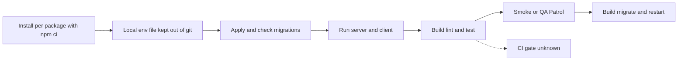

# Iteration Loop

## Setup

- Node and Python tools can come from an optional Nix shell; npm still uses the existing lockfiles ([nix-development.md:3-7](https://github.com/Jeffrey-Keyser/spanish-studio/blob/e93efeff9acd23c86435e82003bab960a94bfd38/docs/nix-development.md#L3-L7)). Its verification commands run `npm ci` per package ([nix-development.md:23-25](https://github.com/Jeffrey-Keyser/spanish-studio/blob/e93efeff9acd23c86435e82003bab960a94bfd38/docs/nix-development.md#L23-L25)).
- Install dependencies in `server/` and `client/` ([README.md:45](https://github.com/Jeffrey-Keyser/spanish-studio/blob/e93efeff9acd23c86435e82003bab960a94bfd38/README.md#L45), [README.md:52](https://github.com/Jeffrey-Keyser/spanish-studio/blob/e93efeff9acd23c86435e82003bab960a94bfd38/README.md#L52)).
- Create the server env file from the example and supply database and vendor credentials. Do not copy credential values into docs or commits ([README.md:46](https://github.com/Jeffrey-Keyser/spanish-studio/blob/e93efeff9acd23c86435e82003bab960a94bfd38/README.md#L46)).

## Database changes

- Run `npm run migrate` and `npm run migrate:status` ([README.md:47-48](https://github.com/Jeffrey-Keyser/spanish-studio/blob/e93efeff9acd23c86435e82003bab960a94bfd38/README.md#L47-L48)). The root scripts delegate to the server ([package.json:8-9](https://github.com/Jeffrey-Keyser/spanish-studio/blob/e93efeff9acd23c86435e82003bab960a94bfd38/package.json#L8-L9)).
- Create a new migration with `migrate:create` ([server/package.json:14](https://github.com/Jeffrey-Keyser/spanish-studio/blob/e93efeff9acd23c86435e82003bab960a94bfd38/server/package.json#L14)). Keep it additive; the runner rejects transaction-control statements ([database-migrations.md:27-29](https://github.com/Jeffrey-Keyser/spanish-studio/blob/e93efeff9acd23c86435e82003bab960a94bfd38/docs/database-migrations.md#L27-L29)).

## Run and verify

- Start the API with `npm run dev` on port 3054 ([server/package.json:7](https://github.com/Jeffrey-Keyser/spanish-studio/blob/e93efeff9acd23c86435e82003bab960a94bfd38/server/package.json#L7), [README.md:49](https://github.com/Jeffrey-Keyser/spanish-studio/blob/e93efeff9acd23c86435e82003bab960a94bfd38/README.md#L49)). Start the client on port 3055 ([README.md:52](https://github.com/Jeffrey-Keyser/spanish-studio/blob/e93efeff9acd23c86435e82003bab960a94bfd38/README.md#L52)).
- Build with the root script, which builds the server ([package.json:6](https://github.com/Jeffrey-Keyser/spanish-studio/blob/e93efeff9acd23c86435e82003bab960a94bfd38/package.json#L6)). The server build installs dependencies with `npm ci` if `tsc` is missing ([server/package.json:8](https://github.com/Jeffrey-Keyser/spanish-studio/blob/e93efeff9acd23c86435e82003bab960a94bfd38/server/package.json#L8)).
- Run server tests with `vitest run` ([server/package.json:11](https://github.com/Jeffrey-Keyser/spanish-studio/blob/e93efeff9acd23c86435e82003bab960a94bfd38/server/package.json#L11)). Client build and tests are documented in the README ([README.md:63-64](https://github.com/Jeffrey-Keyser/spanish-studio/blob/e93efeff9acd23c86435e82003bab960a94bfd38/README.md#L63-L64)).
- Lint runs per package through the root script ([package.json:10](https://github.com/Jeffrey-Keyser/spanish-studio/blob/e93efeff9acd23c86435e82003bab960a94bfd38/package.json#L10), [eslint.config.mjs:3-4](https://github.com/Jeffrey-Keyser/spanish-studio/blob/e93efeff9acd23c86435e82003bab960a94bfd38/eslint.config.mjs#L3-L4)).
- The sidecar tests run with pytest ([nix-development.md:30](https://github.com/Jeffrey-Keyser/spanish-studio/blob/e93efeff9acd23c86435e82003bab960a94bfd38/docs/nix-development.md#L30)).
- Live-style checks: the end-to-end smoke script ([README.md:68](https://github.com/Jeffrey-Keyser/spanish-studio/blob/e93efeff9acd23c86435e82003bab960a94bfd38/README.md#L68)) and the QA Patrol mode ([phase2-smoke.js:72-73](https://github.com/Jeffrey-Keyser/spanish-studio/blob/e93efeff9acd23c86435e82003bab960a94bfd38/server/scripts/phase2-smoke.js#L72-L73)).

## Flow

CI workflow files are not in the provided excerpts, so whether CI runs these gates is unknown.
