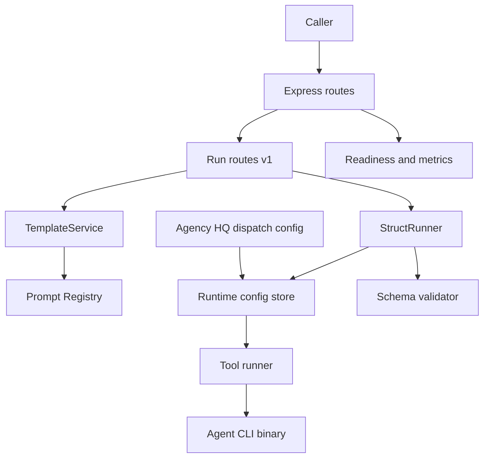

# Architecture

## Components

- **Server bootstrap.** `app.ts` configures the Express app with the `minimal` preset, a 1mb JSON limit, CORS disabled, a health check at `/health`, and Swagger outside tests ([server/app.ts:L9-L42](https://github.com/Jeffrey-Keyser/struct/blob/bc94f30f2343c96088092304214eda45a68c596f/server/app.ts#L9-L42)). `bin/www.ts` starts it and logs the provider, executable, and readiness ([server/bin/www.ts:L7-L48](https://github.com/Jeffrey-Keyser/struct/blob/bc94f30f2343c96088092304214eda45a68c596f/server/bin/www.ts#L7-L48)).
- **Root routes.** `/` lists endpoints. `/runtime-config`, `/metrics`, and `/ready` are served here ([server/routes/index.ts:L10-L38](https://github.com/Jeffrey-Keyser/struct/blob/bc94f30f2343c96088092304214eda45a68c596f/server/routes/index.ts#L10-L38)).
- **v1 router.** API key checks and rate limiting run before `/run` ([server/routes/versions/v1/index.ts:L8-L10](https://github.com/Jeffrey-Keyser/struct/blob/bc94f30f2343c96088092304214eda45a68c596f/server/routes/versions/v1/index.ts#L8-L10)).
- **Run routes.** Direct, batch, async, job lookup, and job cancellation ([server/routes/versions/v1/run.ts:L235-L360](https://github.com/Jeffrey-Keyser/struct/blob/bc94f30f2343c96088092304214eda45a68c596f/server/routes/versions/v1/run.ts#L235-L360)).
- **StructRunner.** Holds a concurrency semaphore with a bounded wait queue, and runs the retry loop ([server/services/StructRunner.ts:L17-L27](https://github.com/Jeffrey-Keyser/struct/blob/bc94f30f2343c96088092304214eda45a68c596f/server/services/StructRunner.ts#L17-L27)).
- **Tool runners.** The factory selects a runner per provider ([server/services/ToolRunnerFactory.ts:L27-L63](https://github.com/Jeffrey-Keyser/struct/blob/bc94f30f2343c96088092304214eda45a68c596f/server/services/ToolRunnerFactory.ts#L27-L63)). The `CodexRunner` rewrites its exec flags to pin `--sandbox read-only` and strips sandbox- or approval-widening flags, logging a warning when it does ([server/services/CodexRunner.ts:L34](https://github.com/Jeffrey-Keyser/struct/blob/485e0bc74909d8b40d147ea24238363eaa0db7ef/server/services/CodexRunner.ts#L34)).
- **Runtime config.** Holds the applied provider and model, and gates Agency HQ switches behind a test call ([server/services/RuntimeConfig.ts:L144-L157](https://github.com/Jeffrey-Keyser/struct/blob/bc94f30f2343c96088092304214eda45a68c596f/server/services/RuntimeConfig.ts#L144-L157)).
- **Template service.** Fetches from Prompt Registry with a TTL cache and in-flight deduplication ([server/services/TemplateService.ts:L236-L262](https://github.com/Jeffrey-Keyser/struct/blob/bc94f30f2343c96088092304214eda45a68c596f/server/services/TemplateService.ts#L236-L262)).
- **Readiness and metrics.** Readiness probes the CLI and Prompt Registry ([server/services/ReadinessService.ts:L79-L107](https://github.com/Jeffrey-Keyser/struct/blob/bc94f30f2343c96088092304214eda45a68c596f/server/services/ReadinessService.ts#L79-L107)). Metrics are in-process counters ([server/services/MetricsService.ts:L167-L211](https://github.com/Jeffrey-Keyser/struct/blob/bc94f30f2343c96088092304214eda45a68c596f/server/services/MetricsService.ts#L167-L211)).

## Contracts

- **Direct request.** Requires `prompt`. Optional fields are `schema`, `model`, `maxRetries`, `timeout`, and `images` ([server/types/api.ts:L28-L48](https://github.com/Jeffrey-Keyser/struct/blob/bc94f30f2343c96088092304214eda45a68c596f/server/types/api.ts#L28-L48)).
- **Template request.** Requires `templateKey` and takes optional `templateVars` ([server/types/api.ts:L52-L55](https://github.com/Jeffrey-Keyser/struct/blob/bc94f30f2343c96088092304214eda45a68c596f/server/types/api.ts#L52-L55)).
- **Response envelope.** A success or failure union, each with `meta` ([server/types/api.ts:L118-L140](https://github.com/Jeffrey-Keyser/struct/blob/bc94f30f2343c96088092304214eda45a68c596f/server/types/api.ts#L118-L140)). Failure codes are enumerated in [server/types/api.ts:L99-L116](https://github.com/Jeffrey-Keyser/struct/blob/bc94f30f2343c96088092304214eda45a68c596f/server/types/api.ts#L99-L116).
- **Tool runner.** `run` takes a prompt, model, timeout, images, request ID, and abort signal, and returns stdout, stderr, and exit code ([server/services/ToolRunner.ts:L1-L16](https://github.com/Jeffrey-Keyser/struct/blob/bc94f30f2343c96088092304214eda45a68c596f/server/services/ToolRunner.ts#L1-L16)).
- **HTTP status.** Template-specific statuses are documented in [README.md:L61](https://github.com/Jeffrey-Keyser/struct/blob/bc94f30f2343c96088092304214eda45a68c596f/README.md#L61).

## Flowchart

