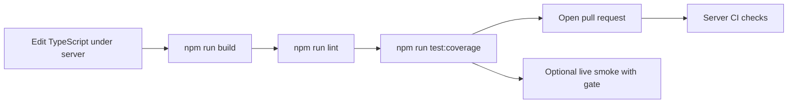

# Iteration Loop

Struct's source lives under `server/`. Run the commands below from that directory.

## Local loop

1. Install dependencies with `npm install` ([README.md:L16](https://github.com/Jeffrey-Keyser/struct/blob/bc94f30f2343c96088092304214eda45a68c596f/README.md#L16)). CI uses `npm ci` against the lockfile ([.github/workflows/server-ci.yml:L27-L28](https://github.com/Jeffrey-Keyser/struct/blob/bc94f30f2343c96088092304214eda45a68c596f/.github/workflows/server-ci.yml#L27-L28)).
2. Start development mode with `npm run dev`, which runs `ts-node ./bin/www.ts` ([server/package.json:L8](https://github.com/Jeffrey-Keyser/struct/blob/bc94f30f2343c96088092304214eda45a68c596f/server/package.json#L8)).
3. Compile with `npm run build`, which runs `tsc` ([server/package.json:L9](https://github.com/Jeffrey-Keyser/struct/blob/bc94f30f2343c96088092304214eda45a68c596f/server/package.json#L9)).
4. Lint with `npm run lint` (`eslint .`) ([server/package.json:L11](https://github.com/Jeffrey-Keyser/struct/blob/bc94f30f2343c96088092304214eda45a68c596f/server/package.json#L11)). The ESLint config is at [server/eslint.config.js:L5-L29](https://github.com/Jeffrey-Keyser/struct/blob/bc94f30f2343c96088092304214eda45a68c596f/server/eslint.config.js#L5-L29).
5. Test with `npm run test:coverage` ([server/package.json:L15](https://github.com/Jeffrey-Keyser/struct/blob/bc94f30f2343c96088092304214eda45a68c596f/server/package.json#L15)). Jest enforces global thresholds of 75 branches, 85 functions, and 90 lines and statements ([server/jest.config.js:L20-L27](https://github.com/Jeffrey-Keyser/struct/blob/bc94f30f2343c96088092304214eda45a68c596f/server/jest.config.js#L20-L27)).
6. `npm run verify` chains build, lint, and coverage ([server/package.json:L16](https://github.com/Jeffrey-Keyser/struct/blob/bc94f30f2343c96088092304214eda45a68c596f/server/package.json#L16)).

## Pull requests and CI

Server CI runs on `pull_request` and on pushes to `main` ([.github/workflows/server-ci.yml:L4-L7](https://github.com/Jeffrey-Keyser/struct/blob/bc94f30f2343c96088092304214eda45a68c596f/.github/workflows/server-ci.yml#L4-L7)). Its steps are install, build, lint, and test with coverage ([.github/workflows/server-ci.yml:L30-L37](https://github.com/Jeffrey-Keyser/struct/blob/bc94f30f2343c96088092304214eda45a68c596f/.github/workflows/server-ci.yml#L30-L37)).

Note: the CI trigger names `main`, while the deploy script pulls `master` ([deploy.sh:L23](https://github.com/Jeffrey-Keyser/struct/blob/bc94f30f2343c96088092304214eda45a68c596f/deploy.sh#L23)). The branch used in practice is not confirmed by the excerpts.

## Optional live smoke

`scripts/smoke-providers.ts` drives real host CLIs. It is gated by `RUN_LIVE_PROVIDER_SMOKE=1` and excluded from `npm run verify` and CI ([README.md:L36](https://github.com/Jeffrey-Keyser/struct/blob/bc94f30f2343c96088092304214eda45a68c596f/README.md#L36)). Without the gate it exits 0 as a no-op ([server/scripts/smoke-providers.ts:L121-L127](https://github.com/Jeffrey-Keyser/struct/blob/bc94f30f2343c96088092304214eda45a68c596f/server/scripts/smoke-providers.ts#L121-L127)).

## Flowchart

## Changes that touch runtime

Changes to the systemd unit are installed by the deploy script only when the file differs from the installed copy ([deploy.sh:L41-L45](https://github.com/Jeffrey-Keyser/struct/blob/bc94f30f2343c96088092304214eda45a68c596f/deploy.sh#L41-L45)). Provider changes should be checked with the live smoke before relying on them, since CI does not exercise live CLIs.
